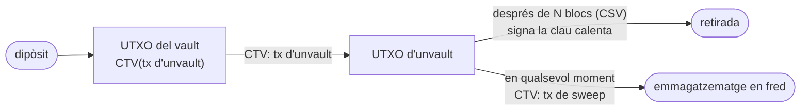

Aquest post va començar com la transcripció d'una xerrada i ha acabat sent la pàgina que m'hauria agradat tenir mentre la preparava. Espero que sigui útil per a més gent que intenti entendre què són realment els **covenants**.

La facilitat de l'ésser humà per generar una economia complexa és increïble. Tot i que, al nivell més baix, tot es redueix a transaccions, la necessitat de pagaments més sofisticats acaba derivant en creacions com els contractes o els préstecs. A Bitcoin això també s'ha vist com una necessitat, i aquestes tasques complexes s'aconsegueixen mitjançant Bitcoin Script. Per què fer servir Bitcoin per a aquests contractes? Perquè aquests scripts s'executen directament com a codi: una seqüència de condicions immutables que, a diferència del món real, no depenen de la confiança en un tercer.

Bitcoin Script pot dir *qui* pot gastar una moneda, i *quan*. Tot i així, no pot fixar per avançat cap condició sobre els UTXO que genera.

## Introducció als covenants

Un **covenant** trasllada aquesta promesa al consens. Podríem definir un **covenant** com:

> Tècnicament es defineix com *covenant* quan el `scriptPubKey` d'un UTXO restringeix el `scriptPubKey` de les sortides de la transacció que el gasta.
>
> De manera simplificada, tractem els *covenants* com a primitives que permeten a les transaccions restringir com es podran gastar en el futur.
{: .quote-sm}

### Breu història

| any | esdeveniment |
| --- | --- |
| 2013 | El fil ["CoinCovenants"](https://bitcointalk.org/index.php?topic=278122.0) de Greg Maxwell a bitcointalk. Invito a llegir la proposta inicial de Maxwell i revisar les propostes de contractes que van sorgir en aquella època. |
| 2015 | S'activa `OP_CHECKLOCKTIMEVERIFY` ([BIP-65](https://github.com/bitcoin/bips/blob/master/bip-0065.mediawiki)). Script ja pot dir *quan* es pot gastar una moneda, fixant una alçada o data absoluta. |
| 2016 | • S'activa `OP_CHECKSEQUENCEVERIFY` ([BIP-112](https://github.com/bitcoin/bips/blob/master/bip-0112.mediawiki)), permet esperar un nombre de blocs des que es confirma per poder fer la despesa.<br>• Möser, Eyal i Sirer publiquen *[Bitcoin Covenants](https://maltemoeser.de/paper/covenants.pdf)* i proposen vaults amb un opcode `OP_CHECKOUTPUTVERIFY`. |
| 2017 | O'Connor i Piekarska, *[Enhancing Bitcoin Transactions with Covenants](https://fc17.ifca.ai/bitcoin/papers/bitcoin17-final28.pdf)*. Mencionen `OP_CHECKSIGFROMSTACK` i l'apliquen en una sidechain (Elements). |
| 2018 | Decker, Russell i Osuntokun publiquen [eltoo](https://blockstream.com/eltoo.pdf): un canal de Lightning on l'estat més recent sempre guanya i ningú ha de guardar secrets de revocació. Necessita `SIGHASH_NOINPUT`, i és l'origen del que avui anomenem LN-Symmetry. |
| 2019 | • Jeremy Rubin proposa [`OP_CHECKOUTPUTSHASHVERIFY`](https://gnusha.org/pi/bitcoindev/CAD5xwhgHyR5qdd09ikvA_vgepj4o+Aqb0JA_T6FuqX56ZNe1RQ@mail.gmail.com/), rebatejat `OP_CHECKTEMPLATEVERIFY` aquell desembre.<br>• `SIGHASH_NOINPUT` es converteix en [ANYPREVOUT (BIP-118)](https://github.com/bitcoin/bips/blob/master/bip-0118.mediawiki). |
| 2021 | • S'activa Taproot. Els opcodes [`OP_SUCCESSx`](https://github.com/bitcoin/bips/blob/master/bip-0342.mediawiki) de tapscript fan que afegir opcodes nous sigui molt més barat.<br>• Andrew Poelstra publica [*CAT and Schnorr Tricks*](https://blog.blockstream.com/cat-and-schnorr-tricks-i/), on mostra que amb `OP_CAT` i una signatura Schnorr amb clau coneguda un script pot llegir la transacció; en parlem a la [secció d'`OP_CAT`](#op_cat-bip-347). |
| 2022 | • Un intent de publicar un [client d'activació de CTV](https://bitcoinmagazine.com/technical/analyzing-bip119-and-the-controversy-surrounding-it) via [Speedy Trial](https://bitcoinops.org/en/newsletters/2022/04/27/) provoca un rebuig fort i no prospera.<br>• [Bitcoin Inquisition](https://gnusha.org/pi/bitcoindev/Y5gCqsCaT0rVKrmX@erisian.com.au/T) arrenca a signet amb CTV i APO actius. |
| 2023 | • `OP_VAULT` ([BIP-345](https://bips.dev/345/)), [MATT](http://mirror.b10c.me/lists/bitcoindev/CAMhCMoFYF+9NL1sqKfn=ma3C_mfQv7mj2fqbqO5WXVwd6vyhLw@mail.gmail.com/), `OP_TXHASH` ([BIP-346](https://bips.dev/346/)) i `OP_CAT` proposat de nou ([BIP-347](https://bips.dev/347/)).<br>• Burak Keceli proposa [Ark](https://mirror.b10c.me/lists/bitcoindev/1300890009.1516890.1684742043892@eu1.myprofessionalmail.com/) i John Law els [timeout trees](https://mirror.b10c.me/lists/bitcoindev/vUfA21-18moEP9UiwbWvzpwxxn83yJQ0J4YsnzK4iQGieArfWPpIZblsVs1yxEs9NBpqoMBISuufMsckbuWXZE1qkzXkf36oJKfwDVqQ2as=@protonmail.com/), dos dissenys que amb covenants deixarien de necessitar que tothom signi alhora.<br>• Robin Linus publica [BitVM](https://bitvm.org/bitvm.pdf) i torna a obrir el debat sobre verificar càlculs a Bitcoin. |
| 2024 | • `OP_CAT` [s'activa a Inquisition signet](https://github.com/bitcoin-inquisition/bitcoin/pull/39).<br>• CSFS rep el [BIP-348](https://bips.dev/348/).<br>• [LNHANCE](https://www.spark.money/research/lightning-lnhance-soft-fork-proposal) agrupa CTV, CSFS, `OP_INTERNALKEY` i `OP_PAIRCOMMIT`.<br>• moonsettler llança ["CTV++"](https://delvingbitcoin.org/t/ctv-op-templatehash-and-op-inputamounts/1344). |
| 2025 | • `OP_VAULT` [es retira](https://github.com/bitcoin/bips/pull/1848) en favor de propostes més generals.<br>• Una [carta oberta](https://ctv-csfs.com/) de desenes de desenvolupadors dona suport a CTV+CSFS.<br>• `OP_CHECKCONTRACTVERIFY` rep el [BIP-443](https://bips.dev/443/). |
| 2026 | • `OP_TEMPLATEHASH` ([BIP-446](https://bips.dev/446/)) i el seu paquet de tapscript ([BIP-448](https://bips.dev/448/)) arriben a Draft.<br>• La Great Script Restoration rep els BIP [440](https://bips.dev/440/) i [441](https://bips.dev/441/).<br>• Un [client d'activació de CTV](https://www.spark.money/glossary/activation-client) obre una finestra de senyalització. |

Posem-nos tècnics :=)

Un UTXO sempre està *limitat a l'hora de gastar-se* pel seu `scriptPubKey`. De fet, no només el limita sinó que el defineix: quan parlem d'adreces, en realitat parlem del que hi ha dins d'aquest camp. Per exemple, una sortida P2PKH porta dins l'`scriptPubKey` el hash d'una clau pública (un SHA-256 seguit d'un RIPEMD-160), a més de diversos opcodes auxiliars per validar que qui gasta l'UTXO aporta un `scriptSig` correcte.

> // Definir un OP_CODE  

// Tal vez se podria añadir una aplicación de ejecución del stack de bitcoin de manera sencilla.

Aquests opcodes obren la porta a condicions de despesa molt més sofisticades.

### Propietats dels covenants

Els timelocks omplen el **quan**. `OP_CHECKLOCKTIMEVERIFY` ([BIP-65](https://github.com/bitcoin/bips/blob/master/bip-0065.mediawiki)) i `OP_CHECKSEQUENCEVERIFY` ([BIP-112](https://github.com/bitcoin/bips/blob/master/bip-0112.mediawiki)) permeten que un script es negui a ser gastat abans d'una alçada absoluta o abans que hagin passat un cert nombre de blocs des que la moneda es va confirmar. També poden funcionar amb temps (una data) en lloc de blocs, però és menys habitual.

El **on** no té opcode. Qui el necessiti té tres opcions:

- **Confiar en algú.** Un custodi, una federació, un comitè multisig.
- **Signar per avançat i esborrar.** Crear una clau efímera, bloquejar-hi fons, signar les úniques transaccions que vols permetre i destruir la clau.
- **Signar per avançat amb tothom.** Moltes aplicacions actuals signen per avançat en comunitat i produeixen una signatura n-de-n (avui amb [MuSig2](https://github.com/bitcoin/bips/blob/master/bip-0327.mediawiki)) sobre un arbre de transaccions futures. Tots els protocols que ho fan, des dels canals de Lightning fins a Ark, ho paguen amb interacció activa dels usuaris.

Els covenants substitueixen les tres opcions per una regla que fa complir el consens. Per fer-ho, l'script necessita conèixer informació de la transacció que el gasta, i aquesta capacitat s'anomena **introspecció**.

### Introspecció

// Explicació

### Origen dels covenants

El 20 d'agost del 2013, Greg Maxwell va obrir a bitcointalk el fil [*CoinCovenants using SCIP signatures, an amusingly bad idea*](https://bitcointalk.org/index.php?topic=278122.0). Proposava que un script pogués fer introspecció de la transacció que el gasta i exigir que totes les sortides futures portessin la mateixa regla, creant una moneda «subjecta per sempre a un covenant». Van sorgir diverses idees molt interessants sobre possibles contractes, la majoria horribles, com UTXO que per consens només es poden gastar si la transacció crea una sortida més gran que la moneda que gasta, de manera que cada despesa hi ha d'afegir bitcoins nous i la moneda creix com una bola de neu sense poder tornar a fer-se petita. Però també n'hi va haver algunes que van marcar l'inici del que ara són els covenants.

### OP_CHECKOUTPUTVERIFY i OP_PATTERN

El 2016, Möser, Eyal i Sirer van proposar el primer covenant específic per a Bitcoin. Aquest incluia un opcode nou, `OP_CHECKOUTPUTVERIFY`, que rep tres coses: un índex de sortida, un import i un *patró*. Comprova que la sortida existeix, que porta exactament aquest import i que el seu script coincideix amb el patró. El patró és un script amb forats: els *placeholders* `PubKey` i `PubKeyHash` accepten qualsevol clau o hash de clau. Si l'import o el patró es posen a 0, aquell camp no es comprova.

L'exemple del paper és una moneda que representa un actiu real, posem 1 BTC:

```
0 <100000000> <PubKey CHECKSIG> OP_CHECKOUTPUTVERIFY
```

La sortida 0 de la transacció següent ha de portar exactament 1 BTC (100.000.000 sats) cap a qualsevol clau pública, així que la moneda no es pot partir ni barrejar amb altres. El problema és que només aguanta un salt: a la transacció següent la restricció desapareix.

Per fer-la durar es podria niar el covenant dins del patró, però caldria fer-ho infinites vegades. En lloc d'escriure un script que es reprodueixi a si mateix (un *quine*), afegeixen un altre placeholder, `OP_PATTERN`, que l'intèrpret substitueix pel mateix patró. Així la regla es copia a cada sortida i la moneda queda lligada per sempre, que és justament el tipus de covenant recursiu que preocupava a Maxwell.

## OP_CTV

La idea d'`OP_CHECKTEMPLATEVERIFY` és senzilla: quan crees l'adreça, escrius per avançat la transacció que vols permetre i en guardes un hash a l'script. Quan algú intenta gastar la moneda, el node calcula el mateix hash sobre la transacció real i només l'accepta si coincideix. Així, la moneda només es pot gastar de la manera que es va decidir quan es va crear.

`OP_CHECKTEMPLATEVERIFY` reutilitza `OP_NOP4` (`0xb3`).

- Si l'element del cim **no** fa exactament 32 bytes, es comporta com un NOP; això és el que permet introduir-lo amb un soft fork.
- Si **fa** 32 bytes, calcula el hash de plantilla de la transacció que gasta i compara. Si no coincideix, l'script falla.

El hash, `DefaultCheckTemplateVerifyHash`, és un únic SHA256 sobre la concatenació dels següents camps de la transacció en aquest ordre:

| # | camp | serialització |
| --- | --- | --- |
| 1 | `nVersion` | 4 bytes, little-endian |
| 2 | `nLockTime` | 4 bytes, little-endian |
| 3 | `sha256(scriptSigs)` | **només si algun scriptSig no és buit** |
| 4 | `input_count` | 4 bytes, little-endian |
| 5 | `sha256(sequences)` | sobre les seqüències de 4 bytes |
| 6 | `output_count` | 4 bytes, little-endian |
| 7 | `sha256(outputs)` | sobre cada `CTxOut`: valor de 8 bytes i després l'script amb prefix de longitud |
| 8 | `input_index` | 4 bytes, little-endian |

Cada camp compromès hi és per tapar un forat concret. Repassar-los és la manera més ràpida d'entendre què promet realment una plantilla.

- **`nVersion`** és el número de versió de la transacció, i decideix quines regles se li apliquen.
- **`nLockTime`** i **`sha256(sequences)`** fixen tots els timelocks absoluts i relatius. Sense ells, qualsevol podria agafar una plantilla pensada per gastar-se després d'un retard i gastar-la abans, o treure-li el senyal de RBF.
- **`sha256(scriptSigs)`** existeix per l'estabilitat del txid. Les entrades legacy i P2SH porten dades a l'scriptSig, i un scriptSig canvia el txid. Si la plantilla no el fixés, un tercer podria [mal·lear una transacció CTV](#txids-predictibles) i deixar orfes tots els fills precalculats que la gasten.
- **`input_count`** i **`input_index`** asseguren que la moneda es gasta sola i en la posició prevista. Així ningú pot ajuntar dues monedes amb la mateixa plantilla en una sola transacció, cosa que deixaria el valor d'una d'elles al miner.
- **`output_count`** i **`sha256(outputs)`** fixen quantes sortides hi ha, quant va a cada una i a quin script. És aquí on el covenant obliga que els diners vagin on prèviament s'ha decidit.

### Una conseqüència que ningú no havia demanat: txids predictibles {#txids-predictibles}

Ajunta el compromís amb l'scriptSig i les entrades segwit, i en surt una cosa útil. Un cop finançada l'arrel d'un arbre CTV, totes les transaccions de sota tenen un txid totalment determinat: les entrades són sortides de transaccions el contingut de les quals fixen les plantilles, i en aquestes transaccions no queda res que es pugui mal·lear.

Això vol dir que pots donar a cada destinatari d'un arbre la cadena exacta de txids que porta a la seva moneda *abans que cap d'aquestes transaccions existeixi a la cadena*. Els arbres de control de congestió, els timeout trees, les obertures de canal no interactives i Ark depenen d'aquesta propietat.

### On pot viure l'opcode

CTV es va construir sobre un `OP_NOP`, no sobre un `OP_SUCCESS` de tapscript, i aquesta decisió té una conseqüència que poca gent menciona: funciona a tots els contextos d'script que té Bitcoin.

| context | script | notes |
| --- | --- | --- |
| **bare** | `<H> OP_CHECKTEMPLATEVERIFY` | sortida de 34 bytes, gastada amb un scriptSig buit i sense witness. La implementació de referència la retransmet com a estàndard. La forma més barata possible. |
| **P2WSH** | el mateix script, passat pel hash | la plantilla queda privada fins que es gasta la moneda |
| **tapscript** | una fulla d'un arbre Taproot | pot conviure amb el key path i altres fulles; l'únic context on existeix CSFS per combinar-s'hi |
| **P2SH** | embolcall legacy | funciona, però el seu hash de 160 bits és un compromís més feble del que voldries |

Gairebé totes les altres propostes d'aquest post viuen només a tapscript. Guarda-t'ho; resulta que importa molt a [la continuació post-quàntica](/blog/2026/covenants-post-quantum-ca/).[^txhashnop]


## Primera omissió: sense outpoint, la plantilla flota {#primera-omissio}

Una plantilla no sap quina moneda està gastant. Descriu una *forma*: tantes entrades, tantes sortides, aquests imports, aquests scripts, aquest locktime.

Això és el que la fa una plantilla i no una transacció prèviament signada. Qualsevol UTXO l'script del qual es comprometi amb aquest hash es pot gastar amb qualsevol transacció que tingui la forma correcta. Envia fons a la mateixa adreça dues vegades i totes dues monedes accepten la mateixa despesa, perquè cap no apareix anomenada enlloc del que s'ha passat pel hash.

Ara posa-hi [CSFS](https://bips.dev/348/) al costat. `OP_CHECKSIGFROMSTACK` reutilitza `OP_SUCCESS204` (`0xcc`), només funciona a tapscript i es diferencia d'`OP_CHECKSIG` en un sol aspecte: el missatge signat surt de la pila en lloc de derivar-se de la transacció. Consumeix, de dalt a baix, una clau pública, un missatge i una signatura, i no fa el hash del missatge abans, ja que BIP-340 accepta missatges de qualsevol longitud.

```
Tapscript:  OP_CHECKTEMPLATEVERIFY <PubKey> OP_CHECKSIGFROMSTACK
Witness:    <sig> <TemplateHash>
```

Llegeix què cobreix realment aquesta signatura. No un txid. No un outpoint. Cobreix el **hash de plantilla**, és a dir, la forma de la despesa. Per tant, la mateixa signatura continua sent vàlida per a qualsevol moneda que arribi a aquest script.

És una **signatura re-vinculable**, i és la propietat per a la qual es va dissenyar [ANYPREVOUT](https://github.com/bitcoin/bips/blob/master/bip-0118.mediawiki). CTV+CSFS hi arriba sense tocar gens la lògica del sighash: signa un hash que mai no va mencionar l'entrada, i la signatura no hi va estar mai lligada.

Tot el que la gent vol d'aquesta parella surt d'aquí. LN-Symmetry, on l'estat més recent del canal simplement guanya i ningú no guarda secrets de revocació. Ark i les channel factories, on un arbre de despeses s'acorda una vegada i es re-vincula quan canvien els membres. Vaults sense claus efímeres per esborrar, perquè no hi ha res per esborrar.

## Segona omissió: sense import d'entrada, la moneda es pot quedar encallada {#segona-omissio}

Aquesta és la mateixa omissió amb una altra cara.

El hash fixa les teves sortides, imports inclosos. No diu res del que ha entrat. El consens continua aplicant l'única regla que sempre hi ha estat: una transacció no pot crear bitcoins.

Imagina't una adreça la plantilla de la qual diu *una entrada, una sortida de 0,99 BTC, 0,01 de comissió*. Es va construir esperant 1,0 BTC. Algú hi envia **0,5 BTC**.

La plantilla continua sent satisfactible en el sentit que existeix una transacció que hi coincideix. Simplement no pot ser vàlida: mouria 0,99 BTC a partir d'una entrada de 0,5 BTC. Tota despesa que compleix el covenant és invàlida, i tota despesa vàlida incompleix el covenant. Res no pot moure la moneda, mai.

Això és l'**UTXO insatisfactible** (Unsatisfiable UTXO), i no és un error de CTV. Comprometre's amb l'import d'entrada és exactament el que impediria que la plantilla fos una plantilla: fixa l'entrada i hauràs fixat la moneda, i les signatures re-vinculables moren amb ella.

Te'n pots defensar. La resposta habitual és una sortida d'emergència pel key path de Taproot, de manera que el script path sigui una opció i no l'única, cosa que renuncia discretament a part de la manca de confiança que buscava el covenant. El que no pots fer és tenir l'import compromès i no compromès alhora.

## La mateixa elecció, dues vegades {#la-mateixa-eleccio}

Posa-les una al costat de l'altra i la forma de l'intercanvi és difícil de no veure.

| omès del hash | què hi guanyes | què costa |
| --- | --- | --- |
| l'outpoint d'entrada | les plantilles floten; les signatures es re-vinculen; semàntica d'APO de franc | subtil: reutilitza una adreça i la segona moneda es pot empènyer per la mateixa plantilla, amb qualsevol excedent cap al miner |
| l'import d'entrada | la plantilla continua sent una plantilla | un dipòsit equivocat pot inutilitzar la moneda per sempre |

Totes dues surten de la mateixa decisió: descriure la despesa, no la moneda. Una lectura dona a CTV el seu millor truc, l'altra el seu pitjor mode de fallada, i cap quantitat de cura al programari de la cartera fa desaparèixer el segon, perquè l'omissió és al consens.

Hi ha una cosa més que la plantilla ha de fixar per avançat, i és la que mossega primer a la pràctica.

## Comissions: la plantilla ha de pagar a algú {#comissions}

Una plantilla fixa l'import de cada sortida. La comissió és el que queda de l'entrada, així que la comissió també queda fixada, en el moment de crear l'adreça. Per a un vault que potser no es gastarà en cinc anys, això vol dir endevinar el mercat de comissions d'aquí a cinc anys. Si et quedes curt, la transacció es queda a la mempool per sempre; si et passes, pagues de més a cada despesa.

Hi ha quatre maneres d'esquivar-ho, i els dissenys reals solen combinar-ne dues.

1. **Una escala de plantilles.** Comprometre's amb diverses plantilles que només es diferencien en la comissió (1, 4, 16, 64 sat/vB, per exemple) i posar cadascuna a la seva fulla de tapscript. Funciona, però cada nivell de comissió extra multiplica el nombre de fulles, i l'escala només és tan bona com el seu graó més alt.
2. **Una sortida àncora.** Afegir una sortida minúscula que qualsevol pot gastar i pujar la comissió amb una transacció filla (CPFP). Des de Bitcoin Core 28.0 hi ha un tipus de sortida estàndard fet exactament per a això, pay-to-anchor (P2A, `OP_1 <0x4e73>`), i Core 29.0 permet que porti valor zero com a *ephemeral dust* sempre que la filla la gasti immediatament. Una plantilla que es compromet amb `nVersion = 3` obté a més les proteccions de TRUC contra el pinning.
3. **Transaction sponsors.** Una proposta, també de Jeremy Rubin, que permetria que una transacció no relacionada pagués per una altra. Mai no es va incorporar.
4. **Signar tard.** CTV+CSFS o `OP_TEMPLATEHASH`+CSFS permeten que una clau signi el hash de plantilla en el moment de gastar, de manera que la comissió es pot triar quan es construeix la transacció i no quan es va crear l'adreça. El preu és que tornes a confiar en una clau per a aquesta elecció.

La via de l'àncora és cap on convergeixen els dissenys actuals de CTV. També és on el segon post hi trobarà un problema, perquè una filla CPFP necessita una entrada pròpia, i aquesta entrada l'ha de poder gastar algú.

## OP_CTV pas a pas {#op-ctv-pas-a-pas}

Fins ara hem vist les peces per separat: quins camps entren al hash, quins se'n queden fora i què passa amb els imports. L'executor de sota les ajunta i mostra què fa un node quan valida una moneda bloquejada amb CTV.

**El punt de partida.** Algú ha creat una adreça amb l'script `<H> OP_CHECKTEMPLATEVERIFY`. Per obtenir H, primer va escriure la transacció que vol permetre, que anomenarem **la transacció prevista**: una entrada i una sortida de 0,99 BTC cap al destinatari previst (els 0,01 BTC que falten són la comissió). En va calcular el hash de plantilla, i aquest hash és H. Després va enviar 1 BTC a l'adreça.

**Les quatre transaccions.** Cada botó és una transacció diferent que intenta gastar aquesta moneda:

- **La transacció prevista**: exactament la que es va fixar.
- **Una altra moneda**: la mateixa transacció, però gastant una altra moneda que també es va enviar a la mateixa adreça. Només canvien el txid i el vout de l'entrada.
- **Una altra adreça de destí**: el mateix import, però la sortida paga a una altra adreça, com faria un atacant.
- **Dues monedes juntes**: gasta alhora dues monedes bloquejades amb la mateixa plantilla, amb una sola sortida.

**Com llegir-lo.** A l'esquerra hi ha la moneda que es gasta i la transacció que ho intenta. Els camps amb vora verda entren al hash, els grisos amb vora puntejada no, i la marca taronja indica què és diferent de la transacció prevista. A la dreta, el botó *Endavant* executa l'script instrucció a instrucció: veuràs com canvia la pila, quins bytes agafa el node de la transacció i, al final, si el hash que calcula (T) coincideix amb el que hi ha a l'adreça (H). Els hashes es mostren com els primers caràcters i una tira de colors: si les dues tires són iguals, els hashes també.

<div class="demo-block" id="ctvx">
    <h6 class="demo-heading">Execució d'OP_CTV</h6>

    <div class="demo-modes" id="ctvx-scen"></div>

    <div class="ctvx-grid">
      <div>
        <div class="ctvx-label">Moneda que es gasta</div>
        <div class="ctvx-coin">
          <span class="ctvx-sublabel">scriptPubKey</span>
          <code class="ctvx-spk">&lt;H&gt; OP_CHECKTEMPLATEVERIFY</code>
          <div class="ctvx-hrow"><span class="ctvx-hname">H</span><span id="ctvx-h"></span></div>
          <span class="ctvx-hint">H es va fixar en crear l'adreça, a partir de la transacció prevista.</span>
        </div>

        <div class="ctvx-label">Transacció que la vol gastar</div>
        <div class="ctvx-tx" id="ctvx-tx"></div>
        <div class="ctvx-legend">
          <span class="ctvx-key ctvx-key--on">entra al hash</span>
          <span class="ctvx-key ctvx-key--off">CTV no ho mira</span>
          <span class="ctvx-key ctvx-key--chg">diferent de la prevista</span>
        </div>
      </div>

      <div>
        <div class="ctvx-label">Execució de l'script</div>
        <div class="ctvx-script">
          <span class="ctvx-tok" data-t="0">&lt;H&gt;</span>
          <span class="ctvx-tok" data-t="1">OP_CHECKTEMPLATEVERIFY</span>
        </div>

        <div class="ctvx-stackwrap">
          <span class="ctvx-sublabel">pila</span>
          <div class="ctvx-stack" id="ctvx-stack"></div>
        </div>

        <div class="ctvx-steptext" id="ctvx-text"></div>
        <div id="ctvx-detail"></div>

        <div class="ctvx-controls">
          <button type="button" class="demo-mode ctvx-btn" data-step="-1">&larr; Enrere</button>
          <span class="ctvx-count" id="ctvx-count"></span>
          <button type="button" class="demo-mode ctvx-btn" data-step="1">Endavant &rarr;</button>
        </div>
      </div>
    </div>
</div>

<style>
#ctvx .ctvx-grid { display: grid; grid-template-columns: 1fr 1fr; gap: 2rem; margin-top: 0.4rem; }
@media (max-width: 760px) { #ctvx .ctvx-grid { grid-template-columns: 1fr; } }
#ctvx .ctvx-label { font-size: 0.7rem; font-weight: 600; letter-spacing: 0.09em; text-transform: uppercase;
  color: var(--global-text-color-light); margin: 0 0 0.6rem; }
#ctvx .ctvx-sublabel { display: block; font-size: 0.68rem; letter-spacing: 0.06em; text-transform: uppercase;
  color: var(--global-text-color-light); margin-bottom: 0.3rem; }
#ctvx .ctvx-hint { display: block; font-size: 0.75rem; color: var(--global-text-color-light); margin-top: 0.5rem; }
#ctvx code { color: var(--global-text-color); }

#ctvx .ctvx-coin { padding: 0.8rem 0.9rem; border-radius: 6px; background: var(--demo-surface); margin-bottom: 1.4rem; }
#ctvx .ctvx-spk { font-size: 0.8rem; }
#ctvx .ctvx-hrow { display: flex; align-items: center; gap: 0.6rem; margin-top: 0.6rem; }
#ctvx .ctvx-hname { font-family: var(--bs-font-monospace, ui-monospace, monospace); font-weight: 700; font-size: 0.85rem; width: 1.2rem; }

#ctvx .ctvx-hash { display: inline-flex; align-items: center; gap: 0.5rem; }
#ctvx .ctvx-hash code { font-size: 0.78rem; background: transparent; padding: 0; }
#ctvx .ctvx-swatch { display: inline-flex; gap: 2px; }
#ctvx .ctvx-swatch i { display: block; width: 0.55rem; height: 0.9rem; border-radius: 1px; }

#ctvx .ctvx-tx { border: 1px solid var(--demo-rule); border-radius: 6px; padding: 0.8rem 0.9rem; }
#ctvx .ctvx-txhead { display: flex; flex-wrap: wrap; gap: 0.4rem; margin-bottom: 0.9rem; }
#ctvx .ctvx-io { display: grid; grid-template-columns: 1fr auto 1fr; gap: 0.6rem; align-items: start; }
#ctvx .ctvx-arrow { align-self: center; color: var(--global-text-color-light); font-size: 1.1rem; }
#ctvx .ctvx-item { display: flex; flex-direction: column; gap: 0.3rem; margin-bottom: 0.6rem; }
#ctvx .ctvx-f { display: inline-block; width: fit-content; max-width: 100%; padding: 0.15rem 0.45rem; border-radius: 4px;
  border: 1px solid var(--demo-rule); font-size: 0.75rem; line-height: 1.4;
  font-family: var(--bs-font-monospace, ui-monospace, monospace); transition: border-color 0.2s, opacity 0.2s; }
#ctvx .ctvx-f.is-off { border-style: dashed; color: var(--global-text-color-light); }
#ctvx .ctvx-f.is-chg { box-shadow: inset 3px 0 0 var(--demo-r); }
#ctvx .ctvx-tx.is-hashing .ctvx-f.is-on { border-color: var(--demo-s); }
#ctvx .ctvx-tx.is-hashing .ctvx-f.is-off { opacity: 0.45; }

#ctvx .ctvx-legend { display: flex; flex-wrap: wrap; gap: 0.9rem; margin-top: 0.6rem; font-size: 0.7rem;
  color: var(--global-text-color-light); }
#ctvx .ctvx-key::before { content: ""; display: inline-block; width: 0.8rem; height: 0.55rem; margin-right: 0.35rem;
  border-radius: 2px; vertical-align: baseline; border: 1px solid var(--demo-s); }
#ctvx .ctvx-key--off::before { border: 1px dashed var(--demo-quiet); }
#ctvx .ctvx-key--chg::before { border: 1px solid var(--demo-rule); box-shadow: inset 3px 0 0 var(--demo-r); }

#ctvx .ctvx-script { font-family: var(--bs-font-monospace, ui-monospace, monospace); font-size: 0.85rem;
  display: flex; flex-wrap: wrap; gap: 0.5rem; margin-bottom: 1rem; }
#ctvx .ctvx-tok { padding: 0.2rem 0.5rem; border-radius: 4px; border: 1px solid var(--demo-rule);
  color: var(--global-text-color-light); transition: all 0.2s; }
#ctvx .ctvx-tok.is-done { color: var(--global-text-color); }
#ctvx .ctvx-tok.is-active { border-color: var(--demo-r); color: var(--global-text-color); background: var(--demo-pad-bg); }

#ctvx .ctvx-stackwrap { margin-bottom: 1rem; }
#ctvx .ctvx-stack { min-height: 2.3rem; border: 1px solid var(--demo-rule); border-top: 0; border-radius: 0 0 6px 6px;
  padding: 0.4rem; display: flex; flex-direction: column-reverse; gap: 0.3rem; }
#ctvx .ctvx-stack .ctvx-empty { font-size: 0.75rem; color: var(--global-text-color-light); padding: 0.2rem 0.3rem; }
#ctvx .ctvx-cell { padding: 0.3rem 0.5rem; border-radius: 4px; background: var(--demo-surface); }

#ctvx .ctvx-steptext { font-size: 0.88rem; line-height: 1.65; min-height: 4.5rem; }
#ctvx .ctvx-pre { width: 100%; margin: 0.6rem 0 0.4rem; font-size: 0.75rem; border-collapse: collapse; }
#ctvx table.ctvx-pre td { padding: 0.15rem 0.6rem 0.15rem 0; border: 0; vertical-align: top; font-size: 0.75rem; line-height: 1.5; }
#ctvx .ctvx-pre td:first-child { font-family: var(--bs-font-monospace, ui-monospace, monospace); white-space: nowrap; }
#ctvx .ctvx-pre td:last-child { font-family: var(--bs-font-monospace, ui-monospace, monospace); color: var(--global-text-color-light); word-break: break-all; }
#ctvx .ctvx-cmp { margin-top: 0.7rem; display: grid; grid-template-columns: auto 1fr; gap: 0.35rem 0.7rem; align-items: center; font-size: 0.8rem; }
#ctvx .ctvx-verdict { margin-top: 0.8rem; padding-left: 0.8rem; border-left: 3px solid var(--demo-s); font-size: 0.88rem; line-height: 1.6; }
#ctvx .ctvx-verdict.is-bad { border-left-color: var(--demo-pad); }
#ctvx .ctvx-verdict strong { color: var(--demo-s); }
#ctvx .ctvx-verdict.is-bad strong { color: var(--demo-pad); }

#ctvx .ctvx-controls { display: flex; align-items: center; gap: 0.8rem; margin-top: 1.2rem; }
#ctvx .ctvx-btn { border: 1px solid var(--demo-rule); border-radius: 6px; }
#ctvx .ctvx-btn:disabled { opacity: 0.35; cursor: default; }
#ctvx .ctvx-count { flex: 1 1 auto; text-align: center; font-size: 0.75rem; color: var(--global-text-color-light); }
</style>

<script>
(function () {
  // The coin is locked to the template of PLANNED. Each scenario is a transaction
  // that tries to spend it; the stepper runs <H> OP_CHECKTEMPLATEVERIFY on it.
  var PLANNED = {
    version: 2, locktime: 0,
    inputs: [{ txid: '9f2c…a10b', vout: 0, seq: 0xfffffffd, amount: 1.0 }],
    outputs: [{ amount: 0.99, script: 'P2WPKH', len: 22, fill: 0x00, who: 'destinatari previst' }]
  };

  function clone(o) { return JSON.parse(JSON.stringify(o)); }

  var SCENARIOS = [
    { id: 'prevista', label: 'La transacció prevista', tx: clone(PLANNED), changed: {},
      why: 'És exactament la transacció que es va fixar quan es va crear l\'adreça.' },
    { id: 'txid', label: 'Una altra moneda', changed: { outpoint: true },
      tx: (function () { var t = clone(PLANNED); t.inputs[0].txid = '7a1e…44c0'; t.inputs[0].vout = 1; return t; })(),
      why: 'Gasta una altra moneda enviada a la mateixa adreça. El txid i el vout no entren al hash, així que la plantilla també l\'accepta: la plantilla no sap quina moneda gasta.' },
    { id: 'sortida', label: 'Una altra adreça de destí', changed: { outputs: true },
      tx: (function () { var t = clone(PLANNED); t.outputs[0].fill = 0xa7; t.outputs[0].who = 'adreça de l\'atacant'; return t; })(),
      why: 'Mateix import, però cap a una altra adreça. Canvia sha256(outputs), i per tant canvia T.' },
    { id: 'entrades', label: 'Dues monedes juntes', changed: { count: true },
      tx: (function () { var t = clone(PLANNED); t.inputs.push({ txid: 'b31d…0e97', vout: 0, seq: 0xfffffffd, amount: 1.0 }); return t; })(),
      why: 'Intenta gastar dues monedes amb la mateixa plantilla en una sola transacció. input_count passa de 1 a 2, i T ja no coincideix.' }
  ];

  var scen = SCENARIOS[0], step = 0, LAST = 5;
  var H = null, cache = {};

  function el(id) { return document.getElementById(id); }
  function h2(n) { return n.toString(16).padStart(2, '0'); }
  function hex(b) { return b.map(h2).join(''); }
  function btc(n) { return n.toFixed(2).replace('.', ',') + ' BTC'; }
  function u32le(n) { var a = []; n = n >>> 0; for (var i = 0; i < 4; i++) { a.push(n & 0xff); n >>>= 8; } return a; }
  function u64le(n) { var a = [], b = BigInt(Math.round(n)); for (var i = 0; i < 8; i++) { a.push(Number(b & 255n)); b >>= 8n; } return a; }
  async function sha256(bytes) {
    return Array.from(new Uint8Array(await crypto.subtle.digest('SHA-256', new Uint8Array(bytes))));
  }

  // BIP-119 template hash for input 0. Every scriptSig is empty, so
  // sha256(scriptSigs) is left out, as the BIP specifies.
  async function templateHash(tx) {
    var seq = [];
    tx.inputs.forEach(function (i) { seq = seq.concat(u32le(i.seq)); });
    var outs = [];
    tx.outputs.forEach(function (o) { outs = outs.concat(u64le(o.amount * 1e8), [o.len], new Array(o.len).fill(o.fill)); });
    var fields = [
      { n: 'nVersion', b: u32le(tx.version) },
      { n: 'nLockTime', b: u32le(tx.locktime) },
      { n: 'input_count', b: u32le(tx.inputs.length) },
      { n: 'sha256(sequences)', b: await sha256(seq) },
      { n: 'output_count', b: u32le(tx.outputs.length) },
      { n: 'sha256(outputs)', b: await sha256(outs) },
      { n: 'input_index', b: u32le(0) }
    ];
    var pre = [];
    fields.forEach(function (f) { pre = pre.concat(f.b); });
    return { fields: fields, digest: await sha256(pre) };
  }

  // A hash shown as its first bytes plus a strip of colours, so two hashes can be
  // compared at a glance without reading 64 hex characters.
  function hashChip(d) {
    var sw = d.slice(0, 8).map(function (b) {
      return '<i style="background:hsl(' + Math.round(b * 360 / 256) + ',55%,52%)"></i>';
    }).join('');
    return '<span class="ctvx-hash"><code>' + hex(d.slice(0, 6)) + '…</code><span class="ctvx-swatch">' + sw + '</span></span>';
  }

  function field(text, on, chg) {
    return '<span class="ctvx-f ' + (on ? 'is-on' : 'is-off') + (chg ? ' is-chg' : '') + '">' + text + '</span>';
  }

  function renderTx() {
    var t = scen.tx, c = scen.changed, html = '';
    html += '<div class="ctvx-txhead">' + field('versió ' + t.version, true) + field('locktime ' + t.locktime, true) +
      field(t.inputs.length + (t.inputs.length === 1 ? ' entrada' : ' entrades'), true, c.count) +
      field(t.outputs.length + (t.outputs.length === 1 ? ' sortida' : ' sortides'), true) + '</div>';
    html += '<div class="ctvx-io"><div>';
    t.inputs.forEach(function (i, k) {
      var extra = k > 0;
      html += '<div class="ctvx-item">' +
        field(i.txid + ':' + i.vout, false, c.outpoint || extra) +
        field(btc(i.amount), false, extra) +
        field('seq ' + i.seq.toString(16), true, extra) + '</div>';
    });
    html += '</div><div class="ctvx-arrow">&rarr;</div><div>';
    t.outputs.forEach(function (o) {
      html += '<div class="ctvx-item">' + field(btc(o.amount), true) +
        field(o.script + ' · ' + o.who, true, c.outputs) + '</div>';
    });
    html += '</div></div>';
    var box = el('ctvx-tx');
    box.innerHTML = html;
    box.classList.toggle('is-hashing', step >= 3);
  }

  var TEXT = [
    'El node ha de validar l\'entrada 0. Per fer-ho executa el <code>scriptPubKey</code> de la moneda que gasta, d\'esquerra a dreta. La pila comença buida.',
    'Primer element: <code>&lt;H&gt;</code>. Són dades, així que es posen a la pila. H són els 32 bytes que es van fixar quan es va crear l\'adreça.',
    '<code>OP_CHECKTEMPLATEVERIFY</code> mira el cim de la pila. Si no fes exactament 32 bytes es comportaria com un NOP. Fa 32 bytes, així que toca comprovar la plantilla.',
    'El node agafa de la transacció els camps de la plantilla, en un ordre fix (en verd a l\'esquerra). El txid, el vout i l\'import de l\'entrada no hi entren.',
    'Fa SHA256 de tots aquests bytes junts i obté <strong>T</strong>, el hash de plantilla d\'aquesta transacció.',
    'Compara T amb H, el valor que hi ha al cim de la pila.'
  ];

  // Every hash is computed once in init(), so rendering stays synchronous and
  // fast clicks can never interleave with a pending digest.
  function render() {
    var r = cache[scen.id], T = r.digest, match = hex(T) === hex(H);

    el('ctvx-scen').querySelectorAll('button').forEach(function (b) {
      b.classList.toggle('is-active', b.dataset.id === scen.id);
    });
    renderTx();

    document.querySelectorAll('#ctvx .ctvx-tok').forEach(function (t) {
      var i = +t.dataset.t;
      t.classList.toggle('is-active', (step === 1 && i === 0) || (step >= 2 && i === 1));
      t.classList.toggle('is-done', step >= 1 && i === 0 && step !== 1);
    });

    el('ctvx-stack').innerHTML = step >= 1
      ? '<div class="ctvx-cell">' + hashChip(H) + '</div>'
      : '<span class="ctvx-empty">buida</span>';

    el('ctvx-text').innerHTML = TEXT[step];

    var d = '';
    if (step >= 3) {
      d += '<table class="ctvx-pre"><tbody>' + r.fields.map(function (f) {
        var v = hex(f.b);
        return '<tr><td>' + f.n + '</td><td>' + (v.length > 16 ? v.slice(0, 16) + '…' : v) + '</td></tr>';
      }).join('') + '</tbody></table>';
    }
    if (step >= 4) {
      d += '<div class="ctvx-cmp"><strong>T</strong>' + hashChip(T) +
        (step >= 5 ? '<strong>H</strong>' + hashChip(H) : '') + '</div>';
    }
    if (step >= 5) {
      d += match
        ? '<div class="ctvx-verdict"><strong>Coincideixen.</strong> OP_CTV no fa res més i l\'script acaba amb H a la pila, un valor no nul: la despesa és vàlida. ' + scen.why + '</div>'
        : '<div class="ctvx-verdict is-bad"><strong>No coincideixen.</strong> L\'script falla i la transacció és invàlida. ' + scen.why + '</div>';
    }
    el('ctvx-detail').innerHTML = d;

    el('ctvx-count').textContent = 'Pas ' + (step + 1) + ' de ' + (LAST + 1);
    var btns = document.querySelectorAll('#ctvx .ctvx-btn');
    btns[0].disabled = step === 0;
    btns[1].disabled = step === LAST;
  }

  async function init() {
    H = (await templateHash(PLANNED)).digest;
    for (var i = 0; i < SCENARIOS.length; i++) cache[SCENARIOS[i].id] = await templateHash(SCENARIOS[i].tx);
    el('ctvx-h').innerHTML = hashChip(H);
    el('ctvx-scen').innerHTML = SCENARIOS.map(function (s) {
      return '<button type="button" class="demo-mode" data-id="' + s.id + '">' + s.label + '</button>';
    }).join('');
    el('ctvx-scen').querySelectorAll('button').forEach(function (b) {
      b.addEventListener('click', function () {
        scen = SCENARIOS.filter(function (s) { return s.id === b.dataset.id; })[0];
        render();
      });
    });
    document.querySelectorAll('#ctvx .ctvx-btn').forEach(function (b) {
      b.addEventListener('click', function () {
        step = Math.max(0, Math.min(LAST, step + parseInt(b.dataset.step, 10)));
        render();
      });
    });
    render();
  }

  if (document.readyState === 'loading') document.addEventListener('DOMContentLoaded', init);
  else init();
})();
</script>

## Què vol construir-hi la gent {#que-vol-construir-hi-la-gent}

Els casos d'ús són, al capdavall, de què va tot el debat, així que val la pena ser concret amb cadascun.

### Control de congestió i pagaments en lot

Un exchange vol pagar 1.000 retirades mentre les comissions són altes. Amb CTV pot confirmar avui una sola transacció petita la sortida de la qual es compromet amb un arbre de transaccions que acaba pagant els 1.000 destinataris. El pagament de cada destinatari és definitiu en el moment que aquesta transacció petita es confirma, perquè ningú no la pot gastar d'una altra manera, i l'arbre es pot desplegar quan baixin les comissions. Els destinataris que necessitin les monedes abans despleguen la seva branca i només paguen per ella.

No és gratis. Cada transacció interna afegeix sobrecost, així que l'arbre complet costa més espai de bloc que un sol lot gran. El que compres és *quan* ho pagues. Juga amb els números:

<div class="demo-block" id="cc-tool">
    <h6 class="demo-heading">Arbre de control de congestió</h6>
    <div class="cc-grid">
      <div>
        <div class="demo-field">
          <label for="cc-n">destinataris</label>
          <input type="number" id="cc-n" value="1000" min="2" max="100000">
        </div>
        <div class="demo-field">
          <label for="cc-r">sortides per node (radix)</label>
          <input type="number" id="cc-r" value="4" min="2" max="250">
        </div>
        <div class="demo-note mt-3" id="cc-note"></div>
      </div>
      <div>
        <div class="demo-stats">
          <div><span class="demo-stat-value" id="cc-now">–</span><span class="demo-stat-label">vB confirmats ara</span></div>
          <div><span class="demo-stat-value" id="cc-later">–</span><span class="demo-stat-label">vB per a l'arbre complet</span></div>
        </div>
        <div class="demo-stats">
          <div><span class="demo-stat-value" id="cc-batch">–</span><span class="demo-stat-label">vB com a un sol lot</span></div>
          <div><span class="demo-stat-value" id="cc-depth">–</span><span class="demo-stat-label">profunditat / txs a l'arbre</span></div>
        </div>
      </div>
    </div>
</div>

<style>
#cc-tool .cc-grid { display: grid; grid-template-columns: 1fr 1fr; gap: 2rem; }
@media (max-width: 700px) { #cc-tool .cc-grid { grid-template-columns: 1fr; } }
#cc-tool .demo-stats { gap: 2.5rem; }
</style>

<script>
(function () {
  // Sizes in vbytes. Tree transactions spend bare CTV outputs, so they carry no
  // witness and their vsize equals their size.
  var OUT = 43;        // 8 value + 1 length + 34 script (bare CTV and P2TR are both 34)
  var TX_BASE = 10;    // version + locktime + input/output counts (under 253 each)
  var CTV_IN = 41;     // 36 outpoint + 1 empty scriptSig + 4 sequence
  var FUND = 10.5 + 57.5; // segwit tx overhead + one taproot key-path input

  function el(id) { return document.getElementById(id); }
  function fmt(n) { return Math.round(n).toLocaleString('ca-ES'); }

  function recompute() {
    var n = Math.max(2, Math.min(100000, parseInt(el('cc-n').value || 2, 10)));
    var r = Math.max(2, Math.min(250, parseInt(el('cc-r').value || 2, 10)));

    // Walk up the tree: each level groups the one below into nodes of r outputs.
    var level = n, txs = 0, depth = 0;
    while (level > 1) { level = Math.ceil(level / r); txs += level; depth++; }

    // Each tree transaction has one input; every output is either a recipient
    // or the input of another tree transaction.
    var outputs = n + (txs - 1);
    var tree = txs * (TX_BASE + CTV_IN) + outputs * OUT;
    var now = FUND + OUT;           // the commitment transaction: one CTV output
    var batch = FUND + n * OUT;     // the same payments, all at once

    el('cc-now').textContent = fmt(now);
    el('cc-later').textContent = fmt(now + tree);
    el('cc-batch').textContent = fmt(batch);
    el('cc-depth').textContent = depth + ' / ' + fmt(txs);
    var overhead = ((now + tree) / batch - 1) * 100;
    el('cc-note').innerHTML = 'Confirmar <strong>' + fmt(now) + ' vB</strong> ara liquida els ' + fmt(n) +
      ' pagaments. Desplegar-ho tot més endavant costa un <strong>' + overhead.toFixed(0) + '%</strong> més d\'espai de bloc que un sol lot, ' +
      'però un destinatari que vulgui sortir abans només paga ' + depth + ' transaccions petites. Radix més gran, menys sobrecost, sortides anticipades més cares.';
  }

  function init() {
    ['cc-n', 'cc-r'].forEach(function (id) { el(id).addEventListener('input', recompute); });
    recompute();
  }
  if (document.readyState === 'loading') document.addEventListener('DOMContentLoaded', init);
  else init();
})();
</script>

### Vaults

Un vault és una moneda que no pot anar directament a una adreça arbitrària. Primer ha d'*anunciar* que se'n va, esperar, i durant l'espera el seu propietari encara la pot recuperar cap a l'emmagatzematge en fred. Si un atacant et roba la clau calenta, pot començar una retirada però no acabar-la abans que te n'adonis.

El vault CTV més senzill, [el que James O'Beirne va publicar el 2022](https://github.com/jamesob/simple-ctv-vault), són tres plantilles:



Un watchtower vigila la transacció d'unvault. Si no l'has fet tu, emet el sweep, que no necessita cap clau perquè la plantilla ja fixa on va. Aquest últim detall és el que em sembla elegant: el camí d'emergència no requereix cap secret, així que no hi ha res que l'atacant hagi pogut robar.

Els límits tenen a veure amb la rigidesa. Tot el saldo surt del vault de cop. L'import es fixa quan es crea el vault, així que un segon dipòsit a la mateixa adreça o bé no es pot gastar o bé és un regal per al miner (les omissions de dalt, un altre cop). Les retirades parcials necessiten un arbre nou per cada import possible. `OP_VAULT` es va dissenyar per arreglar exactament això amb imports dinàmics i més tard es va retirar en favor d'eines més generals; `OP_CHECKCONTRACTVERIFY` i els opcodes d'import d'entrada que es comenten més avall són els intents actuals.

### Channel factories, timeout trees i Ark

Tots comparteixen una forma: molts usuaris tenen drets sobre un sol UTXO a la cadena, i cadascun pot sortir unilateralment publicant la branca d'un arbre de transaccions que porta a la seva fulla.

- Els **timeout trees**, proposats per John Law el 2023, posen un canal o un saldo a cada fulla i retornen l'UTXO sencer a l'operador després d'un temps límit. Els usuaris o surten per la seva branca a temps o es passen al següent arbre.
- **Ark** fa el mateix amb *UTXO virtuals*. Un operador agrupa molts usuaris en una ronda, i el dret de cada usuari és una fulla de l'arbre de la ronda.
- Els **payment pools** i les **channel factories** permeten que un grup comparteixi un UTXO i obri canals entre ells sense tocar la cadena.

Sense covenants, tots aquests necessiten que l'arbre el signin per avançat els seus participants amb un n-de-n, i d'aquí ve el cost d'interacció: tothom de la ronda ha d'estar connectat per cosignar. L'Ark sense covenants, la variant que s'està construint i desplegant avui, fa exactament això. Amb CTV, l'arbre és un conjunt de plantilles i ningú no ha de signar res. L'operador el construeix, els usuaris el comproven i la cadena el fa complir.

### LN-Symmetry

Els canals de Lightning d'avui es basen en *penalitzacions*. Cada vegada que canvia el saldo, les dues parts revoquen l'estat anterior intercanviant-se un secret; si mai emets un estat antic, el teu company fa servir aquest secret per quedar-s'ho tot. Funciona, però fa que les còpies de seguretat siguin perilloses (restaura'n una d'antiga i pots emetre un estat revocat per accident) i fa impracticables els canals de més de dues parts.

LN-Symmetry (abans eltoo) substitueix el càstig per l'ordre. Cada estat és una transacció d'actualització que pot gastar *qualsevol* transacció d'actualització *anterior*, així que qui emet un estat antic simplement queda superat pel més recent. Això requereix una signatura que no estigui lligada a una sortida anterior concreta, que és exactament la signatura re-vinculable de CTV+CSFS de la secció anterior. Abans de CSFS requeria `SIGHASH_ANYPREVOUT`. Hi ha esborranys de BOLT i una implementació a Core Lightning construïda sobre el paquet BIP-448.

### Discreet Log Contracts

Un DLC paga segons l'atestació d'un oracle. Avui cada part ha d'intercanviar una adaptor signature per cada resultat possible, cosa que, per a un contracte amb milers de resultats, és molta signatura interactiva.

Amb CTV, cada resultat pot ser en canvi una fulla de tapscript: "la plantilla del resultat, més una signatura vàlida sota el punt d'atestació de l'oracle per a aquest resultat". Quan l'oracle fa l'atestació, el secret d'aquest punt es fa públic i qualsevol pot completar la despesa. No passa res, perquè la plantilla ja fixa on van els diners. La configuració passa a ser no interactiva.

Aquest patró, *revelar el secret públicament i confiar que la plantilla faci inofensiva la revelació*, és petit aquí i central a [el següent post](/blog/2026/covenants-post-quantum-ca/).

### I uns quants més

- **Obertures de canal no interactives.** Pagar a una plantilla la sortida de la qual és un canal amb el destinatari, sense que estigui connectat.
- **Spacechains.** El disseny de Ruben Somsen per al blind merged mining fa servir una llarga cadena de transaccions precompromeses, cadascuna una subhasta de comissions per a un bloc de la sidechain.
- **Ponts a l'estil BitVM.** Avui depenen de comitès que signen per avançat grafs de transaccions grans. Les plantilles podrien substituir part d'aquesta signatura prèvia, i detalls com el compromís de CTV amb l'scriptSig són part del motiu pel qual als desenvolupadors de BitVM els importa quin opcode de plantilla s'acaba incorporant.


## La resta del camp {#la-resta-del-camp}

CTV és la proposta més petita, no l'única. Aquí hi ha tot el que hi ha ara mateix sobre la taula, aproximadament de menys a més expressiu.

### `SIGHASH_ANYPREVOUT` (BIP-118)

Nous flags de sighash que permeten que una signatura deixi fora l'outpoint que gasta (`ANYPREVOUT`) o també l'script (`ANYPREVOUTANYSCRIPT`). És la via original cap a les signatures re-vinculables i LN-Symmetry. No és un opcode de covenant com a tal, però combinat amb una signatura d'una clau coneguda pot emular una plantilla semblant a CTV. És actiu a Inquisition signet des del 2022 i ha perdut impuls davant de CTV+CSFS, que arriba al mateix lloc sense tocar la lògica del sighash.

### `OP_CHECKSIGFROMSTACK` (BIP-348)

Verifica una signatura BIP-340 sobre un missatge arbitrari de la pila. Per si sol no és un covenant; és delegació i oracles. Al costat d'un opcode de plantilla es converteix en signatures re-vinculables, com s'ha vist abans. Només a tapscript.

### `OP_INTERNALKEY` (BIP-349) i `OP_PAIRCOMMIT` (BIP-442)

Dos ajudants petits. `OP_INTERNALKEY` posa a la pila la clau interna de Taproot, i estalvia 32 bytes a cada script que la vulgui reutilitzar amb CSFS. `OP_PAIRCOMMIT` fa el hash de dos elements de la pila juntament amb les seves longituds, un cosí deliberadament limitat d'`OP_CAT` que n'hi ha prou per als compromisos d'estat de LN-Symmetry sense permetre manipulació a nivell de byte. CTV, CSFS i aquests dos formen el paquet **LNHANCE**.

### De CTV++ a `OP_TEMPLATEHASH` (BIP-446, BIP-448)

Aquí dues idees diferents comparteixen nom, i és fàcil confondre-les.

La primera és l'esbós **CTV++** de moonsettler, del desembre del 2024. Afegeix un `OP_TEMPLATEHASH` que *construeix* un hash CTV a partir d'elements de la pila, de manera que un script pot muntar una plantilla amb, per exemple, un import calculat, i un `OP_INPUTAMOUNTS` que posa a la pila la suma dels imports de les entrades seleccionades. Junts ataquen l'UTXO insatisfactible de costat: un script per fi pot raonar sobre quant ha entrat.

La segona és el [BIP-446](https://github.com/bitcoin/bips/blob/master/bip-0446.mediawiki), de Greg Sanders, Antoine Poinsot i Steven Roose, que va arribar a Draft el març del 2026. El seu `OP_TEMPLATEHASH` no pren res i *posa a la pila* el hash de plantilla de la transacció que gasta. És un redisseny de CTV natiu de Taproot més que no pas una extensió:

- viu a tapscript com a `OP_SUCCESS206`, no en un `OP_NOP`;
- posa el hash a la pila en lloc de verificar-lo, de manera que es combina directament amb CSFS o `OP_EQUALVERIFY`;
- elimina el compromís amb l'scriptSig, que no té sentit a Taproot, i n'afegeix un amb l'annex;
- continua sense comprometre's amb els prevouts ni amb els imports d'entrada, així que l'UTXO insatisfactible continua allà.

El BIP-448 l'agrupa amb CSFS i `OP_INTERNALKEY` com a "Taproot-native (Re)bindable Transactions". Els seus partidaris diuen que és més net que CTV. Els crítics assenyalen que renuncia a l'ús de CTV fora de tapscript i a algunes propietats de les quals depenen els dissenys de BitVM. Al setembre del 2026 hi ha un pedaç de Bitcoin Inquisition, feina a miniscript i PSBT, i una demo d'Ark a signet.

### `OP_TXHASH` i `OP_CHECKTXHASHVERIFY` (BIP-346)

La generalització de Steven Roose: un argument *selector de camps* tria quines parts de la transacció entren al hash. CTV passa a ser un selector concret. La mateixa maquinària pot expressar tots els modes de sighash del BIP-341 i molts més, cosa que la converteix en el substrat natural per a protocols del tipus "signa exactament els camps que m'importen". El preu és una especificació molt més gran per revisar.

### `OP_CAT` (BIP-347)

Concatena dos elements de la pila. Satoshi el va desactivar el 2010 juntament amb la majoria d'opcodes de manipulació de bytes, per por de denegacions de servei que ara limita el màxim de 520 bytes per element de tapscript. Ethan Heilman i Armin Sabouri el van tornar a proposar el 2023, i és actiu a Inquisition signet des del 2024.

Sona inofensiu. És la proposta més potent d'aquesta llista per culpa d'un sol truc.

El *truc de Schnorr* d'Andrew Poelstra funciona així. Una signatura Schnorr és $$(R, s)$$ amb $$s = k + e \cdot x$$, on $$e$$ és un hash de $$R$$, la clau pública i el missatge. Tria la clau secreta $$x = 1$$ i el nonce $$k = 1$$, de manera que tant la clau pública com $$R$$ són el generador $$G$$. Aleshores $$s = 1 + e$$, i qualsevol el pot calcular. Ara fes que el witness aporti les peces de la preimatge del sighash del BIP-341, que l'script les ajunti amb `OP_CAT` i en faci el hash per obtenir $$e$$, construeix la signatura $$(G, 1 + e)$$ a la pila (amb una mica de grinding perquè el "+1" mai no arrossegui més enllà de l'últim byte), i passa-la a `OP_CHECKSIG` amb la clau $$G$$.

`OP_CHECKSIG` només passa si el missatge que ha muntat l'script *és* el sighash real de la transacció que gasta. L'script acaba de llegir la transacció. Tots els camps que cobreix el sighash, sortides incloses, són ara a la pila per fer-hi comprovacions arbitràries. Això és introspecció completa, covenants recursius i, amb prou d'això, verificació a la cadena de signatures basades en hash i fins i tot de proves STARK, tot a partir d'un opcode que enganxa dues cadenes.

Que és precisament per què fa por.

### MATT i `OP_CHECKCONTRACTVERIFY` (BIP-443)

El *Merkleize All The Things* de Salvatore Ingala dona estat a cada UTXO: les dades s'incorporen (tweak) a la clau interna de Taproot, i `OP_CHECKCONTRACTVERIFY` comprova que una entrada porta certes dades, o que una sortida porta les dades correctes i l'arbre d'scripts correcte. Amb això, un UTXO pot executar una màquina d'estats, i dues parts poden jugar a un joc de bisecció per demostrar a la cadena un càlcul en disputa, que és el nucli dels optimistic rollups i de les fraud proofs a l'estil BitVM. CCV també té una semàntica d'imports, així que pot fer els vaults flexibles per als quals estava pensat `OP_VAULT`. Hi ha una pull request a Bitcoin Core (#32080). Cap proposta d'activació.

### `OP_VAULT` (BIP-345)

L'opcode de vault d'ús específic de James O'Beirne, amb imports dinàmics, retirades agrupades i un camí de recuperació. Va ser el disseny de vault més polit durant dos anys i es va retirar el 2025, amb l'argument que els primitius generals (CTV+CSFS ara, CCV més endavant) cobreixen la necessitat. L'incloc perquè mostra el patró: les propostes d'ús específic continuen perdent davant de les generals.

### La Great Script Restoration (BIP 440 i 441)

El projecte de llarg recorregut de Rusty Russell, publicat com a BIP l'abril del 2026. El BIP-441 defineix una nova versió de tapleaf, `0xc2`, en què tornen tots els opcodes que Satoshi va desactivar, i els nombres poden ser grans. El BIP-440 substitueix els antics límits per opcode per un *pressupost de varops*: cada operació es cobra segons quants bytes toca, i el pressupost està dimensionat perquè el pitjor bloc possible no sigui més car de validar que el pitjor bloc d'avui ple de comprovacions de signatura. És la resposta maximalista: deixar d'afegir opcodes d'un en un i tornar a Script tot el seu vocabulari, amb un model de cost que ho faci segur.

### Simplicity, a la casa del costat

Encara no és una proposta per a Bitcoin, però val la pena conèixer-la: Simplicity, de Blockstream, un llenguatge de baix nivell especificat formalment amb límits de cost estàtics, es va activar a Liquid el 2025. És el que molta gent s'imagina com a destinació a llarg termini.

### Tot plegat en una taula

| proposta | BIP | què obté l'script | recursiu? | on funciona | estat (set. 2026) |
| --- | --- | --- | --- | --- | --- |
| CTV | 119 | "la despesa és aquesta plantilla?" | no | tots els contextos d'script | client d'activació senyalitzant, 0% de suport |
| APO | 118 | signatures que ometen l'outpoint | no | tapscript | només Inquisition |
| CSFS | 348 | verificar una signatura sobre qualsevol missatge | no | tapscript | proposat amb CTV i al BIP-448 |
| INTERNALKEY | 349 | la clau interna de Taproot | no | tapscript | a LNHANCE i al BIP-448 |
| PAIRCOMMIT | 442 | hash de dos elements | no | tapscript | a LNHANCE |
| TEMPLATEHASH | 446 / 448 | el hash de plantilla, a la pila | no | tapscript | Draft, pedaç d'Inquisition |
| TXHASH | 346 | hash de camps seleccionats | no, sol | tapscript + slot NOP | Draft |
| CAT | 347 | concatenació de bytes, i per tant introspecció | sí | tapscript | Inquisition des del 2024 |
| CCV | 443 | estat portat a la clau interna, imports | sí | tapscript | Draft, PR a Core |
| OP_VAULT | 345 | específic per a vaults | no | tapscript | retirat |
| GSR | 440 / 441 | l'Script original complet, amb cost | sí | nova tapleaf | publicat l'abril del 2026 |

L'escala d'expressivitat, si la vols en una línia:

$$\text{CTV} \rightarrow \text{TEMPLATEHASH} + \text{CSFS} \rightarrow \text{TXHASH} \rightarrow \text{CCV} \rightarrow \texttt{OP\_CAT} \rightarrow \text{GSR}$$

Cada graó amunt compra capacitat i gasta pressupost de revisió, i la discussió sobre on aturar-se ha estat la major part del debat sobre covenants.

## Per què això ha trigat vuit anys {#per-que-ha-trigat-vuit-anys}

És temptador llegir el retard com a disfunció. Crec que és millor llegir-lo com una llista de preguntes realment difícils, unes de tècniques i unes altres que no.

- **Recursió.** Un covenant recursiu pot restringir una moneda per sempre. La preocupació original de Maxwell era un govern exigint monedes que només es poguessin moure a adreces d'una llista blanca. La resposta habitual és que això ja es pot fer amb un multisig que cosigni el govern; els covenants no creen aquest poder, només treuen el cosignant. És cert, i no ha acabat de dissipar la preocupació.
- **MEV.** Uns covenants prou expressius fan possibles exchanges i AMM a la cadena i, amb ells, el miner extractable value: l'incentiu perquè els miners reordenin i censurin transaccions per treure'n profit. La descentralització de Bitcoin depèn que la mineria sigui un negoci de commodity. Ningú no vol importar el mercat de block builders d'Ethereum.
- **Cost de validació.** Cada opcode nou és una nova manera d'escriure un script car. El pressupost de varops del BIP-440 és l'intent més seriós de respondre-ho en general i no opcode per opcode.
- **"Quin?"** Els defensors de cada proposta coincideixen que els covenants són útils i discrepen sobre quin incorporar. Cada alternativa treu atenció de revisió a les altres i, sense consens sobre un objectiu, no s'incorpora res. La carta del 2025 a favor de CTV+CSFS era, en bona part, un intent de desencallar-ho.
- **Trauma d'activació.** L'activació de SegWit el 2017 gairebé va partir la xarxa; la de Taproot el 2021 va ser tranquil·la però controvertida en el mètode. L'intent del 2022 d'activar CTV amb un client fora de Bitcoin Core va cremar molta bona voluntat. Des d'aleshores, cada soft fork es jutja en part pel seu procés.
- **Prioritats en competència.** La Great Consensus Cleanup (BIP-54) arregla atacs reals, i la migració post-quàntica s'ha convertit, el 2026, en el tema que fa més soroll. Els soft forks són escassos, i els covenants són un dels diversos candidats per al proper.
- **Ossificació.** Hi ha una facció real que creu que les regles de Bitcoin haurien de deixar essencialment de canviar. No cal estar-hi d'acord per veure que puja el llistó per a totes les propostes.

## On som realment {#on-som-realment}

A finals de setembre del 2026, res activat. Res d'aquesta pàgina funciona a mainnet.

- **CTV** té un client d'activació amb paràmetres formals: una finestra de senyalització que es va obrir el **30 de març del 2026**, un límit el **30 de març del 2027** i un llindar del 90% (1.815 de 2.016 blocs en un període de reajustament). No és una versió de Bitcoin Core i, als recomptes públics més recents que he trobat, de finals de maig, la senyalització dels miners era **zero**.
- **CTV+CSFS** és la combinació amb el suport més ampli entre desenvolupadors. [Una carta oberta signada per 66 desenvolupadors](https://ctv-csfs.com/) defensa que són les dues propostes prou madures per incorporar: revisades a fons, petites i demanades repetidament.
- **BIP-448** (`OP_TEMPLATEHASH` + CSFS + `OP_INTERNALKEY`) és l'alternativa principal. Segons l'[Optech #421](https://bitcoinops.org/en/newsletters/2026/09/04/), el paquet complet es podrà fer servir al signet per defecte amb la propera versió de Bitcoin Inquisition.
- **LNHANCE** manté viu el paquet centrat en Lightning com a opció intermèdia.
- **`OP_CAT`** fa dos anys que viu a signet, amb un flux constant de demos: vaults, verificadors STARK, signatures basades en hash. Cap impuls d'activació.
- **CCV** i la **GSR** són de nivell de recerca i apunten explícitament a forks posteriors.
- **`OP_VAULT`** està retirat.

Aquesta distància em sona. Vaig passar [l'últim post](/blog/2026/grinding-bytes/) comptant una optimització d'un byte que fa vuit anys que és gratuïta i documentada i que dos terços de les signatures ECDSA encara no fan servir. Codi publicat i codi adoptat són quantitats diferents, i la distància entre totes dues no sol ser tècnica. La distància entre codi especificat i codi activat és encara més gran.

## Problemes oberts que valen el temps d'algú {#problemes-oberts}

Llegint tot l'anterior, unes quantes preguntes em semblen alhora obertes i abordables, del tipus en què una tesi o un estiu ben aprofitat poden fer progressos.

1. **Convertir l'UTXO insatisfactible en un problema de la cartera.** El consens no ho pot arreglar sense renunciar a les plantilles flotants, però les carteres es podrien negar a crear-lo. Un format d'adreça (o una extensió del BIP-21) que porti l'import exacte que espera una adreça amb covenant, més suport als descriptors perquè totes les carteres ho comprovin abans d'enviar, eliminaria la major part del risc sense cap soft fork. Les peces existeixen, com la [feina sobre output descriptors per a vaults CTV a Delving](https://delvingbitcoin.org/t/ctv-vault-output-descriptor/1766); ningú no ha estandarditzat la vinculació de l'import.
2. **Triar una escala de comissions amb dades.** Quantes plantilles de nivell de comissió necessita un vault, i a quines tarifes, per ser confirmable amb, per exemple, un 99% de probabilitat en un horitzó de cinc anys, i quan surt més barata una sortida àncora? És un problema d'optimització sobre dades històriques de la mempool, el mateix tipus d'arqueologia de cadena que el post del grinding, i no l'he vist fet.
3. **Comprovació de vivacitat per a arbres de covenants.** Un arbre CTV és un graf finit. Cada fulla hauria d'acabar arribant a una clau que algú té, cap camí no hauria d'exigir un import impossible i cap comissió no hauria de ser negativa. És un problema de model checking prou petit per resoldre'l exhaustivament quan es crea l'adreça, i atraparia la majoria de les trampes d'aquest post abans que hi hagi diners en risc.
4. **Com són els covenants després d'un ordinador quàntic.** La majoria de les propostes anteriors depenen, en algun punt, de signatures de corba el·líptica. CTV no. I els covenants poden fer una cosa que les signatures no poden: fer que les monedes siguin impossibles de robar fins i tot quan les signatures es poden falsificar, anunciant una despesa abans d'executar-la. Va resultar prou gran per tenir el seu propi post: [Covenants després de Shor](/blog/2026/covenants-post-quantum-ca/).

## La mateixa llista, dues vegades {#la-mateixa-llista}

El que crec que val la pena retenir és més petit i més concret que la pregunta de l'activació. CTV és un hash de vuit camps. Llegir la llista del que passa pel hash et diu què pot fer; llegir la llista del que se salta et diu alhora per què és potent i com pot fallar. Resulta que són la mateixa llista, i cada proposta posterior és, al final, una resposta diferent a la pregunta de quins camps hauria de poder veure un script.

<sub>*Escrit a partir d'una xerrada que vaig fer sobre covenants de Bitcoin i ampliat des d'aleshores. Definicions dels camps comprovades amb el [BIP-119](https://github.com/bitcoin/bips/blob/master/bip-0119.mediawiki), el [BIP-348](https://bips.dev/348/) i el [BIP-446](https://bips.dev/446/); estat a finals de setembre del 2026, segons [Bitcoin Optech](https://bitcoinops.org/en/topics/covenants/) i el repositori de BIP.*</sub>

[^txhashnop]: L'excepció és `OP_CHECKTXHASHVERIFY` del BIP-346, que reclamaria el mateix slot `OP_NOP4` que CTV. És una de les raons per les quals no es poden incorporar tots dos tal com estan escrits ara.

[^resums]: Per què `sha256(sequences)` i `sha256(outputs)` són resums i no les dades senceres? El node valida cada entrada CTV per separat, i cada validació necessita el hash de plantilla. Si l'hagués de calcular de zero, caldria fer el hash de les $$n$$ seqüències i de totes les sortides per a cadascuna de les $$n$$ entrades: cost $$O(n^2)$$. CTV calcula aquests dos resums una sola vegada per transacció i els reutilitza; cada entrada només fa un hash final sobre uns quants camps de mida fixa. El cost total és proporcional a la mida de la transacció, $$O(n)$$. És el mateix truc que SegWit va introduir al [BIP-143](https://bips.dev/143/) per resoldre el cost quadràtic del *sighash* legacy, on cada signatura obligava a tornar a fer el hash de gairebé tota la transacció.
