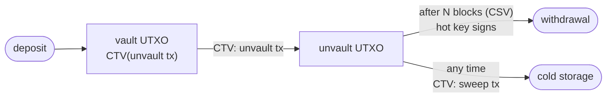

Bitcoin Script can say *who* may spend a coin, and *when*. It cannot say *where the money goes next*. Every construction that needs that, vaults, payment pools, channel factories, has to fake it with pre-signed transactions: generate a key, sign the future spends in advance, then delete the key and pray you deleted it properly. The security of the whole thing rests on a deletion nobody can prove happened.

A **covenant** moves that promise into consensus. The definition is narrow:

> A covenant occurs when the `scriptPubKey` of a UTXO restricts the `scriptPubKey` of the outputs of the transaction that spends it.
{: .quote-sm}

[CTV](https://github.com/bitcoin/bips/blob/master/bip-0119.mediawiki) is the smallest useful version of that idea. It hashes a description of the spending transaction and refuses the spend unless the real one matches. One opcode, one hash, one comparison.

And the whole character of CTV, both what it makes possible and what it can destroy, comes down to a single question:

**Which fields go into that hash, and which ones don't?**

This post started as the write-up of a talk and grew into the page I wished I had while preparing it: one place with everything you need to follow the covenant debate. It goes in this order:

1. What Script can already see, and why that is not enough.
2. CTV field by field, with a tool to poke at the hash yourself.
3. The two things CTV refuses to look at, and what each one buys and costs.
4. Fees, which every template has to settle in advance.
5. What people actually want to build: batching trees, vaults, Ark, LN-Symmetry, DLCs.
6. Every other proposal on the table, from `OP_CHECKSIGFROMSTACK` to a full restoration of Satoshi's Script.
7. Why this has taken eight years, and where it stands today.
8. Open problems that I think are worth someone's time.

If you only care about one of those, the table of contents above will take you there. The [next post](/blog/2026/covenants-post-quantum/) picks up where this one ends and asks what happens to all of it once a quantum computer can forge signatures.

## What Script can already see

A Bitcoin output is locked by a small program. When you spend it, you provide data (the witness) and the network runs the program on that data. The program can do arithmetic on small numbers, hash things, compare them, and check timelocks. What it mostly cannot do is look at the transaction that is spending it.

There is exactly one window onto that transaction: the signature check. `OP_CHECKSIG` verifies a signature over a *sighash*, a digest the node computes from the spending transaction. The script never sees the digest. It only learns "the holder of key K approved this transaction". So the script can decide **who** approves the outputs, but never **what** the outputs are.

Timelocks fill in the **when**. `OP_CHECKLOCKTIMEVERIFY` ([BIP-65](https://github.com/bitcoin/bips/blob/master/bip-0065.mediawiki)) and `OP_CHECKSEQUENCEVERIFY` ([BIP-112](https://github.com/bitcoin/bips/blob/master/bip-0112.mediawiki)) let a script refuse to be spent before an absolute height or before some number of blocks have passed since the coin confirmed.

The **where** has no opcode. Anyone who needs it has three options, and none of them is good:

- **Trust someone.** A custodian, a federation, a multisig committee. It works, and it is exactly the thing Bitcoin was supposed to let you stop doing.
- **Pre-sign and delete.** Create an ephemeral key, lock funds to it, sign the only transactions you ever want to allow, then destroy the key. The coins can now only move along the transactions you signed. Nobody can verify the deletion, it has to happen *before* funding, the fees are frozen at signing time, and with several parties every one of them has to sign and delete.
- **Pre-sign with everybody.** The multi-party version of the above: all participants produce an n-of-n signature (these days with [MuSig2](https://github.com/bitcoin/bips/blob/master/bip-0327.mediawiki)) over a tree of future transactions. Every protocol that does this, from Lightning channels to covenant-less Ark, pays for it with interaction: everyone has to be online, in the same round, at the same time.

Covenants replace all three with a rule the network enforces.

### A small taxonomy

The word covers a large design space, and most arguments about "covenants" are really arguments about which corner of it to open. Four axes are enough to place every proposal in this post.

| axis | one end | other end |
| --- | --- | --- |
| **how the spend is constrained** | *template*: the next transaction is fully specified in advance | *introspection*: the script reads individual fields and checks whatever it likes |
| **memory** | *stateless*: every spend is judged on its own | *stateful*: a UTXO carries data forward to its successor |
| **recursion** | *bounded*: the chain of constrained spends is finite and known | *recursive*: an output can demand that its successor carry the same covenant, forever |
| **scope** | *general*: a building block for arbitrary contracts | *special-purpose*: one opcode for one application, like vaults |

CTV sits firmly in the first column on every row. It is a template, it has no state, it is not recursive, and it is general.

The "not recursive" part is worth one sentence of proof, because it is the property that got CTV this far. To make a CTV output that re-creates itself, its template hash $$H$$ would have to describe a transaction whose output contains $$H$$. So $$H$$ would have to satisfy $$H = \text{SHA256}(\ldots H \ldots)$$, a fixed point of SHA-256, and finding one is as hard as breaking the hash. Every CTV contract is therefore a finite tree of transactions that you can write down completely before funding it.

### A short history

| year | event |
| --- | --- |
| 2013 | Greg Maxwell's "CoinCovenants" thread on bitcointalk, written half as a warning: recursive covenants could be used to build coins nobody could ever un-restrict. |
| 2016 | Möser, Eyal and Sirer publish *Bitcoin Covenants* and propose vaults with an `OP_CHECKOUTPUTVERIFY` opcode. The word sticks. |
| 2017 | O'Connor and Piekarska, *Enhancing Bitcoin Transactions with Covenants*: covenants from `OP_CHECKSIGFROMSTACK`. Elements (and later Liquid) ships CSFS. |
| 2019 | Jeremy Rubin proposes `OP_CHECKOUTPUTSHASHVERIFY`, renamed `OP_CHECKTEMPLATEVERIFY` that December. `SIGHASH_NOINPUT` becomes ANYPREVOUT (BIP-118). |
| 2021 | Taproot activates. Tapscript's `OP_SUCCESSx` opcodes make new opcodes far cheaper to add. |
| 2022 | An attempt to ship a CTV activation client via Speedy Trial draws a strong backlash and is abandoned. Bitcoin Inquisition launches on signet with CTV and APO active. |
| 2023 | `OP_VAULT` (BIP-345), MATT, `OP_TXHASH` (BIP-346), and `OP_CAT` re-proposed (BIP-347). |
| 2024 | `OP_CAT` activates on Inquisition signet. CSFS gets a Bitcoin BIP (BIP-348). LNHANCE bundles CTV, CSFS, `OP_INTERNALKEY` and `OP_PAIRCOMMIT`. moonsettler floats "CTV++". |
| 2025 | `OP_VAULT` is withdrawn in favour of more general proposals. An open letter from dozens of developers backs CTV+CSFS. `OP_CHECKCONTRACTVERIFY` gets BIP-443. |
| 2026 | `OP_TEMPLATEHASH` (BIP-446) and its tapscript bundle (BIP-448) reach Draft. The Great Script Restoration gets BIPs 440 and 441. A CTV activation client opens a signaling window. |

Keep that last row in mind; the [status section](#where-it-actually-stands) comes back to it.

## Eight fields and a comparison

`OP_CHECKTEMPLATEVERIFY` reuses `OP_NOP4` (`0xb3`). It looks at the top of the stack and does something deliberately anticlimactic:

- If the top element is **not** exactly 32 bytes, it behaves as a NOP.[^nop] Old nodes see nothing.
- If it **is** 32 bytes, it computes the template hash of the spending transaction and compares. Mismatch fails the script.

The hash, `DefaultCheckTemplateVerifyHash`, is a single SHA256 over these fields, in this order:

| # | field | serialization |
| --- | --- | --- |
| 1 | `nVersion` | 4 bytes, little-endian |
| 2 | `nLockTime` | 4 bytes, little-endian |
| 3 | `sha256(scriptSigs)` | **only if any scriptSig is non-empty**[^scriptsigs] |
| 4 | `input_count` | 4 bytes, little-endian |
| 5 | `sha256(sequences)` | over the 4-byte sequences |
| 6 | `output_count` | 4 bytes, little-endian |
| 7 | `sha256(outputs)` | over each `CTxOut`: 8-byte value, then length-prefixed script |
| 8 | `input_index` | 4 bytes, little-endian |

Amounts appear exactly once in that list, inside the outputs. Read the list again looking for the inputs and you will not find them. There are no txids, no outpoints, and no input amounts anywhere in the hash.

That is not an oversight. It is the entire design.

## Try it

Change anything on the left and watch the hash. The fields at the bottom are the ones CTV never looks at: touch them and the hash stays exactly where it was.

<div class="demo-block" id="ctv-tool">
    <h6 class="demo-heading">CTV template inspector</h6>

    <div class="ctv-grid">
      <div>
        <div class="ctv-group-title">Committed by the template</div>

        <div class="demo-field">
          <label for="ctv-version">nVersion</label>
          <input type="number" id="ctv-version" value="2" min="0" max="2147483647">
        </div>
        <div class="demo-field">
          <label for="ctv-locktime">nLockTime</label>
          <input type="number" id="ctv-locktime" value="0" min="0">
        </div>
        <div class="demo-field">
          <label for="ctv-sequence">nSequence</label>
          <input type="number" id="ctv-sequence" value="4294967293" min="0" max="4294967295">
        </div>
        <div class="demo-field">
          <label for="ctv-count">input_count</label>
          <input type="number" id="ctv-count" value="1" min="1" max="5">
        </div>
        <div class="demo-field">
          <label for="ctv-index">input_index</label>
          <input type="number" id="ctv-index" value="0" min="0" max="4">
        </div>

        <div class="ctv-outputs-head">
          <span>outputs</span>
          <span>
            <button class="demo-mode ctv-mini" id="ctv-out-remove" title="Remove an output">&minus;</button>
            <button class="demo-mode ctv-mini" id="ctv-out-add" title="Add an output">+</button>
          </span>
        </div>
        <div id="ctv-outputs"></div>

        <div class="ctv-group-title ctv-group-title--muted">Not committed &mdash; CTV never sees these</div>
        <div class="ctv-uncommitted">
          <div class="demo-field">
            <label for="ctv-txid">input txid</label>
            <input type="text" id="ctv-txid" value="9f2c…a10b" maxlength="20">
          </div>
          <div class="demo-field">
            <label for="ctv-vout">input vout</label>
            <input type="number" id="ctv-vout" value="0" min="0">
          </div>
          <div class="demo-field">
            <label for="ctv-inamount">input amount (BTC)</label>
            <input type="number" id="ctv-inamount" value="1.0" min="0" step="0.01">
          </div>
          <div id="ctv-uncommitted-note" class="ctv-hint">Change any of these three and the hash below will not move.</div>
        </div>
      </div>

      <div>
        <div class="ctv-group-title">What gets hashed</div>
        <div id="ctv-preimage" class="demo-hex"></div>
        <div class="demo-legend" id="ctv-legend">
          <span class="is-quiet">counts</span>
          <span class="is-r">version / locktime</span>
          <span class="is-quiet">sha256(sequences)</span>
          <span class="is-s">sha256(outputs)</span>
          <span class="is-pad">input_index</span>
        </div>

        <div class="ctv-group-title mt-3">Template hash</div>
        <div id="ctv-hash" class="ctv-hash">computing…</div>
        <div id="ctv-hash-state" class="ctv-hint"></div>

        <div class="ctv-group-title mt-3">Can this coin actually move?</div>
        <div id="ctv-verdict" class="ctv-verdict"></div>
      </div>
    </div>
</div>

<style>
#ctv-tool .ctv-grid { display: grid; grid-template-columns: 1fr 1fr; gap: 2rem; }
@media (max-width: 700px) { #ctv-tool .ctv-grid { grid-template-columns: 1fr; } }
#ctv-tool .ctv-group-title { font-size: 0.7rem; text-transform: uppercase; letter-spacing: 0.09em;
  color: var(--global-text-color-light); margin-bottom: 0.7rem; font-weight: 600; }
#ctv-tool .ctv-group-title--muted { margin-top: 1.6rem; }
#ctv-tool .ctv-outputs-head { display: flex; justify-content: space-between; align-items: center;
  font-size: 0.7rem; text-transform: uppercase; letter-spacing: 0.09em; font-weight: 600;
  color: var(--global-text-color-light); margin: 1.4rem 0 0.7rem; }
#ctv-tool .ctv-mini { padding: 0.1rem 0.6rem; font-size: 0.9rem; border: 1px solid var(--demo-rule);
  border-radius: 4px; margin-left: 0.25rem; }
#ctv-tool .ctv-out { display: flex; gap: 0.6rem; margin-bottom: 0.5rem; align-items: center; }
#ctv-tool .ctv-out input, #ctv-tool .ctv-out select { flex: 1 1 40%; min-width: 0; padding: 0.2rem 0.45rem;
  border: 0; border-bottom: 1px solid var(--demo-rule); background: transparent;
  color: var(--global-text-color); font-family: inherit; font-size: 0.8rem; }
#ctv-tool .ctv-uncommitted { padding: 0.9rem 1rem; border-radius: 4px; background: var(--demo-surface); }
#ctv-tool .ctv-hint { font-size: 0.75rem; color: var(--global-text-color-light); margin-top: 0.6rem; }
#ctv-tool .ctv-field-label { display: block; font-size: 0.68rem; color: var(--global-text-color-light);
  margin-top: 0.7rem; letter-spacing: 0.04em; }
#ctv-tool .ctv-hash { font-family: var(--bs-font-monospace, ui-monospace, monospace); font-size: 0.78rem;
  word-break: break-all; line-height: 1.9; padding-left: 0.9rem; border-left: 2px solid var(--demo-r); }
#ctv-tool .ctv-verdict { font-size: 0.83rem; line-height: 1.6; padding-left: 0.9rem;
  border-left: 2px solid var(--demo-s); }
#ctv-tool .ctv-verdict.is-bad { border-left-color: var(--demo-pad); }
</style>

<script>
(function () {
  var SCRIPTS = {
    'P2WPKH (22 B)': 22, 'P2TR (34 B)': 34, 'P2PKH (25 B)': 25, 'P2SH (23 B)': 23
  };
  var outputs = [
    { amount: 0.99, script: 'P2WPKH (22 B)' }
  ];
  var lastHash = null, lastCommitted = null;

  function el(id) { return document.getElementById(id); }
  function h2(n) { return n.toString(16).padStart(2, '0'); }

  // Little-endian serialization helpers, matching BIP-119 field widths.
  function u32le(n) { var a = []; n = n >>> 0; for (var i = 0; i < 4; i++) { a.push(n & 0xff); n >>>= 8; } return a; }
  function u64le(n) {
    var a = [], big = BigInt(Math.round(n));
    for (var i = 0; i < 8; i++) { a.push(Number(big & 255n)); big >>= 8n; }
    return a;
  }
  function compactSize(n) {
    if (n < 0xfd) return [n];
    if (n <= 0xffff) return [0xfd, n & 0xff, (n >> 8) & 0xff];
    return [0xfe].concat(u32le(n));
  }
  async function sha256(bytes) {
    var buf = await crypto.subtle.digest('SHA-256', new Uint8Array(bytes));
    return Array.from(new Uint8Array(buf));
  }
  function hex(bytes) { return bytes.map(h2).join(''); }

  // PurgeCSS scans the built site for literal class names, so these have to be
  // spelled out in full here. Building them as 'demo-byte--' + key would leave
  // the rules unreferenced and they would be stripped from the stylesheet.
  var BYTE_CLASS = {
    r: 'demo-byte--r',
    s: 'demo-byte--s',
    pad: 'demo-byte--pad',
    dropped: 'demo-byte--dropped'
  };

  function chip(bytes, cls, title) {
    return '<span class="demo-byte' + (cls ? ' ' + BYTE_CLASS[cls] : '') + '" title="' + title + '">' +
      hex(bytes) + '</span>';
  }

  function renderOutputs() {
    var html = '';
    outputs.forEach(function (o, i) {
      html += '<div class="ctv-out">' +
        '<input type="number" step="0.00000001" min="0" value="' + o.amount + '" data-out="' + i + '" data-k="amount">' +
        '<select data-out="' + i + '" data-k="script">' +
        Object.keys(SCRIPTS).map(function (s) {
          return '<option' + (s === o.script ? ' selected' : '') + '>' + s + '</option>';
        }).join('') + '</select></div>';
    });
    el('ctv-outputs').innerHTML = html;
    el('ctv-outputs').querySelectorAll('input,select').forEach(function (n) {
      n.addEventListener('input', function () {
        var o = outputs[+n.dataset.out];
        o[n.dataset.k] = n.dataset.k === 'amount' ? parseFloat(n.value || 0) : n.value;
        recompute();
      });
    });
  }

  async function recompute() {
    var version = parseInt(el('ctv-version').value || 0, 10);
    var locktime = parseInt(el('ctv-locktime').value || 0, 10);
    var sequence = parseInt(el('ctv-sequence').value || 0, 10);
    var count = Math.max(1, parseInt(el('ctv-count').value || 1, 10));
    var index = Math.min(parseInt(el('ctv-index').value || 0, 10), count - 1);
    var inAmount = parseFloat(el('ctv-inamount').value || 0);
    el('ctv-index').max = count - 1;

    // sha256 over the concatenated 4-byte sequences, one per input.
    var seqBytes = [];
    for (var i = 0; i < count; i++) seqBytes = seqBytes.concat(u32le(sequence));
    var seqHash = await sha256(seqBytes);

    // sha256 over each CTxOut: 8-byte value, then the length-prefixed script.
    var outBytes = [];
    outputs.forEach(function (o) {
      var len = SCRIPTS[o.script];
      outBytes = outBytes.concat(u64le(o.amount * 1e8), compactSize(len), new Array(len).fill(0));
    });
    var outHash = await sha256(outBytes);

    // BIP-119 field order. sha256(scriptSigs) is omitted: every scriptSig is empty here.
    var fields = [
      { b: u32le(version), c: 'r', n: 'nVersion' },
      { b: u32le(locktime), c: 'r', n: 'nLockTime' },
      { b: u32le(count), c: '', n: 'input_count' },
      { b: seqHash, c: '', n: 'sha256(sequences)' },
      { b: u32le(outputs.length), c: '', n: 'output_count' },
      { b: outHash, c: 's', n: 'sha256(outputs)' },
      { b: u32le(index), c: 'pad', n: 'input_index' }
    ];

    var preimage = [], html = '';
    fields.forEach(function (f) {
      preimage = preimage.concat(f.b);
      html += '<span class="ctv-field-label">' + f.n + '</span>' + chip(f.b, f.c, f.n);
    });
    el('ctv-preimage').innerHTML = html;

    var digest = hex(await sha256(preimage));
    el('ctv-hash').textContent = digest;

    // Did this edit touch a committed field, or only the ignored ones?
    var committed = JSON.stringify(fields.map(function (f) { return f.b; }));
    if (lastHash !== null) {
      if (digest === lastHash && committed === lastCommitted) {
        el('ctv-hash-state').innerHTML =
          '<strong style="color:var(--demo-s)">Hash unchanged.</strong> That field is not committed.';
      } else {
        el('ctv-hash-state').textContent = 'Hash changed: that field is part of the template.';
      }
    }
    lastHash = digest; lastCommitted = committed;

    // Consensus still forbids creating bitcoins, and the template said nothing
    // about the input, so this is where the Unsatisfiable UTXO shows up.
    var outTotal = outputs.reduce(function (a, o) { return a + o.amount; }, 0);
    var v = el('ctv-verdict');
    if (outTotal > inAmount) {
      v.className = 'ctv-verdict is-bad';
      v.innerHTML = '<strong>Unsatisfiable.</strong> The template demands ' + outTotal.toFixed(8) +
        ' BTC of outputs from a ' + inAmount.toFixed(8) + ' BTC input. Every transaction that satisfies ' +
        'the covenant creates bitcoins, so none of them is valid. This coin can never move.';
    } else {
      v.className = 'ctv-verdict';
      v.innerHTML = '<strong>Spendable.</strong> Outputs total ' + outTotal.toFixed(8) + ' BTC against a ' +
        inAmount.toFixed(8) + ' BTC input, leaving ' + (inAmount - outTotal).toFixed(8) + ' BTC of fee.';
    }
  }

  function init() {
    renderOutputs();
    ['ctv-version', 'ctv-locktime', 'ctv-sequence', 'ctv-count', 'ctv-index', 'ctv-inamount', 'ctv-txid', 'ctv-vout']
      .forEach(function (id) { el(id).addEventListener('input', recompute); });
    el('ctv-out-add').addEventListener('click', function () {
      if (outputs.length < 5) { outputs.push({ amount: 0.1, script: 'P2TR (34 B)' }); renderOutputs(); recompute(); }
    });
    el('ctv-out-remove').addEventListener('click', function () {
      if (outputs.length > 1) { outputs.pop(); renderOutputs(); recompute(); }
    });
    recompute();
  }

  if (document.readyState === 'loading') document.addEventListener('DOMContentLoaded', init);
  else init();
})();
</script>


## Why these eight, and not others

Each committed field is there to close a specific hole. Going through them is the fastest way to understand what a template actually promises.

- **`nVersion`** pins the transaction's relay semantics as well as its consensus ones. It matters more now than in 2019: a template that commits to version 3 is a [TRUC](https://github.com/bitcoin/bips/blob/master/bip-0431.mediawiki) transaction, with the anti-pinning rules that come with it, and one that commits to version 2 is not. You choose at address-creation time.
- **`nLockTime`** and **`sha256(sequences)`** pin every absolute and relative timelock. Without them, anyone could take a template meant to be spent after a delay and spend it earlier, or strip the RBF signal from it.
- **`sha256(scriptSigs)`** exists for txid stability. Legacy and P2SH inputs carry data in the scriptSig, and a scriptSig changes the txid. If the template did not pin it, a third party could malleate a CTV transaction and orphan every pre-computed child that spends it.
- **`input_count`** and **`input_index`** close the *half-spend problem*. Suppose two coins sit on the same template and the index were not committed. A single transaction could spend both, satisfy both covenants with the same set of outputs, and silently leave the second coin's value to the miner. Committing the count and the position means each input sees a different hash, so two coins with an identical template cannot be merged into one spend.
- **`output_count`** and **`sha256(outputs)`** are the point of the whole exercise.

The way the fields are hashed matters too. The sequences and outputs are each reduced to a single digest that is computed once per transaction and then reused for every input. Validating a transaction with $$n$$ CTV inputs therefore costs $$O(n)$$ hashing rather than $$O(n^2)$$, which is the lesson Bitcoin learned the hard way from legacy sighash, where a single oversized transaction could take minutes to validate.

### A consequence nobody asked for: predictable txids

Put the scriptSig commitment together with segwit inputs and something useful falls out. Once a CTV tree's root is funded, every transaction below it has a fully determined txid: the inputs are outputs of transactions whose content is fixed by templates, and nothing left in those transactions can be malleated.

That means you can hand every recipient in a tree the exact chain of txids leading to their coin *before any of those transactions exist on chain*. Congestion-control trees, timeout trees, non-interactive channel opens and Ark all rely on that property.

### Where the opcode can live

CTV was built on an `OP_NOP`, not on a tapscript `OP_SUCCESS`, and that decision has a consequence people rarely mention: it works in every script context Bitcoin has.

| context | script | notes |
| --- | --- | --- |
| **bare** | `<H> OP_CHECKTEMPLATEVERIFY` | 34-byte output, spent with an empty scriptSig and no witness. The reference implementation relays it as standard. The cheapest possible form. |
| **P2WSH** | the same script, hashed | the template stays private until the coin is spent |
| **tapscript** | a leaf of a Taproot tree | can sit next to key-path and other leaves; the only context where CSFS exists to pair with it |
| **P2SH** | legacy wrapper | works, but its 160-bit hash is a weaker commitment than you want |

Almost every other proposal in this post lives in tapscript only. Hold on to that; it turns out to matter a great deal in [the post-quantum sequel](/blog/2026/covenants-post-quantum/).[^txhashnop]


## Omission one: no outpoint, so the template floats

A template does not know which coin it is spending. It describes a *shape*: this many inputs, this many outputs, these amounts, these scripts, this locktime.

That is what makes it a template rather than a pre-signed transaction. Any UTXO whose script commits to this hash can be spent by any transaction with the right shape. Send funds to the same address twice and both coins accept the same spend, because neither is named anywhere in what was hashed.

Now put [CSFS](https://bips.dev/348/) next to it. `OP_CHECKSIGFROMSTACK` reuses `OP_SUCCESS204` (`0xcc`), works only in tapscript, and differs from `OP_CHECKSIG` in one respect: the signed message comes off the stack instead of being derived from the transaction. It consumes, top down, a pubkey, a message and a signature, and it does not hash the message first, since BIP-340 takes messages of any length.

```
Tapscript:  OP_CHECKTEMPLATEVERIFY <PubKey> OP_CHECKSIGFROMSTACK
Witness:    <sig> <TemplateHash>
```

Read what that signature actually covers. Not a txid. Not an outpoint. It covers the **template hash**, which is to say the shape of the spend. So the same signature stays valid for any coin that lands in this script.

That is a **re-bindable signature**, and it is the property [ANYPREVOUT](https://github.com/bitcoin/bips/blob/master/bip-0118.mediawiki) was designed to provide. CTV+CSFS reaches it without touching sighash logic at all: sign a hash that never mentioned the input, and the signature was never bound to one in the first place.

Everything people want from this pair follows from here. LN-Symmetry, where the latest channel state simply wins and nobody stores revocation secrets. Ark and channel factories, where a tree of spends is agreed once and rebound as membership changes. Vaults with no ephemeral keys to delete, because there is nothing to delete.

## Omission two: no input amount, so the coin can starve

Here is the same omission wearing a different face.

The hash pins your outputs, amounts included. It says nothing about what came in. Consensus still enforces the one rule that has always been there: a transaction cannot create bitcoins.

So picture an address whose template says *one input, one output of 0.99 BTC, 0.01 for fees*. It was built expecting 1.0 BTC. Somebody sends **0.5 BTC** instead.

The template is still satisfiable in the sense that a matching transaction exists. It just cannot be valid: it would move 0.99 BTC out of a 0.5 BTC input. Every spend that satisfies the covenant is invalid, and every valid spend violates the covenant. Nothing can move the coin, ever.

This is the **Unsatisfiable UTXO**, and it is not a bug in CTV. Committing to the input amount is exactly what would stop the template from being a template: pin the input and you have pinned the coin, and re-bindable signatures die with it.

You can defend against it. The usual answer is a Taproot key-path escape hatch, so the script path is one option and not the only one, which quietly gives up part of the trustlessness the covenant was for. What you cannot do is have the amount both committed and not committed.

## The same choice, twice

Put the two side by side and the shape of the trade is hard to miss.

| omitted from the hash | what you get | what it costs |
| --- | --- | --- |
| the input outpoint | templates float; signatures re-bind; APO semantics for free | subtle: reuse an address and the second coin can be pushed along the same template, with any surplus going to the miner |
| the input amount | the template stays a template | a wrong deposit can brick the coin forever |

Both come from the same decision: describe the spend, not the coin. One reading gives CTV its best trick, the other its worst failure mode, and no amount of care in wallet software makes the second one disappear, because the omission is in consensus.

There is one more thing the template has to settle in advance, and it is the one that bites first in practice.

## Fees: the template has to pay someone

A template fixes every output amount. The fee is whatever is left of the input, so the fee is fixed too, at the moment the address is created. For a vault that might not be spent for five years, that means guessing the fee market five years out. Guess low and the transaction sits in the mempool forever; guess high and you overpay on every spend.

There are four ways around it, and real designs usually combine two of them.

1. **A ladder of templates.** Commit to several templates that differ only in fee (1, 4, 16, 64 sat/vB, say) and put each in its own tapscript leaf. It works, but each extra fee level multiplies the number of leaves, and the ladder is only as good as its top rung.
2. **An anchor output.** Add a tiny output anyone can spend and bump the fee with a child transaction (CPFP). Since Bitcoin Core 28.0 there is a standard output type made for exactly this, pay-to-anchor (P2A, `OP_1 <0x4e73>`), and Core 29.0 lets it carry zero value as *ephemeral dust* as long as the child spends it immediately. A template that commits to `nVersion = 3` gets TRUC's pinning protections on top.
3. **Transaction sponsors.** A proposal, also from Jeremy Rubin, that would let an unrelated transaction pay for another one. Never merged.
4. **Sign late.** CTV+CSFS or `OP_TEMPLATEHASH`+CSFS let a key sign the template hash at spend time, so the fee can be chosen when the transaction is built rather than when the address was. The cost is that you are back to trusting a key for that choice.

The anchor route is the one current CTV designs converge on. It is also where the second post will find a problem, because a CPFP child needs an input of its own, and that input has to be spendable by someone.

## What people want to build with it

The use cases are what the whole debate is ultimately about, so it is worth being concrete about each.

### Congestion control and batch payments

An exchange wants to pay 1,000 withdrawals while fees are high. With CTV it can confirm a single small transaction today whose one output commits to a tree of transactions that eventually pays all 1,000 recipients. Every recipient's payment is final the moment that small transaction confirms, because nobody can spend it any other way, and the tree can be unrolled whenever fees drop. Recipients who need their coins early unroll their own branch and pay only for it.

It is not free. Each internal transaction adds overhead, so the full tree costs more block space than one big batch. What you buy is *when* you pay for it. Play with the numbers:

<div class="demo-block" id="cc-tool">
    <h6 class="demo-heading">Congestion-control tree</h6>
    <div class="cc-grid">
      <div>
        <div class="demo-field">
          <label for="cc-n">recipients</label>
          <input type="number" id="cc-n" value="1000" min="2" max="100000">
        </div>
        <div class="demo-field">
          <label for="cc-r">outputs per node (radix)</label>
          <input type="number" id="cc-r" value="4" min="2" max="250">
        </div>
        <div class="demo-note mt-3" id="cc-note"></div>
      </div>
      <div>
        <div class="demo-stats">
          <div><span class="demo-stat-value" id="cc-now">–</span><span class="demo-stat-label">vB confirmed now</span></div>
          <div><span class="demo-stat-value" id="cc-later">–</span><span class="demo-stat-label">vB for the full tree</span></div>
        </div>
        <div class="demo-stats">
          <div><span class="demo-stat-value" id="cc-batch">–</span><span class="demo-stat-label">vB as one batch</span></div>
          <div><span class="demo-stat-value" id="cc-depth">–</span><span class="demo-stat-label">depth / txs in tree</span></div>
        </div>
      </div>
    </div>
</div>

<style>
#cc-tool .cc-grid { display: grid; grid-template-columns: 1fr 1fr; gap: 2rem; }
@media (max-width: 700px) { #cc-tool .cc-grid { grid-template-columns: 1fr; } }
#cc-tool .demo-stats { gap: 2.5rem; }
</style>

<script>
(function () {
  // Sizes in vbytes. Tree transactions spend bare CTV outputs, so they carry no
  // witness and their vsize equals their size.
  var OUT = 43;        // 8 value + 1 length + 34 script (bare CTV and P2TR are both 34)
  var TX_BASE = 10;    // version + locktime + input/output counts (under 253 each)
  var CTV_IN = 41;     // 36 outpoint + 1 empty scriptSig + 4 sequence
  var FUND = 10.5 + 57.5; // segwit tx overhead + one taproot key-path input

  function el(id) { return document.getElementById(id); }
  function fmt(n) { return Math.round(n).toLocaleString('en-US'); }

  function recompute() {
    var n = Math.max(2, Math.min(100000, parseInt(el('cc-n').value || 2, 10)));
    var r = Math.max(2, Math.min(250, parseInt(el('cc-r').value || 2, 10)));

    // Walk up the tree: each level groups the one below into nodes of r outputs.
    var level = n, txs = 0, depth = 0;
    while (level > 1) { level = Math.ceil(level / r); txs += level; depth++; }

    // Each tree transaction has one input; every output is either a recipient
    // or the input of another tree transaction.
    var outputs = n + (txs - 1);
    var tree = txs * (TX_BASE + CTV_IN) + outputs * OUT;
    var now = FUND + OUT;           // the commitment transaction: one CTV output
    var batch = FUND + n * OUT;     // the same payments, all at once

    el('cc-now').textContent = fmt(now);
    el('cc-later').textContent = fmt(now + tree);
    el('cc-batch').textContent = fmt(batch);
    el('cc-depth').textContent = depth + ' / ' + fmt(txs);
    var overhead = ((now + tree) / batch - 1) * 100;
    el('cc-note').innerHTML = 'Confirming <strong>' + fmt(now) + ' vB</strong> now settles all ' + fmt(n) +
      ' payments. Unrolling everything later costs <strong>' + overhead.toFixed(0) + '%</strong> more block space than a single batch, ' +
      'but one recipient who wants out early pays for only ' + depth + ' small transactions. Larger radix, less overhead, more expensive early exits.';
  }

  function init() {
    ['cc-n', 'cc-r'].forEach(function (id) { el(id).addEventListener('input', recompute); });
    recompute();
  }
  if (document.readyState === 'loading') document.addEventListener('DOMContentLoaded', init);
  else init();
})();
</script>

### Vaults

A vault is a coin that cannot go straight to an arbitrary address. It first has to *announce* that it is leaving, wait, and during the wait its owner can still claw it back to cold storage. If an attacker steals your hot key, they can start a withdrawal but not finish one before you notice.

The simplest CTV vault, [the one James O'Beirne published in 2022](https://github.com/jamesob/simple-ctv-vault), is three templates:



A watchtower watches for the unvault transaction. If it did not come from you, it broadcasts the sweep, which needs no key at all because the template already fixes where it goes. That last detail is the one I find elegant: the emergency path requires no secret, so there is nothing for the attacker to have stolen.

The limits are all about rigidity. The whole balance unvaults at once. The amount is fixed when the vault is created, so a second deposit to the same address is either unspendable or a gift to the miner (the omissions above, again). Partial withdrawals need a new tree per possible amount. `OP_VAULT` was designed to fix exactly this with dynamic amounts and was later withdrawn in favour of more general tools; `OP_CHECKCONTRACTVERIFY` and the input-amount opcodes discussed further down are the current attempts.

### Channel factories, timeout trees and Ark

These all share one shape: many users hold claims on one on-chain UTXO, and each can exit unilaterally by publishing the branch of a transaction tree that leads to their leaf.

- **Timeout trees**, proposed by John Law in 2023, put a channel or a balance at each leaf and give the operator the whole UTXO back after a timeout. Users either leave through their branch in time or move to the next tree.
- **Ark** does the same with *virtual UTXOs*. An operator batches many users into a round, and each user's claim is a leaf of the round's tree.
- **Payment pools** and **channel factories** let a group share a UTXO and open channels among themselves without touching the chain.

Without covenants, every one of these requires the tree to be pre-signed by an n-of-n of its participants, which is where the interaction cost comes from: everybody in the round has to be online to co-sign. Covenant-less Ark, the variant being built and deployed today, does exactly that. With CTV, the tree is a set of templates and nobody has to sign anything. The operator builds it, users check it, and the chain enforces it.

### LN-Symmetry

Today's Lightning channels are *penalty*-based. Every time the balance changes, both parties revoke the previous state by handing each other a secret; if you ever broadcast an old state, your peer uses that secret to take everything. It works, but it makes backups dangerous (restore an old one and you may broadcast a revoked state by accident) and it makes channels with more than two parties impractical.

LN-Symmetry (formerly eltoo) replaces punishment with ordering. Each state is an update transaction that can spend *any earlier* update transaction, so whoever broadcasts an old state simply gets overridden by the latest one. That requires a signature that is not bound to a specific previous output, which is exactly the re-bindable signature from CTV+CSFS in the section above. Before CSFS it required `SIGHASH_ANYPREVOUT`. There are draft BOLTs and a Core Lightning implementation built on the BIP-448 bundle.

### Discreet Log Contracts

A DLC pays out according to an oracle's attestation. Today each party has to exchange an adaptor signature for every possible outcome, which for a contract with thousands of outcomes is a lot of interactive signing.

With CTV, each outcome can instead be a tapscript leaf: "the outcome template, plus a signature valid under the oracle's attestation point for this outcome". Once the oracle attests, the secret for that point becomes public and anyone can complete the spend. That is fine, because the template already fixes where the money goes. Setup becomes non-interactive.

That pattern, *reveal the secret publicly and rely on the template to make the revelation harmless*, is small here and central in [the next post](/blog/2026/covenants-post-quantum/).

### And a few more

- **Non-interactive channel opens.** Pay into a template whose output is a channel with the recipient, without them being online.
- **Spacechains.** Ruben Somsen's design for blind merged mining uses a long pre-committed chain of transactions, each a fee auction for one sidechain block.
- **BitVM-style bridges.** Today these rely on committees pre-signing large transaction graphs. Templates could replace some of that pre-signing, and details like CTV's scriptSig commitment are part of why BitVM developers care which template opcode ships.


## The rest of the field

CTV is the smallest proposal, not the only one. Here is everything currently on the table, roughly from least to most expressive.

### `SIGHASH_ANYPREVOUT` (BIP-118)

New sighash flags that let a signature leave out the outpoint it spends (`ANYPREVOUT`) or also the script (`ANYPREVOUTANYSCRIPT`). It is the original route to re-bindable signatures and LN-Symmetry. It is not a covenant opcode as such, but combined with a signature from a known key it can emulate a CTV-like template. It has been active on Inquisition signet since 2022 and has lost momentum to CTV+CSFS, which reaches the same place without touching sighash logic.

### `OP_CHECKSIGFROMSTACK` (BIP-348)

Verify a BIP-340 signature over an arbitrary message from the stack. On its own it is not a covenant; it is delegation and oracles. Next to a template opcode it becomes re-bindable signatures, as shown above. Tapscript only.

### `OP_INTERNALKEY` (BIP-349) and `OP_PAIRCOMMIT` (BIP-442)

Two small helpers. `OP_INTERNALKEY` pushes the Taproot internal key, saving 32 bytes in every script that wants to reuse it with CSFS. `OP_PAIRCOMMIT` hashes two stack elements together with their lengths, a deliberately limited cousin of `OP_CAT` that is enough for LN-Symmetry's state commitments without enabling byte-level manipulation. CTV, CSFS and these two form the **LNHANCE** bundle.

### From CTV++ to `OP_TEMPLATEHASH` (BIP-446, BIP-448)

Two different ideas share a name here, and they are easy to conflate.

The first is moonsettler's **CTV++** sketch from December 2024. It adds an `OP_TEMPLATEHASH` that *builds* a CTV hash from elements on the stack, so a script can assemble a template with, say, a computed amount, and an `OP_INPUTAMOUNTS` that pushes the sum of selected input amounts. Together they attack the Unsatisfiable UTXO from the side: a script can finally reason about how much came in.

The second is [BIP-446](https://github.com/bitcoin/bips/blob/master/bip-0446.mediawiki), by Greg Sanders, Antoine Poinsot and Steven Roose, which reached Draft in March 2026. Its `OP_TEMPLATEHASH` takes nothing and *pushes* the template hash of the spending transaction. It is a Taproot-native redesign of CTV rather than an extension:

- it lives in tapscript as `OP_SUCCESS206`, not in an `OP_NOP`;
- it pushes instead of verifying, so it composes directly with CSFS or `OP_EQUALVERIFY`;
- it drops the scriptSig commitment, meaningless in Taproot, and adds a commitment to the annex;
- it still does not commit to prevouts or input amounts, so the Unsatisfiable UTXO is still there.

BIP-448 bundles it with CSFS and `OP_INTERNALKEY` as "Taproot-native (Re)bindable Transactions". Its supporters argue it is cleaner than CTV. Its critics point out that it gives up CTV's use outside tapscript and some properties BitVM designs rely on. As of September 2026 there is a Bitcoin Inquisition patch, miniscript and PSBT work, and an Ark demo on signet.

### `OP_TXHASH` and `OP_CHECKTXHASHVERIFY` (BIP-346)

Steven Roose's generalization: a *field selector* argument chooses which parts of the transaction go into the hash. CTV becomes one particular selector. The same machinery can express every BIP-341 sighash mode and many more, which makes it the natural substrate for "sign exactly the fields I care about" protocols. The cost is a much larger specification to review.

### `OP_CAT` (BIP-347)

Concatenate two stack elements. Satoshi disabled it in 2010 along with most of the byte-manipulation opcodes, over denial-of-service concerns that tapscript's 520-byte element limit now bounds. Ethan Heilman and Armin Sabouri re-proposed it in 2023, and it has been live on Inquisition signet since 2024.

It sounds innocuous. It is the most powerful proposal on this list because of one trick.

Andrew Poelstra's *Schnorr trick* goes like this. A Schnorr signature is $$(R, s)$$ with $$s = k + e \cdot x$$, where $$e$$ is a hash of $$R$$, the public key and the message. Pick the secret key $$x = 1$$ and nonce $$k = 1$$, so both the public key and $$R$$ are the generator $$G$$. Then $$s = 1 + e$$, and anyone can compute it. Now let the witness provide the pieces of the BIP-341 sighash preimage, have the script `OP_CAT` them together and hash them into $$e$$, build the signature $$(G, 1 + e)$$ on the stack (with a little grinding so that the "+1" never carries past the last byte), and hand it to `OP_CHECKSIG` with key $$G$$.

`OP_CHECKSIG` passes only if the message the script assembled *is* the real sighash of the spending transaction. The script has just read the transaction. Every field the sighash covers, outputs included, is now available on the stack for arbitrary checks. That is full introspection, recursive covenants, and, with enough of it, on-chain verification of hash-based signatures and even STARK proofs, all from an opcode that glues two strings together.

Which is precisely why it scares people.

### MATT and `OP_CHECKCONTRACTVERIFY` (BIP-443)

Salvatore Ingala's *Merkleize All The Things* gives each UTXO state: data is tweaked into the Taproot internal key, and `OP_CHECKCONTRACTVERIFY` checks that an input carries some data, or that an output carries the right data and the right script tree. With that, a UTXO can run a state machine, and two parties can play a bisection game to prove a disputed computation on chain, which is the core of optimistic rollups and BitVM-style fraud proofs. CCV also has an amount semantic, so it can do the flexible vaults `OP_VAULT` was meant for. There is a Bitcoin Core pull request (#32080). No activation proposal.

### `OP_VAULT` (BIP-345)

James O'Beirne's special-purpose vault opcode, with dynamic amounts, batched withdrawals and a recovery path. It was the most polished vault design for two years and was withdrawn in 2025, on the grounds that general primitives (CTV+CSFS now, CCV later) cover the need. I include it because it shows the pattern: special-purpose proposals keep losing to general ones.

### The Great Script Restoration (BIPs 440 and 441)

Rusty Russell's long-running project, published as BIPs in April 2026. BIP-441 defines a new tapleaf version, `0xc2`, in which every opcode Satoshi disabled comes back, and numbers can be large. BIP-440 replaces the old per-opcode limits with a *varops budget*: every operation is charged by how many bytes it touches, and the budget is sized so that the worst possible block is no more expensive to validate than today's worst block full of signature checks. It is the maximalist answer: stop adding opcodes one argument at a time and give Script back its full vocabulary, with a cost model that makes that safe.

### Simplicity, next door

Not a Bitcoin proposal yet, but worth knowing: Blockstream's Simplicity, a formally specified low-level language with static cost bounds, went live on Liquid in 2025. It is what many people picture as the long-term destination.

### All of it in one table

| proposal | BIP | what the script gets | recursive? | where it runs | status (Sep 2026) |
| --- | --- | --- | --- | --- | --- |
| CTV | 119 | "is the spend this template?" | no | every script context | activation client signaling, 0% support |
| APO | 118 | signatures that skip the outpoint | no | tapscript | Inquisition only |
| CSFS | 348 | verify a signature over any message | no | tapscript | proposed with CTV and in BIP-448 |
| INTERNALKEY | 349 | the Taproot internal key | no | tapscript | in LNHANCE and BIP-448 |
| PAIRCOMMIT | 442 | hash of two elements | no | tapscript | in LNHANCE |
| TEMPLATEHASH | 446 / 448 | the template hash, pushed | no | tapscript | Draft, Inquisition patch |
| TXHASH | 346 | hash of selected fields | no, alone | tapscript + NOP slot | Draft |
| CAT | 347 | byte concatenation, hence introspection | yes | tapscript | Inquisition since 2024 |
| CCV | 443 | state carried in the internal key, amounts | yes | tapscript | Draft, Core PR |
| OP_VAULT | 345 | vault-specific | no | tapscript | withdrawn |
| GSR | 440 / 441 | the full original Script, costed | yes | new tapleaf | published April 2026 |

The expressiveness ladder, if you want it in one line:

$$\text{CTV} \rightarrow \text{TEMPLATEHASH} + \text{CSFS} \rightarrow \text{TXHASH} \rightarrow \text{CCV} \rightarrow \texttt{OP\_CAT} \rightarrow \text{GSR}$$

Every step up buys capability and spends review budget, and the argument about where to stop is most of what the covenant debate has been.

## Why this has taken eight years

It is tempting to read the delay as dysfunction. I think it is better read as a list of genuinely hard questions, some technical and some not.

- **Recursion.** A recursive covenant can restrict a coin forever. Maxwell's original worry was a government demanding coins that can only ever move to whitelisted addresses. The standard reply is that you can already do this with a multisig the government co-signs; covenants do not create the power, they only remove the co-signer. That is true, and it has not fully settled the worry.
- **MEV.** Expressive enough covenants make on-chain exchanges and AMMs possible, and with them, miner extractable value: the incentive for miners to reorder and censor transactions for profit. Bitcoin's decentralization depends on mining being a commodity business. Nobody wants to import Ethereum's block-builder market.
- **Validation cost.** Every new opcode is a new way to write an expensive script. The varops budget in BIP-440 is the most serious attempt to answer this in general rather than opcode by opcode.
- **"Which one?"** Proponents of each proposal agree covenants are useful and disagree about which to ship. Every alternative drains review attention from the others, and with no consensus on a target, nothing ships. The 2025 letter backing CTV+CSFS was, in large part, an attempt to break that deadlock.
- **Activation trauma.** SegWit's activation in 2017 nearly split the network; Taproot's in 2021 was smooth but controversial in method. The 2022 attempt to activate CTV through a client outside Bitcoin Core burned a lot of goodwill. Every soft fork since then is judged partly on its process.
- **Competing priorities.** The Great Consensus Cleanup (BIP-54) fixes real attacks, and post-quantum migration has become, in 2026, the loudest topic of all. Soft forks are scarce, and covenants are one of several candidates for the next slot.
- **Ossification.** A real faction holds that Bitcoin's rules should essentially stop changing. You do not have to agree with it to see that it raises the bar for every proposal.

## Where it actually stands

As of late September 2026, not activated. Nothing on this page is live on mainnet.

- **CTV** has an activation client with formal parameters: a signaling window that opened on **30 March 2026**, a timeout on **30 March 2027**, and a 90% threshold (1,815 of 2,016 blocks in a retarget period). It is not a Bitcoin Core release, and in the most recent public tallies I could find, from late May, miner signaling was at **zero**.
- **CTV+CSFS** is the combination with the broadest developer support. [An open letter signed by 66 developers](https://ctv-csfs.com/) argues they are the two proposals mature enough to ship: extensively reviewed, small, and repeatedly asked for.
- **BIP-448** (`OP_TEMPLATEHASH` + CSFS + `OP_INTERNALKEY`) is the main alternative. Per [Optech #421](https://bitcoinops.org/en/newsletters/2026/09/04/), the full bundle will be usable on the default signet with the next Bitcoin Inquisition release.
- **LNHANCE** keeps the Lightning-focused bundle alive as a middle option.
- **`OP_CAT`** has lived on signet for two years, with a steady stream of demos: vaults, STARK verifiers, hash-based signatures. No activation push.
- **CCV** and the **GSR** are research-grade and explicitly aimed at later forks.
- **`OP_VAULT`** is withdrawn.

That gap is familiar. I spent [the last post](/blog/2026/grinding-bytes/) counting a one-byte optimization that has been free and documented for eight years and that two thirds of ECDSA signatures still do not use. Shipped code and adopted code are different quantities, and the distance between them is usually not technical. The distance between specified code and activated code is larger still.

## Open problems worth someone's time

Reading everything above, a few questions seem to me both open and tractable, the kind a thesis or a well-spent summer could make progress on.

1. **Making the Unsatisfiable UTXO a wallet problem.** Consensus cannot fix it without giving up floating templates, but wallets could refuse to create it. An address format (or a BIP-21 extension) that carries the exact amount a covenant address expects, plus descriptor support so every wallet checks it before sending, would remove most of the risk without any soft fork. The pieces exist, like the [CTV vault output descriptor work on Delving](https://delvingbitcoin.org/t/ctv-vault-output-descriptor/1766); nobody has standardized the amount binding.
2. **Choosing a fee ladder with data.** How many fee-level templates does a vault need, at which rates, to be confirmable with, say, 99% probability over a five-year horizon, and when is an anchor output cheaper? That is an optimization problem over historical mempool data, the same kind of chain archaeology as the grinding post, and I have not seen it done.
3. **Liveness checking for covenant trees.** A CTV tree is a finite graph. Every leaf should eventually reach a key someone holds, no path should require an impossible amount, and no fee should be negative. That is a model-checking problem small enough to solve exhaustively at address-creation time, and it would catch most footguns in this post before any money is at risk.
4. **What covenants look like after a quantum computer.** Most of the proposals above rely, somewhere, on elliptic-curve signatures. CTV does not. And covenants can do something signatures cannot: make coins impossible to steal even when signatures are forgeable, by announcing a spend before executing it. That turned out to be big enough for its own post: [Covenants After Shor](/blog/2026/covenants-post-quantum/).

## The same list, twice

What I find worth holding onto is smaller and more specific than the activation question. CTV is a hash of eight fields. Reading the list of what it hashes tells you what it can do; reading the list of what it skips tells you both why it is powerful and how it can fail. Those turn out to be the same list, and every proposal after it is, in the end, a different answer to the question of which fields a script should be allowed to see.

<sub>*Written up from a talk I gave on Bitcoin covenants and expanded since. Field definitions checked against [BIP-119](https://github.com/bitcoin/bips/blob/master/bip-0119.mediawiki), [BIP-348](https://bips.dev/348/) and [BIP-446](https://bips.dev/446/); status as of late September 2026, from [Bitcoin Optech](https://bitcoinops.org/en/topics/covenants/) and the BIPs repository.*</sub>

[^nop]: Consensus treats a non-32-byte argument as a NOP, which is what keeps the soft fork soft. Standardness policy is stricter and rejects it with `SCRIPT_ERR_DISCOURAGE_UPGRADABLE_NOPS`, so you cannot relay one by accident.

[^scriptsigs]: This field is conditional, which is easy to miss: BIP-119 includes `sha256(scriptSigs)` only when at least one input carries a non-empty scriptSig. For the segwit and taproot spends where CTV is actually interesting, every scriptSig is empty and the field is skipped entirely. The tool above assumes that case.

[^txhashnop]: The exception is `OP_CHECKTXHASHVERIFY` from BIP-346, which would claim the very same `OP_NOP4` slot as CTV. That is one reason the two cannot both ship as currently written.
