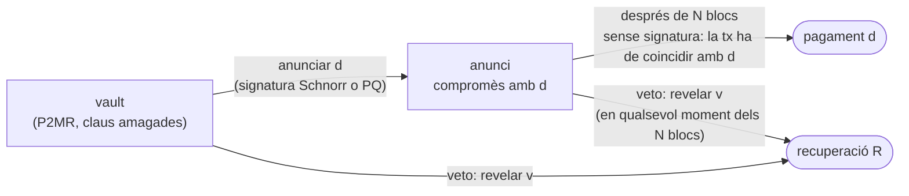

A [l'anterior post](/blog/2026/ctv-templates-ca/) vaig repassar totes les propostes de covenants sobre la taula, començant pels vuit camps que passa pel hash `OP_CHECKTEMPLATEVERIFY`. Aquest es fa una pregunta que el debat sobre covenants i el debat quàntic han evitat majoritàriament fer-se l'un a l'altre:

**Si un ordinador quàntic pot falsificar qualsevol signatura de corba el·líptica, quins covenants continuen funcionant, i poden evitar que et robin les monedes?**

Les dues converses fa anys que avancen en paral·lel. La gent dels covenants discuteix CTV contra `OP_TEMPLATEHASH` contra `OP_CAT`. La gent quàntica discuteix el [BIP-360](https://bips.dev/360/), les signatures basades en hash i si cal congelar les monedes vulnerables. Tots dos grups competeixen pel mateix recurs escàs, el proper soft fork, i les propostes de cap dels dos no estan dissenyades pensant en les de l'altre.

La resposta a què arribo és, crec, útil i una mica sorprenent. Totes les defenses quàntiques sobre la taula intenten fer que la **signatura** no es pugui falsificar. Hi ha una altra manera: organitzar les monedes de manera que una signatura falsificada **no n'hi hagi prou per robar-les**. El truc és partir cada despesa en dues. Primer anuncies, a la cadena, on van els diners. Després esperes. Després la transacció següent executa el pagament, i aquesta transacció no necessita cap signatura. Si algú ha falsificat la teva signatura per anunciar un altre destí, tens el període d'espera per enviar les monedes a un lloc segur amb un secret que només tu tens.

Ben fet, **la seguretat deixa de dependre de l'esquema de signatura**. Només en depèn la comoditat. La signatura pot ser ECDSA avui, trencada demà, i les monedes continuen sense poder anar enlloc que no hagis triat tu.

La idea no és del tot nova; els vaults fa anys que funcionen així, i més avall seré precís sobre qui va arribar primer a on. El que no he trobat enlloc és l'anàlisi de *quins* dissenys de vault sobreviuen realment a un atacant quàntic (la majoria no, per motius fàcils de passar per alt), què ha de poder fer exactament un covenant perquè això funcioni (CTV sol no pot) i quin és el canvi més petit que ho faria possible en un tipus de sortida post-quàntic. Aquest és el nucli de la tesi que començo aquí.

Un full de ruta:

1. Què trenca un ordinador quàntic, i les propostes de migració sobre la taula.
2. Totes les propostes de covenants, passades per un atacant quàntic.
3. Per què els covenants fan la migració alhora més difícil i més fàcil.
4. **Anunciar, esperar, executar**: la construcció, per què funciona i per què els vaults d'avui no la compleixen.
5. Hash-Locked Templates, una capa de recuperació sense signatures on aterrar.
6. El pla de la tesi, amb un recompte honest de què és nou.

## Què trenca realment un ordinador quàntic {#que-trenca-un-ordinador-quantic}

Dos algorismes quàntics importen per a Bitcoin, i importen de manera molt diferent.

L'**algorisme de Shor** resol el problema del logaritme discret en temps polinòmic. Donada una clau pública secp256k1, recupera la clau privada. L'estimació clàssica de recursos per a una corba de 256 bits és de l'ordre d'uns quants milers de qubits *lògics* (Roetteler et al., 2017), que es tradueixen en molts més de físics un cop es compta la correcció d'errors. Les estimacions no paren de baixar: l'article de Craig Gidney del 2025 va situar RSA-2048 per sota del milió de qubits sorollosos, i les estimacions per a corbes el·líptiques han seguit una tendència semblant. Ningú no sap quan existirà un *ordinador quàntic criptogràficament rellevant* (CRQC). Ningú seriós no diu que no pugui existir.

Quan existeixi, ECDSA i Schnorr s'han acabat, i amb ells tot el que s'hi construeix a sobre: MuSig2, FROST, adaptor signatures, els tweaks de clau de Taproot.

L'**algorisme de Grover** dona una acceleració quadràtica per a la cerca no estructurada. Contra les preimatges de SHA-256 converteix una feina de $$2^{256}$$ en aproximadament $$2^{128}$$ operacions quàntiques, que continuen fora d'abast i que no es poden paral·lelitzar tan eficientment com la cerca clàssica. Per a les col·lisions, els millors algorismes quàntics no superen els atacs d'aniversari clàssics un cop es té en compte la memòria. SHA-256 sobreviu.

Així que la regla general és senzilla: **tot el que es basa en corbes el·líptiques es trenca, tot el que es basa en SHA-256 sobreviu.**

### Exposició llarga i exposició curta

Hi ha dues finestres d'atac que importen.

- Un **atac d'exposició llarga** apunta a una clau pública que és a la cadena: sortides P2PK antigues, adreces reutilitzades, totes les sortides Taproot (la clau de sortida de les quals *és* una clau pública). L'atacant té tot el temps que vulgui. Segons el [BIP-361](https://bips.dev/361/), a 1 de març del 2026 més del 34% de tots els bitcoins eren en sortides la clau pública de les quals ja s'havia revelat.
- Un **atac d'exposició curta** apunta a una clau pública que només apareix quan gastes. Les sortides amb hash (P2PKH, P2WPKH, P2WSH) amaguen la clau fins aleshores, però una despesa la posa a la mempool, i un atacant prou ràpid per executar Shor en els minuts abans de la confirmació pot signar una transacció competidora amb una comissió més alta i desviar les monedes.

Amagar les claus darrere de hashes defensa del primer atac i no fa res contra el segon. La conclusió habitual és que només una signatura no falsificable defensa de tots dos. Tingues present aquesta frase; la major part d'aquest post tracta de per què no és del tot certa.

### La trampa NUMS

Un detall en què és fàcil equivocar-se. La manera estàndard de "desactivar" el key path de Taproot és fer servir una clau interna *nothing-up-my-sleeve* (NUMS): un punt generat a partir d'un hash, el logaritme discret del qual ningú no coneix.

A Shor no li importa si algú el coneix. El calcula. Un punt NUMS és exactament igual de vulnerable que qualsevol altre punt, i una sortida Taproot amb una clau interna NUMS la pot gastar pel key path un atacant quàntic sense tocar mai l'arbre d'scripts. **No hi ha manera de construir una sortida Taproot segura davant d'un ordinador quàntic.** Per això el BIP-360 va haver de definir un tipus de sortida nou i no una convenció.

La bona notícia, demostrada per Tim Ruffing el 2025, és que el compromís de Taproot amb l'arbre d'scripts continua sent vinculant fins i tot davant d'un adversari quàntic. Així que si un futur soft fork desactiva les despeses pel key path, les fulles d'script de les sortides Taproot existents continuen tenint sentit. Els plans de rescat s'hi recolzen.

## Les propostes de migració, breument {#propostes-de-migracio}

Al setembre del 2026, la conversa post-quàntica ha convergit en un conjunt petit de documents. Cap no està activat.

| proposta | què fa | estat |
| --- | --- | --- |
| [BIP-360](https://bips.dev/360/) P2MR | *Pay-to-Merkle-Root*: SegWit v2, un arbre d'scripts Taproot sense key path. Les adreces comencen per `bc1z`. Resol l'exposició llarga, no la curta. | incorporat com a Draft, a principis del 2026 |
| [BIP-361](https://bips.dev/361/) | La fase A atura els pagaments nous a tipus de sortida vulnerables; la fase B, uns dos anys després, restringeix les despeses ECDSA/Schnorr a un protocol de rescat segur davant d'ordinadors quàntics, i congela les monedes que no s'hagin mogut. | Draft, abril del 2026 |
| SHRINCS / `OP_CHECKSHRINCS` | L'esquema basat en hash de Jonas Nick i Mikhail Kudinov: claus públiques de 48 bytes, signatures amb estat de ~548 bytes amb una alternativa sense estat de ~5,8 KB. L'estat de signatura és públic a la cadena, així que les carteres el poden comprovar. | esborrany de BIP, l'especificació encara es mou |
| Opcodes per a SLH-DSA, Falcon, ML-DSA | els esquemes estandarditzats pel NIST, diverses propostes sobre com verificar-los a tapscript i com tarifar-ne la mida | en discussió |
| `OP_CHECKINPUTVERIFY` (OP_CIV) | Tadge Dryja, novembre del 2025: una entrada pot apuntar a la signatura d'una entrada germana en lloc de portar-ne una de pròpia, de manera que una sola signatura post-quàntica autoritza moltes entrades del mateix propietari | en discussió |
| Tripwires quàntics | BitMEX Research i altres: activar una congelació només quan algú demostri a la cadena que existeix un CRQC, per exemple gastant monedes bloquejades a una clau NUMS | en discussió, 2026 |
| Protocols de rescat | commit/reveal (DropKick, Lifeboat) i proves zk-STARK de coneixement de la llavor BIP-32, perquè els propietaris de monedes vulnerables puguin demostrar-ne la propietat després del Q-day | discussió i prototips |
| Hourglass | limitar el ritme de despesa de les monedes P2PK exposades en lloc de congelar-les | en discussió |

La forma del pla és: primer donar a la gent un lloc segur on anar (P2MR més un opcode de signatura post-quàntica), després fer-los-hi anar (BIP-361). Totes les entrades tracten de **signatures**: fer-les no falsificables, fer-les més petites o fer que les falsificables deixin de funcionar. Els covenants no apareixen en cap d'aquests documents.

## Covenant per covenant: qui sobreviu {#covenant-per-covenant}

Ara agafa la llista de l'anterior post i passa cada proposta per la regla general.

| proposta | en què es basa la seva seguretat | després d'un CRQC |
| --- | --- | --- |
| **CTV** (BIP-119) | SHA-256 sobre camps de la transacció | **sobreviu** |
| **`OP_TEMPLATEHASH`** (BIP-446) | SHA-256 sobre camps de la transacció | **sobreviu**, només a tapscript |
| **`OP_TXHASH`** (BIP-346) | SHA-256 sobre camps seleccionats | **sobreviu** |
| **CSFS** (BIP-348) | Schnorr BIP-340 | **trencat** |
| **APO** (BIP-118) | Schnorr BIP-340 amb flags de sighash nous | **trencat**; la idea del sighash sobreviu si es porta a una signatura PQ |
| **`OP_INTERNALKEY`** (BIP-349) | posa a la pila un punt de corba el·líptica | **sense sentit**: P2MR no té clau interna per posar a la pila |
| **`OP_PAIRCOMMIT`** (BIP-442) | SHA-256 | sobreviu |
| **`OP_CAT`** (BIP-347) | res; és manipulació de bytes | l'opcode sobreviu; el truc de Schnorr és un cas especial, més avall |
| **CCV** (BIP-443) | dades incorporades a una clau interna de Taproot | **trencat tal com està especificat**: viu exactament a la part de Taproot que P2MR elimina |
| **GSR** (BIP 440/441) | res en concret | sobreviu, i abarateix les signatures basades en hash a l'script |

Tres files mereixen una mirada més atenta.

**CTV+CSFS, la combinació amb més suport entre desenvolupadors, en perd la meitat.** CTV continua funcionant; les signatures re-vinculables que fan possibles LN-Symmetry, el re-vinculament d'Ark i les retirades signades de vaults, no. El *disseny* sobreviu, ja que un CSFS que verifiqués una signatura post-quàntica sobre un missatge de la pila el recuperaria, però no n'hi ha cap d'especificat.

**CCV** guarda l'estat d'un contracte incorporant-lo amb un tweak a una clau interna de Taproot. Una sortida P2MR no té clau interna. Tal com està especificat, no es pot traslladar a un tipus de sortida segur davant d'ordinadors quàntics. Això importa més del que sembla, i la secció [anunciar, esperar, executar](#anunciar-esperar-executar) hi torna.

**`OP_CAT` i el truc de Schnorr** són el cas curiós. El truc fa servir la clau $$G$$ amb clau privada $$1$$, així que la seva seguretat mai no va dependre que el logaritme discret fos difícil: la "clau privada" és pública per disseny, i el que el truc necessita realment és que `OP_CHECKSIG` recalculi el sighash. Un ordinador quàntic no hi canvia res. Però la fase B del BIP-361 restringeix la *verificació* ECDSA i Schnorr, i una implementació ingènua d'aquesta regla mataria tots els covenants amb CAT juntament amb les monedes que havien de protegir. L'ús de Schnorr menys sensible als ordinadors quàntics de tota la xarxa quedaria atrapat per l'apagada. Alhora, CAT és l'única proposta de la llista que permet que l'script verifiqui signatures basades en hash (Lamport i Winternitz s'han prototipat a signet), així que és alhora víctima i eina de la migració.

### El tipus de sortida importa tant com l'opcode

Un covenant només és tan segur com la sortida on viu, i aquí la vella decisió de disseny de CTV, construir sobre `OP_NOP4` i no sobre un `OP_SUCCESS` de tapscript, dona fruit d'una manera que ningú no havia planejat.

| tipus de sortida | claus exposades abans de gastar? | opcodes de covenant disponibles |
| --- | --- | --- |
| script bare | només si l'script en conté una | CTV |
| P2WSH | no, només el hash de l'script | CTV |
| P2TR | **sí**: la clau de sortida, sempre | tot el que es basa en tapscript, però el key path es pot trencar |
| P2MR | no | tot el que es basa en tapscript |

Tots els covenants exclusius de tapscript necessiten P2MR per ser segurs davant d'ordinadors quàntics. CTV és l'única proposta de covenant que pot viure en una sortida segura **sense el BIP-360**: un script bare o P2WSH que contingui CTV i cap clau pública no té res que Shor pugui atacar.

## Els covenants fan la migració més difícil {#mes-dificil}

Abans de les bones notícies, les dolentes.

### Una plantilla no es pot tornar a signar

Una plantilla es compromet amb les seves sortides per sempre. Suposa que avui construeixes un vault la plantilla de sweep del qual paga a una adreça P2TR d'emmagatzematge en fred. Ara s'activa la fase A del BIP-361 i prohibeix sortides noves d'aquest tipus. La transacció de sweep ja no és vàlida. Ningú no la pot arreglar, perquè no hi ha cap clau amb què tornar a signar: aquest era el sentit del covenant. La moneda s'ha convertit en un **UTXO insatisfactible creat per un canvi de política**.

Les transaccions prèviament signades tenen el mateix problema, però les parts que les van signar la primera vegada les poden tornar a signar. Les plantilles de covenant, no. I com que una plantilla CTV queda amagada fins que es gasta, ningú no pot ni comptar quantes monedes així existeixen abans que canviï la regla.

Dues conseqüències concretes, i crec que qualsevol proposta d'apagada les ha d'abordar explícitament:

1. La llista de tipus de sortida prohibits de la fase A importa moltíssim. El text del BIP només diu "vulnerables als ordinadors quàntics"; diversos resums hi inclouen tots els tipus legacy, P2WSH inclòs. Una regla que prohibeixi sortides P2WSH o bare noves trencaria plantilles les sortides de les quals són perfectament segures.
2. Les sortides pay-to-anchor (`OP_1 <0x4e73>`) són, tècnicament, un programa SegWit v1. Una regla general de "a partir d'ara només sortides P2MR" trencaria el fee bumping de totes les plantilles CTV que s'hagin escrit mai.

### Comprometre's amb el futur també és perillós

La imatge simètrica: una plantilla escrita *avui* que paga a una futura sortida SegWit v2 (P2MR) s'està comprometent amb una sortida que és anyone-can-spend fins que s'activi el BIP-360. Si la plantilla es dispara abans de l'activació, qualsevol es pot quedar les monedes. No et pots comprometre amb seguretat amb un tipus de sortida que encara no existeix.

La regla pràctica és incòmoda però clara: les plantilles només haurien de pagar a sortides la semàntica de les quals ja s'apliqui i que no es prohibiran, i avui cap tipus de sortida no té garantit complir totes dues condicions.

## Els covenants fan la migració més fàcil {#mes-facil}

Ara les bones notícies, i pesen més que les dolentes.

### Els covenants substitueixen l'agregació de signatures

Les corbes el·líptiques van donar a Bitcoin una cosa que cap esquema post-quàntic encara no ofereix: agregació barata. MuSig2 permet que mil persones produeixin una sola signatura de 64 bytes. Tots els protocols que coordinen molts usuaris fora de la cadena (l'Ark sense covenants, les channel factories, les statechains, els comitès de BitVM, les adaptor signatures dels DLC) s'hi construeixen a sobre.

No hi ha cap equivalent post-quàntic madur. Les multisignatures basades en reticles i els esquemes de llindar són recerca activa, i les signatures basades en hash no s'agreguen en absolut.

OP_CIV ataca la meitat d'aquest problema: **un propietari, moltes entrades**. Una cartera que consolida cinquanta monedes signa una vegada i deixa que les altres quaranta-nou entrades apuntin a aquesta signatura. No fa res per l'altra meitat: **molts propietaris, una sortida**, que és exactament la forma d'Ark, dels pools i de les factories. Allà, després d'una migració, cada signant paga la seva pròpia signatura post-quàntica a cada transacció que cosigna.

Agafa una ronda d'Ark sense covenants amb 1.024 usuaris en un arbre binari. Sigues generós i suposa que cada transacció interna només necessita les signatures dels usuaris que té a sota (les implementacions en què tots els participants signen tots els nodes són pitjors). La sortida unilateral d'un usuari publica les deu transaccions del camí fins a la seva fulla, signades per $$1024 + 512 + \dots + 2 = 2046$$ signants.

| camí de sortida signat amb | bytes de signatura a la cadena per a una sortida |
| --- | --- |
| MuSig2 (avui, trencat pels ordinadors quàntics) | 10 × 64 B = **640 B** |
| SHRINCS, amb estat (millor cas) | 2.046 × 548 B ≈ **1,1 MB** |
| ML-DSA-44 | 2.046 × 2.420 B ≈ **5,0 MB**: més gran que un bloc |
| SLH-DSA-128s | 2.046 × 7.856 B ≈ **16 MB** |
| **Plantilles CTV** | **0 B**: cap signatura a tot l'arbre |

Amb aquestes suposicions, la sortida ML-DSA d'un sol usuari no cabria en un bloc. El camí de sortida d'un arbre CTV són deu transaccions petites d'uns 140 vbytes cadascuna, sense signatures, i aquest cost no canvia quan es trenquen les corbes el·líptiques.

**En un Bitcoin post-quàntic, els covenants deixen de ser una comoditat i es converteixen en l'única manera pràctica de coordinar molts usuaris fora de la cadena.** L'argument habitual que els covenants poden esperar fins després de la migració quàntica posa la dependència al revés. OP_CIV i els covenants són complements, no alternatives: un arregla les signatures per propietari, l'altre elimina les signatures entre propietaris.

### Revelar un secret passa a ser inofensiu

La segona bona notícia torna a un patró de l'anterior post. En un Discreet Log Contract amb CTV, l'atestació de l'oracle revela un secret, aleshores qualsevol pot completar la despesa, i no passa res, perquè la plantilla fixa on van els diners.

Aquest patró, **un covenant que fa inofensiu que tothom conegui el teu secret**, és la palanca de tot el que ve després. Tot el poder d'un ordinador quàntic és descobrir secrets que no hauria de conèixer. Si descobrir-los no et deixa desviar diners, el poder desapareix.

## Anunciar, esperar, executar {#anunciar-esperar-executar}

### On passa realment el robatori

Mira què és una despesa. Agrupa dues coses: una **elecció** (on van els diners) i una **autorització** (la prova que el propietari ha fet aquesta elecció). Avui totes dues arriben a la mateixa transacció, en el mateix instant, i l'autorització és una signatura.

Un ordinador quàntic ataca l'autorització. Amb la clau pública del propietari pot falsificar una signatura, i com que l'elecció viatja juntament amb l'autorització, falsificar-ne una vol dir fer la teva pròpia elecció: la teva adreça, les teves sortides, una comissió més alta per guanyar la cursa.

El BIP-360 amaga la clau pública fins a la despesa, i això elimina l'atac d'exposició llarga. Però la despesa mateixa continua revelant la clau, i en aquesta transacció l'elecció es fa definitiva. Res no hi pot reaccionar després. Així que les úniques defenses que queden són fer que la signatura no es pugui falsificar (signatures post-quàntiques) o esperar que l'ordinador de l'atacant sigui més lent que un bloc.

Hi ha una tercera opció: **separar l'elecció de la seva execució, i posar-hi entremig una finestra durant la qual l'elecció es pugui vetar amb alguna cosa que un ordinador quàntic no pugui falsificar.**

### La construcció

Cada despesa es converteix en fins a tres transaccions.

1. **Anunciar.** El propietari gasta la sortida del vault cap a una sortida d'*anunci* que registra, a la cadena, la transacció exacta que s'executarà al final, com a hash de plantilla $$d$$. Aquest pas l'autoritza una signatura, i pot ser una signatura Schnorr normal.
2. **Esperar.** La sortida d'anunci no es pot gastar durant $$N$$ blocs, posem 144, un dia.
3. **Executar.** Després de l'espera, es publica la transacció anunciada. **No necessita cap signatura**: l'script de la sortida d'anunci només comprova que la transacció que gasta coincideix amb $$d$$. Qualsevol la pot emetre.

I en qualsevol moment, des del vault o des d'un anunci:

- **Vetar.** Qui conegui un secret $$v$$ pot moure les monedes a una sortida de recuperació $$R$$ compromesa per avançat, i només allà. El veto revela $$v$$, cosa inofensiva, perquè el destí és fix.



En pseudo-script, amb les operacions de covenant escrites amb paraules:

```
Fulla del vault "anunciar":  <pk_a> CHECKSIG
                             + la sortida 0 ha de ser Anunci(d), mateix import, per a la d del witness
Fulla del vault "vetar":     SHA256 <H(v)> EQUALVERIFY
                             + la sortida 0 ha de ser R, mateix import

Fulla d'Anunci(d) "executar":  <N> CHECKSEQUENCEVERIFY DROP
                               + el hash de plantilla d'aquesta transacció ha de ser igual a d
Fulla d'Anunci(d) "vetar":     SHA256 <H(v)> EQUALVERIFY
                               + la sortida 0 ha de ser R, mateix import
```

### Per què un atacant quàntic no pot robar

Repassa què pot fer un CRQC a cada punt.

- **En repòs.** El vault és una sortida P2MR. No hi ha cap clau pública a la cadena, així que no hi ha res sobre què executar Shor.
- **A l'anunci.** La clau Schnorr del propietari apareix a la mempool. Un atacant prou ràpid falsifica una signatura i anuncia el seu propi destí $$d'$$, potser superant l'anunci del propietari. En tot cas, el que arriba a la cadena és un anunci. Si és el de l'atacant, el watchtower del propietari veu un anunci que no esperava i el veta en menys de $$N$$ blocs. Les monedes van a $$R$$.
- **A l'execució.** No hi ha cap signatura per falsificar. La transacció és exactament $$d$$, fixada a la cadena un dia abans.
- **Al veto.** El secret $$v$$ es fa públic, i l'única cosa que qualsevol en pot fer és moure les monedes a $$R$$, on les volia el propietari.

El pitjor que pot aconseguir un atacant és forçar les monedes cap a la recuperació. Això és **griefing, no robatori**, i requereix un ordinador quàntic prou ràpid per trencar una clau nova en menys d'un bloc, més les comissions, a cada intent.

Dit amb una mica més de cura, aquesta és l'afirmació que la tesi ha de demostrar:

> **Seguretat.** Si un vault compleix els quatre requisits de sota, i un watchtower que té $$v$$ pot aconseguir que una transacció es confirmi en menys de $$N$$ blocs, aleshores cap adversari, sigui quin sigui el seu poder quàntic o clàssic, pot moure les monedes del vault a cap destí que no sigui un dels que ha anunciat el propietari o la sortida de recuperació $$R$$. L'argument només suposa que SHA-256 és resistent a preimatges i a segones preimatges.

Fixa't què falta en aquest enunciat: l'esquema de signatura. **La seguretat (safety) no depèn gens de la signatura. Només en depèn la vivacitat (liveness).**

| anunci autoritzat per | qui pot fer un anunci fals | resultat |
| --- | --- | --- |
| Schnorr, abans del Q-day | ningú | els pagaments passen |
| Schnorr, després del Q-day, atacant més lent que un bloc | ningú a la pràctica: cada clau d'anunci és nova i amagada fins que es fa servir | els pagaments passen |
| Schnorr, després del Q-day, atacant més ràpid que un bloc | l'atacant | pagament vetat, monedes a la recuperació |
| només una preimatge de hash | qualsevol que vigili la mempool | vetat: griefing de qualsevol, mala elecció |
| una signatura post-quàntica | ningú | els pagaments passen |
| **a totes les files** | | **no es roba res** |

Aquesta és la propietat que em sembla més útil. Les monedes es poden fer a prova de robatori davant d'un ordinador quàntic **amb les signatures que Bitcoin ja té**, i les signatures post-quàntiques, quan arribin, només eliminen el griefing. La migració deixa de tenir un precipici en què les monedes passen de segures a robables.

### Els quatre requisits

Fer-ho bé és delicat, i tots els dissenys de vault existents que he revisat en trenquen almenys un.

- **R1: cap clau de corba el·líptica en repòs.** El vault i totes les sortides a què pot arribar han de ser P2MR, P2WSH o script bare, mai P2TR, ni tan sols amb una clau interna NUMS, perquè Shor també calcula les claus NUMS.
- **R2: l'elecció és a la cadena abans de l'espera.** El destí ha de quedar fixat a l'anunci, i l'execució no ha de necessitar cap signatura. Si l'elecció flexible passa després del retard, el retard no protegeix res.
- **R3: el veto no es pot convertir en robatori.** L'ha d'autoritzar una preimatge de hash (o qualsevol altra cosa no falsificable) i el covenant l'ha de fixar a $$R$$.
- **R4: la recuperació és segura per si mateixa.** $$R$$ ha de complir R1 a R3 amb secrets nous, o ser una sortida de destí fix com les Hash-Locked Templates de més avall. Si no, l'atacant simplement espera que hi arribin les monedes.

### Auditant els vaults d'avui

Ara agafa els dissenys de vault que la gent ha construït realment i passa'ls pels requisits. Tria un disseny i un atacant:

<div class="demo-block" id="awe-tool">
    <h6 class="demo-heading">Dissenys de vault davant d'un atacant quàntic</h6>
    <div class="demo-modes" id="awe-design"></div>
    <div class="demo-modes" id="awe-attacker"></div>
    <div class="awe-stages" id="awe-stages"></div>
    <div class="demo-note" id="awe-note"></div>
</div>

<style>
#awe-tool .awe-stages { display: grid; grid-template-columns: repeat(3, 1fr); gap: 1rem; margin-bottom: 1.2rem; }
@media (max-width: 700px) { #awe-tool .awe-stages { grid-template-columns: 1fr; } }
#awe-tool .awe-stage { padding: 0.7rem 0.9rem; border-radius: 4px; background: var(--demo-surface); }
#awe-tool .awe-stage-name { display: block; font-size: 0.68rem; letter-spacing: 0.09em; text-transform: uppercase;
  color: var(--global-text-color-light); margin-bottom: 0.3rem; }
#awe-tool .awe-stage-verdict { display: block; font-weight: 600; font-size: 0.95rem; }
#awe-tool .awe-stage-why { display: block; font-size: 0.76rem; line-height: 1.5; margin-top: 0.35rem;
  color: var(--global-text-color-light); }
#awe-tool .awe-safe { color: var(--demo-s); }
#awe-tool .awe-grief { color: var(--demo-r); }
#awe-tool .awe-stolen { color: var(--demo-pad); }
#awe-tool .demo-modes { margin-bottom: 0.9rem; }
</style>

<script>
(function () {
  // Each design lists three stages. Each stage maps the attacker to a verdict:
  // 's' safe, 'g' griefed into recovery, 'x' stolen, and a one-line reason.
  var ATTACKERS = [
    { id: 'none', label: 'sense CRQC' },
    { id: 'slow', label: 'CRQC lent (hores per clau)' },
    { id: 'fast', label: 'CRQC ràpid (minuts per clau)' }
  ];
  var DESIGNS = [
    { id: 'p2tr', label: 'Cartera P2TR normal', stages: [
      ['en repòs', { none: ['s', 'Ningú no pot trencar la clau.'], slow: ['x', 'La clau de sortida és a la cadena. Shor té tot el temps que necessita.'], fast: ['x', 'La clau de sortida és a la cadena.'] }],
      ['despesa', { none: ['s', 'Una signatura normal.'], slow: ['x', 'Ja no hi són.'], fast: ['x', 'Ja no hi són.'] }],
      ['després', { none: ['s', '—'], slow: ['x', '—'], fast: ['x', '—'] }]
    ], note: 'Totes les sortides Taproot publiquen la seva clau, amb clau interna NUMS o sense. Aquest és l\'atac d\'exposició llarga.' },
    { id: 'p2mr', label: 'P2MR + fulla Schnorr', stages: [
      ['en repòs', { none: ['s', 'Cap clau a la cadena.'], slow: ['s', 'Cap clau a la cadena.'], fast: ['s', 'Cap clau a la cadena.'] }],
      ['despesa', { none: ['s', 'Una signatura normal.'], slow: ['s', 'La clau apareix a la mempool, però la transacció es confirma abans que Shor acabi.'], fast: ['x', 'La clau apareix a la mempool; una signatura falsificada amb una comissió més alta desvia les monedes.'] }],
      ['després', { none: ['s', '—'], slow: ['s', '—'], fast: ['x', '—'] }]
    ], note: 'El BIP-360 sol arregla l\'exposició llarga. L\'elecció i la signatura continuen arribant a la mateixa transacció, així que un atacant ràpid guanya la cursa de l\'exposició curta.' },
    { id: 'ctv', label: 'Vault CTV (P2WSH)', stages: [
      ['en repòs', { none: ['s', 'Només el hash de l\'script.'], slow: ['s', 'Només el hash de l\'script.'], fast: ['s', 'Només el hash de l\'script.'] }],
      ['activació', { none: ['s', 'Unvault CTV sense clau.'], slow: ['s', 'Unvault CTV sense clau.'], fast: ['s', 'Unvault CTV sense clau.'] }],
      ['retirada', { none: ['s', 'La clau calenta signa després del retard.'], slow: ['s', 'Es confirma abans que Shor acabi.'], fast: ['x', 'El destí es tria aquí, després del retard, amb una signatura. L\'atacant la falsifica i fa la cursa; el sweep només pot entrar en una guerra de comissions.'] }]
    ], note: 'Falla R2. El retard va abans de l\'elecció, així que no protegeix res davant d\'una signatura falsificada. Arreglar-ho exigeix tenir el destí a la cadena en el moment de l\'activació, cosa que CTV no pot portar.' },
    { id: 'presigned', label: 'Vault prèviament signat (P2WSH)', stages: [
      ['en repòs', { none: ['s', 'Només el hash de l\'script; la clau es va esborrar.'], slow: ['s', 'Només el hash de l\'script, mentre les transaccions prèviament signades no es filtrin.'], fast: ['s', 'Només el hash de l\'script.'] }],
      ['activació', { none: ['s', 'Unvault prèviament signat.'], slow: ['s', 'Es confirma abans que Shor acabi.'], fast: ['x', 'Emetre revela la clau "esborrada". Shor la recalcula i signa una despesa competidora del vault directament cap a l\'atacant.'] }],
      ['retirada', { none: ['s', 'Prèviament signada o clau calenta.'], slow: ['s', 'Es confirma abans que Shor acabi.'], fast: ['x', 'La mateixa cursa un altre cop, amb la clau següent.'] }]
    ], note: 'Esborrar claus no és segur davant d\'ordinadors quàntics. Tot el que podia signar la clau esborrada, un atacant quàntic que en vegi la clau pública ho pot tornar a signar, inclosa una despesa que se salti el vault del tot.' },
    { id: 'ccv', label: 'CCV / OP_VAULT (P2TR)', stages: [
      ['en repòs', { none: ['s', 'Clau interna NUMS.'], slow: ['x', 'Key path de P2TR: Shor calcula la clau NUMS, tweak inclòs, i gasta directament.'], fast: ['x', 'El mateix.'] }],
      ['activació', { none: ['s', 'Destí compromès a l\'activació.'], slow: ['x', '—'], fast: ['x', '—'] }],
      ['retirada', { none: ['s', 'CTV sense clau cap al hash compromès.'], slow: ['x', '—'], fast: ['x', '—'] }]
    ], note: 'La lògica és exactament la correcta (R2 i R3 es compleixen), però viu a P2TR, i CCV guarda les dades a la mateixa clau interna que P2MR elimina. Només falla R1.' },
    { id: 'awe', label: 'Anunciar-esperar-executar (P2MR)', stages: [
      ['en repòs', { none: ['s', 'Cap clau a la cadena.'], slow: ['s', 'Cap clau a la cadena.'], fast: ['s', 'Cap clau a la cadena.'] }],
      ['anunci', { none: ['s', 'Signatura Schnorr sobre l\'anunci.'], slow: ['s', 'Clau nova, confirmada abans que Shor acabi.'], fast: ['g', 'L\'atacant falsifica un anunci cap a la seva pròpia adreça. El watchtower el veta en menys de N blocs: les monedes van a la recuperació.'] }],
      ['execució', { none: ['s', 'Sense signatura, la tx ha de coincidir amb d.'], slow: ['s', 'No hi ha cap signatura per falsificar.'], fast: ['s', 'No hi ha cap signatura per falsificar.'] }]
    ], note: 'El pitjor cas és griefing: les monedes acaben a la recuperació, mai en mans de l\'atacant. Canvia la signatura de l\'anunci per una de post-quàntica i fins i tot això desapareix.' }
  ];

  var design = 'ctv', attacker = 'fast';
  var VERDICT = {
    s: ['awe-safe', 'segur'],
    g: ['awe-grief', 'griefing → recuperació'],
    x: ['awe-stolen', 'robat']
  };

  function el(id) { return document.getElementById(id); }

  function buttons(container, items, current, onPick) {
    el(container).innerHTML = items.map(function (it) {
      return '<button class="demo-mode' + (it.id === current ? ' is-active' : '') + '" data-id="' + it.id + '">' + it.label + '</button>';
    }).join('');
    el(container).querySelectorAll('button').forEach(function (b) {
      b.addEventListener('click', function () { onPick(b.dataset.id); });
    });
  }

  function render() {
    buttons('awe-design', DESIGNS, design, function (id) { design = id; render(); });
    buttons('awe-attacker', ATTACKERS, attacker, function (id) { attacker = id; render(); });
    var d = DESIGNS.filter(function (x) { return x.id === design; })[0];
    el('awe-stages').innerHTML = d.stages.map(function (st) {
      var r = st[1][attacker], v = VERDICT[r[0]];
      return '<div class="awe-stage"><span class="awe-stage-name">' + st[0] + '</span>' +
        '<span class="awe-stage-verdict ' + v[0] + '">' + v[1] + '</span>' +
        '<span class="awe-stage-why">' + r[1] + '</span></div>';
    }).join('');
    el('awe-note').textContent = d.note;
  }

  if (document.readyState === 'loading') document.addEventListener('DOMContentLoaded', render);
  else render();
})();
</script>

Dues troballes d'aquesta auditoria em van sorprendre.

**El vault CTV canònic no és segur davant d'ordinadors quàntics, ni tan sols a P2WSH.** El seu retard és entre el vault i la sortida d'unvault, però l'elecció real del destí es fa al final de tot, amb una signatura de la clau calenta, sense res després que hi pugui reaccionar. Davant d'un atacant quàntic ràpid, el camí de sweep només entra en una guerra de comissions pel saldo sencer.

**Els vaults prèviament signats són pitjors del que semblen.** Tota la seva seguretat descansa en una clau privada esborrada. Però la clau pública corresponent continua existint, i apareix a la cadena en el moment que s'emet una transacció prèviament signada. Shor torna a convertir una clau pública en una clau privada. **Un ordinador quàntic des-esborra claus.** Tots els protocols que depenen de "signa i després esborra" perden la seva garantia el Q-day: l'emulació de covenants, els arbres d'Ark prèviament signats, els grafs de BitVM signats per comitès que van prometre esborrar.

Mentrestant, els dissenys amb la *lògica* correcta, OP_VAULT i el vault CCV (destí compromès a l'activació, execució sense clau, recuperació fixada a una adreça), només fallen perquè viuen a P2TR.

### Per què CTV no n'hi ha prou, i què sí que n'hi ha

El primer instint és construir-ho amb CTV, l'únic covenant que sobreviu intacte a Shor. No funciona, i el motiu és prou general per enunciar-lo com a lema.

> **Lema (amb plantilles no es poden separar elecció i revelació).** Agafa una sortida els scripts de la qual només fan servir covenants de plantilla (CTV, `OP_TEMPLATEHASH`) i comprovacions de signatura. Qualsevol despesa d'aquesta sortida cap a un destí que no es va fixar quan es va crear l'ha d'autoritzar una signatura que aparegui a la mateixa transacció que gasta.
>
> *Esbós.* Un covenant de plantilla restringeix la transacció que gasta a un conjunt de transaccions fixat en la creació. L'única manera d'arribar a res fora d'aquest conjunt és per una branca la condició de la qual és una signatura, avaluada a la mateixa transacció que gasta. Perquè una transacció *posterior* pogués reaccionar a aquesta elecció, l'elecció s'hauria d'escriure a l'script d'una sortida nova. Aquest script dependria aleshores de dades aportades en el moment de gastar, i les plantilles no poden calcular scripts nous; només poden comparar amb scripts fixats per avançat. ∎

CTV+CSFS no se n'escapa: CSFS permet que una clau signi una plantilla, però la signatura continua havent d'aparèixer a la transacció que autoritza. Així que amb CTV, CSFS o `OP_TEMPLATEHASH` obtens o bé destins fixos (les Hash-Locked Templates de més avall) o bé destins flexibles exposats a la falsificació d'exposició curta, mai totes dues coses.

El que necessita R2 és un covenant **que porti estat**: un que permeti que l'anunci escrigui el valor $$d$$ a l'script de la sortida següent. A la llista actual:

| primitiu | pot portar $$d$$ a la sortida següent? | segur davant d'ordinadors quàntics tal com està especificat? |
| --- | --- | --- |
| CTV, TEMPLATEHASH, CSFS | no | CTV i TEMPLATEHASH sí, CSFS no |
| OP_VAULT (BIP-345) | sí, el hash de destí a l'activació | no: P2TR; a més, retirat |
| **CCV** (BIP-443) | **sí**, com a dades a la sortida | **no**: les dades viuen en una clau interna de Taproot |
| OP_CAT (BIP-347), amb el truc de Schnorr | sí, muntant l'script següent | fràgil: necessita verificació Schnorr, que la fase B del BIP-361 restringeix |
| TXHASH + CAT | sí | sí, a P2MR |
| GSR (BIP 440/441) | sí | sí, a P2MR |

### Un canvi petit: CCV per a P2MR

CCV té exactament la semàntica correcta i l'emmagatzematge equivocat. Es compromet amb les dades d'un contracte fent un tweak a la clau interna de Taproot, $$P' = P + H(P \parallel d) \cdot G$$. Això és aritmètica de corba el·líptica, i P2MR no té clau interna a què fer el tweak.

L'arranjament sembla petit. En un arbre P2MR, es reserva una fulla per a dades:

$$\text{root} = \text{TapBranch}\big(\text{DataLeaf}(d),\ T\big), \qquad \text{DataLeaf}(d) = H_{\text{tag}}(\texttt{"CCV/data"} \parallel d)$$

on $$T$$ és l'arrel de l'arbre d'scripts normal. Com que la fulla de dades es passa pel hash amb una etiqueta diferent de les fulles d'script reals, cap script no hi pot coincidir mai, així que no es pot gastar per construcció. Una variant P2MR d'`OP_CHECKCONTRACTVERIFY` aleshores:

- **per a l'entrada actual**: agafa $$d$$ de la pila i comprova que $$\text{DataLeaf}(d)$$ és el germà superior al control block que s'està executant;
- **per a una sortida**: agafa $$d$$ i l'arrel d'arbre esperada $$T'$$ i comprova que el programa witness de la sortida és $$\text{TapBranch}(\text{DataLeaf}(d), T')$$, juntament amb les regles d'imports que CCV ja té.

Costa 32 bytes extra de control block per despesa, no implica cap operació de corba el·líptica enlloc i és més barat de validar que la versió amb tweak de clau. No l'he vist proposat; és un esbós, i especificar-lo bé (incloent-hi la semàntica d'imports de CCV i com troba un script el seu "propi" arbre) és un dels lliurables concrets de la tesi.

### Watchtowers a qui no cal confiar res

Una propietat més, que crec que a la pràctica importa. El secret de veto $$v$$ només pot moure monedes a $$R$$. Així que pots donar $$v$$ a tants watchtowers com vulguis, gestionats per gent de qui no et fies gens. El pitjor que pot fer un watchtower maliciós és vetar el teu propi pagament legítim, que torna a ser griefing, i es pot detectar i substituir.

Compara-ho amb qualsevol watchtower d'avui, que o bé té una clau (i podria robar) o bé té transaccions prèviament signades (les claus esborrades de les quals un ordinador quàntic recupera).

### Què costa

- **Latència.** Cada pagament espera $$N$$ blocs. Per a estalvis i tresoreries és una virtut; per comprar un cafè és inviable, així que això és custòdia, no una cartera de despesa.
- **Dues transaccions per pagament** en lloc d'una. La transacció d'execució és petita (sense signatura), i la seva comissió pot sortir d'una sortida pay-to-anchor.
- **Algú ha de vigilar** durant el retard: la mateixa suposició que fa Lightning, amb la diferència que aquí el vigilant no necessita confiança.
- **Rotació.** La fulla d'anunci fa servir Schnorr. Abans que la fase B del BIP-361 restringeixi Schnorr, el propietari hauria de rotar cada vault cap a un altre la fulla d'anunci del qual faci servir una signatura post-quàntica. La rotació és en si mateixa només un anunci i una execució, i les monedes continuen a prova de robatori tot el temps.

### Un exemple pràctic

L'Alice té 5 BTC d'estalvis. Amb P2MR i un covenant a l'estil CCV actius, la seva cartera crea un vault amb:

- una fulla d'anunci sota una clau Schnorr nova, derivada de la seva llavor i mai mostrada a la cadena;
- una fulla de veto sota el hash d'un secret $$v$$, que dona a tres watchtowers;
- una sortida de recuperació $$R$$: un segon vault amb claus i secrets nous, la recuperació del qual és un conjunt de Hash-Locked Templates de destí fix en emmagatzematge molt en fred;
- $$N = 144$$ blocs.

Per pagar 0,5 BTC per un cotxe, la seva cartera construeix la transacció de pagament (0,5 BTC al concessionari, la resta a un vault nou, una àncora petita per a les comissions), en fa el hash per obtenir $$d$$ i l'anuncia. Un dia després qualsevol l'executa.

Suposa que és el 2035 i que existeix un ordinador quàntic ràpid. L'atacant veu la seva clau d'anunci a la mempool, falsifica una signatura, la supera en comissió i anuncia una transferència de 5 BTC cap a ell mateix. Es confirma. Els watchtowers de l'Alice veuen un anunci amb una $$d$$ de la qual no els havien informat i emeten el veto. Els 5 BTC van a $$R$$. L'atacant ha gastat un càlcul quàntic ràpid i una comissió alta, i no ha guanyat res. El pagament de l'Alice arriba un dia més tard del previst.

## On aterren les monedes: Hash-Locked Templates {#hash-locked-templates}

El requisit R4 demana una sortida de recuperació que sigui segura fins i tot si tots els esquemes de signatura es trenquen. Fer recursió cap a un altre vault funciona, però la cadena s'ha d'acabar en algun lloc. El final més senzill és una sortida que només pot anar a destins fixats per avançat, autoritzada per res més que preimatges de hash. Amb CTV és fàcil, i funciona a P2WSH el dia que s'activi CTV, sense el BIP-360.

Aquesta part **no és nova**. És el mateix patró que el DLC amb CTV de més amunt i s'acosta a la proposta de quantum vault d'Erik Aronesty a bitcoin-dev del febrer del 2026, que va arribar a la mateixa conclusió de "els atacants només poden endarrerir" amb CTV més `OP_TXHASH`. L'incloc perquè la construcció completa necessita una zona d'aterratge, i perquè analitzar-ne amb cura els costos i els límits va fer sortir un parell de coses que val la pena escriure.

Una sortida Hash-Locked Template (HLT) es compromet amb $$k$$ fulles, cadascuna de les quals aparella una plantilla amb un hash lock:

```
Fulla i:   <T_i> OP_CHECKTEMPLATEVERIFY OP_DROP OP_SHA256 <h_i> OP_EQUAL
Witness:   <p_i>
```

$$T_i$$ és el hash CTV d'una transacció que el propietari pot voler fer, $$p_i$$ un secret de 32 bytes derivat de la llavor només amb funcions hash, i $$h_i = \text{SHA256}(p_i)$$. A P2WSH les fulles són branques d'un arbre d'`OP_IF` (en caben unes 48 dins dels límits d'estandardització); a P2MR són fulles de l'arbre d'scripts i només es revela mai la que es fa servir.

L'argument de seguretat és el de la secció anunciar-esperar-executar, comprimit:

- **Les sortides són fixes.** Qualsevol despesa vàlida té les sortides d'alguna $$T_i$$; qualsevol altra cosa necessita una segona preimatge de SHA-256, uns $$2^{128}$$ de feina fins i tot amb Grover.
- **Només el propietari pot disparar una fulla**, perquè només el propietari coneix $$p_i$$ fins que es fa servir.
- **Revelar $$p_i$$ és inofensiu.** L'únic que qualsevol en pot fer és emetre la transacció que el propietari ja va triar. No hi ha cap signatura a la mempool per falsificar, així que no hi ha atac d'exposició curta.

### L'atac de reutilització

Una subtilesa mereix nom propi. Les plantilles floten: CTV no es compromet amb quina moneda s'està gastant. Si la mateixa adreça HLT rep dues monedes, $$X$$ i més tard $$Y > X$$, i el propietari gasta la primera per la fulla $$i$$, aleshores $$p_i$$ és públic i la fulla $$i$$ és igual de vàlida per a la segona moneda. Qualsevol pot empènyer $$Y$$ per la mateixa plantilla, les sortides de la qual estaven dimensionades per a $$X$$, i **el miner es queda $$Y - X$$ com a comissió**. La regla és estricta: *cada arrel HLT finança exactament un UTXO*, i cada secret pertany exactament a una fulla. Les carteres ho han de fer complir, perquè el consens no ho pot veure.

### Què costa

| despesa | witness (unitats de pes) |
| --- | --- |
| P2WPKH (ECDSA, avui, trencat pels ordinadors quàntics) | ~108 |
| **HLT a P2WSH**, una fulla | ~105 |
| **HLT a P2MR**, profunditat 10 (1.024 fulles) | ~427 |
| **HLT a P2MR**, profunditat 20 (~1M de fulles) | ~747 |
| SHRINCS amb estat en una fulla P2MR | ~606 |
| ML-DSA-44 en una fulla P2MR | ~3.740 |
| SLH-DSA-128s en una fulla P2MR | ~7.900 |

El witness és barat. El cost real és en un altre lloc: una adreça HLT es compromet amb tot el seu futur. Una plantilla que envia el canvi a una arrel HLT nova es compromet amb aquesta arrel, que es compromet amb totes les seves plantilles, i així successivament, de manera que generar una adreça vol dir fer el hash de totes les plantilles a què podria portar mai. Amb $$k$$ fulles per node i $$h$$ despeses, això són $$\sum_{j=1}^{h} k^j$$ plantilles. Els esquemes a l'estil XMSS ho eviten fent que els arbres superiors *signin* les arrels inferiors quan calen; fer el mateix aquí necessitaria una comprovació de signatura basada en hash sobre un element de la pila, que és `OP_CAT` amb Winternitz o un CSFS post-quàntic. Per a una capa de recuperació, on n'hi ha prou amb un grapat de destins, l'exponent no mossega mai. Prova-ho:

<div class="demo-block" id="hlt-tool">
    <h6 class="demo-heading">Dimensionament d'una Hash-Locked Template</h6>
    <div class="hlt-grid">
      <div>
        <div class="demo-modes" id="hlt-mode">
          <button class="demo-mode is-active" data-mode="p2mr">P2MR</button>
          <button class="demo-mode" data-mode="p2wsh">P2WSH</button>
        </div>
        <div class="demo-field">
          <label for="hlt-dest">destins</label>
          <input type="number" id="hlt-dest" value="4" min="1" max="64">
        </div>
        <div class="demo-field">
          <label for="hlt-fee">nivells de comissió</label>
          <input type="number" id="hlt-fee" value="4" min="1" max="64">
        </div>
        <div class="demo-field">
          <label for="hlt-hops">despeses abans de renovar claus</label>
          <input type="number" id="hlt-hops" value="3" min="1" max="6">
        </div>
        <div class="demo-note mt-3" id="hlt-note"></div>
      </div>
      <div>
        <div class="demo-stats">
          <div><span class="demo-stat-value" id="hlt-leaves">–</span><span class="demo-stat-label">fulles per sortida</span></div>
          <div><span class="demo-stat-value" id="hlt-wu">–</span><span class="demo-stat-label">WU de witness per despesa</span></div>
        </div>
        <div class="demo-stats">
          <div><span class="demo-stat-value" id="hlt-templates">–</span><span class="demo-stat-label">plantilles per precalcular</span></div>
        </div>
        <div id="hlt-bars"></div>
      </div>
    </div>
</div>

<style>
#hlt-tool .hlt-grid { display: grid; grid-template-columns: 1fr 1fr; gap: 2rem; }
@media (max-width: 700px) { #hlt-tool .hlt-grid { grid-template-columns: 1fr; } }
#hlt-tool .demo-stats { gap: 2.5rem; }
#hlt-tool .hlt-bar { display: flex; align-items: center; gap: 0.6rem; margin-bottom: 0.35rem;
  font-size: 0.72rem; color: var(--global-text-color-light); }
#hlt-tool .hlt-bar-label { flex: 0 0 40%; }
#hlt-tool .hlt-bar-track { flex: 1 1 auto; height: 0.55rem; }
#hlt-tool .hlt-bar-fill { height: 100%; border-radius: 2px; background: var(--demo-quiet); }
#hlt-tool .hlt-bar-fill.is-hlt { background: var(--demo-s); }
#hlt-tool .hlt-bar-fill.is-broken { background: var(--demo-pad); }
</style>

<script>
(function () {
  var mode = 'p2mr';
  var LEAF = 70;          // <T> CTV DROP SHA256 <h> EQUAL
  var P2WSH_STANDARD = 3600, P2WSH_CONSENSUS = 10000;
  var RATE = 1e6;         // assumed templates hashed per second, for the time estimate

  // Witness sizes in weight units for the comparison bars, P2MR leaf with no
  // special discount: item count + signature + script with the key + control block.
  var REF = [
    { n: 'ECDSA P2WPKH (trencat)', wu: 108, c: 'is-broken' },
    { n: 'SHRINCS amb estat', wu: 606, c: '' },
    { n: 'Falcon-512', wu: 1573, c: '' },
    { n: 'ML-DSA-44', wu: 3742, c: '' },
    { n: 'SLH-DSA-128s', wu: 7898, c: '' }
  ];

  function el(id) { return document.getElementById(id); }
  function fmt(n) { return Math.round(n).toLocaleString('ca-ES'); }
  function clamp(v, lo, hi) { return Math.max(lo, Math.min(hi, v)); }

  function recompute() {
    var d = clamp(parseInt(el('hlt-dest').value || 1, 10), 1, 64);
    var f = clamp(parseInt(el('hlt-fee').value || 1, 10), 1, 64);
    var h = clamp(parseInt(el('hlt-hops').value || 1, 10), 1, 6);
    var k = d * f;
    var depth = Math.ceil(Math.log2(k));
    var wu, note = '';

    if (mode === 'p2mr') {
      // count + preimage + leaf script + control block (1 + 32 per level)
      wu = 1 + 33 + (LEAF + 1) + (1 + 1 + 32 * depth);
    } else {
      // count + preimage + one selector per IF level + the whole script
      var script = k * (LEAF + 2) + 1;
      wu = 1 + 33 + 2 * depth + script + (script < 253 ? 1 : 3);
      if (script > P2WSH_CONSENSUS) note = '<strong>Invàlid:</strong> l\'script fa ' + fmt(script) +
        ' bytes, per sobre del límit de consens de 10.000 bytes de P2WSH. Fes servir P2MR.';
      else if (script > P2WSH_STANDARD) note = '<strong>No estàndard:</strong> l\'script fa ' + fmt(script) +
        ' bytes, per sobre del límit de retransmissió de 3.600 bytes. És vàlid, però necessitaries que un miner l\'inclogués directament.';
    }

    // Every leaf's change goes to a distinct next root, so the spend graph
    // branches k ways at each hop, and every template in it must exist up front.
    var templates = 0;
    for (var i = 1; i <= h; i++) templates += Math.pow(k, i);

    el('hlt-leaves').textContent = fmt(k);
    el('hlt-wu').textContent = fmt(wu);
    el('hlt-templates').textContent = templates >= 1e15 ? templates.toExponential(1) : fmt(templates);

    var secs = templates / RATE, time;
    if (secs < 1) time = 'menys d\'un segon';
    else if (secs < 3600) time = fmt(secs) + ' segons';
    else if (secs < 86400 * 365) time = fmt(secs / 3600) + ' hores';
    else time = (secs / (86400 * 365)).toExponential(1) + ' anys';
    if (!note) note = 'Generar aquesta adreça vol dir fer el hash de totes les plantilles del seu futur: aproximadament <strong>' + time +
      '</strong> a un milió de plantilles per segon. Aquest exponent és el motiu pel qual HLT funciona com a capa de recuperació i no com a cartera.';
    el('hlt-note').innerHTML = note;

    var rows = [{ n: 'aquesta HLT', wu: wu, c: 'is-hlt' }].concat(REF);
    var max = Math.log10(10000);
    el('hlt-bars').innerHTML = rows.map(function (r) {
      var w = clamp(Math.log10(r.wu) / max * 100, 2, 100);
      return '<div class="hlt-bar"><span class="hlt-bar-label">' + r.n + ' · ' + fmt(r.wu) + '</span>' +
        '<span class="hlt-bar-track"><span class="hlt-bar-fill ' + r.c + '" style="display:block;width:' + w + '%"></span></span></div>';
    }).join('');
  }

  function init() {
    ['hlt-dest', 'hlt-fee', 'hlt-hops'].forEach(function (id) { el(id).addEventListener('input', recompute); });
    el('hlt-mode').querySelectorAll('button').forEach(function (b) {
      b.addEventListener('click', function () {
        mode = b.dataset.mode;
        el('hlt-mode').querySelectorAll('button').forEach(function (x) { x.classList.toggle('is-active', x === b); });
        recompute();
      });
    });
    recompute();
  }
  if (document.readyState === 'loading') document.addEventListener('DOMContentLoaded', init);
  else init();
})();
</script>

<sub>*Barres en escala logarítmica. Les mides de witness post-quàntiques suposen que la signatura i la clau pública són en una fulla P2MR sense cap descompte especial; diverses propostes n'hi afegirien un.*</sub>

## La tesi {#la-tesi}

> **Títol provisional:** *Separar la seguretat de les signatures: custòdia de Bitcoin a prova de robatori davant d'adversaris quàntics amb covenants.*
>
> **Resum (esborrany).** Totes les propostes actuals per protegir Bitcoin davant dels ordinadors quàntics treballen sobre la signatura: fer-la no falsificable, més petita, o desactivar les falsificables. Estudiem l'enfocament complementari de fer que una signatura falsificada no sigui suficient per robar. Demostrem que una despesa es torna a prova de robatori davant d'un adversari de poder quàntic il·limitat si el destí es compromet a la cadena abans d'un període d'espera, l'execució no requereix cap signatura i hi ha disponible en tot moment un veto que només pot retornar les monedes a una sortida de recuperació compromesa per avançat, amb una seguretat que es redueix a SHA-256 i a la capacitat d'un watchtower de confirmar una transacció dins del període d'espera. Donem quatre requisits necessaris, auditem els dissenys de vault existents respecte d'ells (cap no els supera: el vault CTV canònic falla perquè la seva elecció va després del retard, els vaults prèviament signats fallen perquè els ordinadors quàntics recuperen claus esborrades, i els vaults CCV i OP_VAULT només fallen perquè viuen a Taproot), demostrem que els covenants només de plantilla no els poden complir i esbossem una variant P2MR mínima d'`OP_CHECKCONTRACTVERIFY` que sí que pot. La construcció resultant manté les monedes segures amb les signatures ECDSA i Schnorr que Bitcoin ja té; les signatures post-quàntiques només restauren la vivacitat.

### Preguntes de recerca

- **PR1.** En quines condicions exactes és una política de despesa basada en covenants a prova de robatori davant d'un adversari quàntic, independentment de l'esquema de signatura que faci servir?
- **PR2.** Quins dissenys de vault i de covenant existents compleixen aquestes condicions, i per què fallen els altres?
- **PR3.** Quina és la funcionalitat de covenant mínima que les compleix en un tipus de sortida post-quàntic, i a quina distància en són les propostes actuals?
- **PR4.** Què costa, en latència, espai de bloc i suposicions sobre watchtowers, i com interactua amb el BIP-360, el BIP-361 i els opcodes de signatura post-quàntica?

### Què és nou aquí, i què no

He intentat ser honest amb això, i probablement encara m'he deixat coses. Les correccions són molt benvingudes.

| idea | estat |
| --- | --- |
| CTV, TEMPLATEHASH i TXHASH sobreviuen a Shor; CSFS, APO i CCV tal com estan especificats, no | una síntesi; cada fet és senzill, però no he trobat la taula escrita enlloc |
| CTV és l'únic covenant utilitzable en una sortida segura sense el BIP-360 | no l'he trobat escrit; probablement altres ja se n'han adonat |
| Els covenants substitueixen l'agregació per a *molts propietaris, una sortida*; OP_CIV cobreix *un propietari, moltes entrades* | OP_CIV és de Dryja; la quantificació multipart i l'argument de complementarietat no els he trobat |
| Plantilles immutables davant de la fase A del BIP-361 (plantilles que paguen a tipus de sortida prohibits, pay-to-anchor, comprometre's amb SegWit v2) | no ho he trobat al BIP ni a la seva discussió |
| Els vaults amb covenants limiten els atacants quàntics al griefing | **conegut**: Aronesty (febrer del 2026) |
| Plantilles CTV amb hash lock com a despesa sense signatura | **patró conegut** (DLC amb CTV, esquemes commit/reveal, Aronesty) |
| Fer servir l'estat públic de la cadena per mantenir segures les claus d'un sol ús | **conegut**: SHRINCS ja ho aprofita |
| Els quatre requisits, i que la seguretat és independent de l'esquema de signatura | no ho he trobat enunciat d'aquesta manera |
| L'auditoria: el vault CTV falla R2, els vaults prèviament signats fallen perquè Shor des-esborra claus, CCV/OP_VAULT només fallen R1 | no ho he trobat; la comparació de vaults de Lillian Wang del setembre del 2026 no considera atacants quàntics |
| El lema d'elecció i revelació per a covenants de plantilla | no l'he trobat |
| CCV per a P2MR amb una fulla de dades | no l'he trobat; és un esbós |
| Watchtowers no fiables gràcies a un secret de veto fixat | la recuperació sense clau és coneguda dels vaults CCV; l'argument quàntic a favor, no |

### Pla

| capítol | contingut | estat |
| --- | --- | --- |
| 1. Introducció i model d'amenaça | capacitats d'un CRQC, atacs d'exposició llarga i curta, adversaris lents i ràpids, definicions d'adversari | esborrany aquí |
| 2. Antecedents | covenants ([anterior post](/blog/2026/ctv-templates-ca/)), signatures post-quàntiques, BIP-360/361, OP_CIV | esborrany |
| 3. Covenants davant d'un adversari quàntic | anàlisi per proposta, tipus de sortida, riscos de la migració, l'argument de l'agregació | esborrany aquí |
| 4. Anunciar, esperar, executar | model, requisits R1 a R4, teorema de seguretat i demostració (QROM per a SHA-256), anàlisi de vivacitat per tipus de signatura | construcció en esborrany, demostracions per fer |
| 5. Impossibilitat i auditoria | lema d'elecció i revelació amb demostració; auditoria dels vaults CTV, prèviament signats, OP_VAULT, CCV, Purrfect, APO i TXHASH | lema esbossat, auditoria en esborrany |
| 6. CCV per a P2MR | especificació del compromís amb fulla de dades, semàntica d'imports, cost de validació, implementació de referència | esbós |
| 7. Implementació | anunciar-esperar-executar en un fork de regtest amb BIP-360 i CCV-MR; la mateixa lògica amb `OP_CAT` a Inquisition signet com a prova de concepte; recuperació HLT a signet amb CTV | per fer |
| 8. Avaluació | latència i comissions amb dades històriques de la mempool, requisits de resposta dels watchtowers, cost del griefing per a l'atacant, comparació amb custòdia només amb SHRINCS | per fer |
| 9. Migració | rotació de claus d'anunci Schnorr a post-quàntiques, recomanacions per al BIP-361 sobre plantilles i despeses sense signatura | obert |

### Preguntes obertes

1. **Que gran ha de ser $$N$$?** Ha de cobrir el temps de detecció d'un watchtower més la pitjor censura plausible del seu veto. El `to_self_delay` de Lightning és el punt de partida natural, però el valor en joc per UTXO és diferent.
2. **Pot l'atacant fer griefing per sempre?** Cada recuperació forçada li costa un càlcul quàntic ràpid i una comissió, i mou les monedes a un vault la clau d'anunci del qual és nova. Hi ha algun disseny en què el segon anunci no es pugui disputar en absolut, per exemple fent que els vaults de recuperació només anunciïn amb claus post-quàntiques?
3. **Pagaments parcials.** La semàntica d'imports de CCV permet enviar una part d'un vault i quedar-se la resta. Com és el veto quan un anunci divideix les monedes?
4. **Pot el veto anar sense clau?** OP_VAULT i CCV permeten que qualsevol dispari la recuperació. Això elimina el secret però permet que qualsevol faci griefing als pagaments legítims. Hi ha un terme mitjà, com un veto que només funcioni mentre un anunci sigui diferent d'un que el propietari hagi registrat prèviament?
5. **Què hauria de dir el BIP-361?** Com a mínim: quins tipus de sortida compten com a vulnerables, si pay-to-anchor n'està exempt, si les despeses que no verifiquen cap signatura ECDSA ni Schnorr queden explícitament fora de la fase B, i quant de temps tenen els propietaris de vaults per rotar les claus d'anunci.

El primer pas concret és redactar els requisits i l'auditoria per a Delving Bitcoin, on la gent que va dissenyar aquests vaults em pot dir què m'he equivocat.

## On deixa això el debat sobre covenants {#on-deixa-aixo-el-debat}

Fa un any hauria dit que la computació quàntica era un argument per *endarrerir* els covenants: primer arreglar les signatures, després afegir funcionalitats. Després d'haver-hi treballat, penso el contrari.

El món post-quàntic té signatures cares i cap agregació, i els covenants són l'única cosa sobre la taula que coordina molts usuaris sense signatures. I, més important, els covenants ofereixen una cosa que les signatures no poden: una manera de fer les monedes a prova de robatori **abans** que ningú es posi d'acord sobre quina signatura post-quàntica adoptar, amb les claus que les carteres ja tenen. Això necessita dues coses, un tipus de sortida sense key path i un covenant que pugui portar estat a la sortida següent, i resulta que el covenant que millor sobreviu a Shor, CTV, no és el que ho pot fer.

CTV fa el hash de vuit camps i es nega a mirar res més. Cap d'aquests camps no implica una corba el·líptica, i per això sobreviu. Però sobreviure no és el mateix que protegir. Protegir monedes requereix un covenant que pugui recordar una decisió durant una transacció més, i és aquí on la pregunta sobre covenants del proper soft fork i la seva pregunta quàntica resulten ser la mateixa pregunta.

<sub>*Això és un esborrany de treball d'una línia de recerca, no un resultat acabat; les correccions, els antecedents que se m'hagin escapat i els arguments en contra són molt benvinguts. Estat de les propostes a finals de setembre del 2026, segons [Bitcoin Optech](https://bitcoinops.org/en/topics/quantum-resistance/), el [BIP-360](https://bips.dev/360/), el [BIP-361](https://bips.dev/361/), el [BIP-443](https://bips.dev/443/), el [BIP-446](https://bips.dev/446/), el [fil d'OP_CIV](https://groups.google.com/g/bitcoindev/c/oFbEQb_DB3I), el [quantum vault d'Aronesty](https://groups.google.com/g/bitcoindev/c/Sl9qQOuuAoI) i la [comparació de vaults a Delving](https://delvingbitcoin.org/t/comparing-bitcoin-covenant-proposals-for-vaults/2877). Les mides de witness són estimacions meves i s'haurien de contrastar amb una implementació.*</sub>
