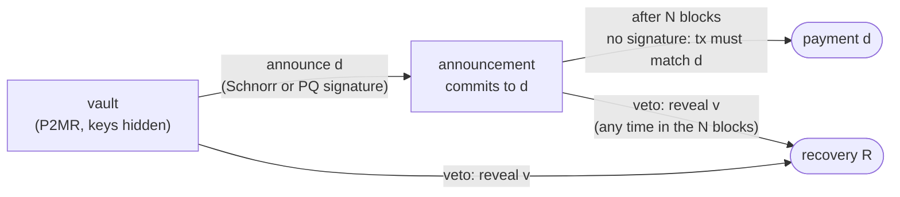

In [the previous post](/blog/2026/ctv-templates/) I went through every covenant proposal on the table, starting from the eight fields `OP_CHECKTEMPLATEVERIFY` hashes. This one asks a question the covenant debate and the quantum debate have mostly avoided asking each other:

**If a quantum computer can forge any elliptic-curve signature, which covenants still work, and can they keep your coins from being stolen?**

The two conversations have run in parallel for years. Covenant people argue about CTV versus `OP_TEMPLATEHASH` versus `OP_CAT`. Quantum people argue about [BIP-360](https://bips.dev/360/), hash-based signatures and whether to freeze vulnerable coins. Both groups compete for the same scarce resource, the next soft fork, and neither group's proposals are designed with the other's in mind.

The answer I arrive at is, I think, useful and a little surprising. Every quantum defence on the table tries to make the **signature** unforgeable. There is another way: arrange your coins so that a forged signature is **not enough to steal them**. The trick is to split every spend in two. First you announce, on chain, where the money is going. Then you wait. Then the next transaction executes the payment, and that transaction needs no signature at all. If someone forged your signature to announce a different destination, you have the waiting period to send the coins to safety with a secret only you hold.

Done right, **safety stops depending on the signature scheme**. Only convenience does. The signature can be ECDSA today, broken tomorrow, and the coins still cannot go anywhere you did not choose.

That idea is not entirely new; vaults have worked like this for years, and I will be precise below about who got where first. What I have not found anywhere is the analysis of *which* vault designs actually survive a quantum attacker (most do not, for reasons that are easy to miss), what exactly a covenant must be able to do for this to work (CTV alone cannot), and what the smallest change is that would make it possible on a post-quantum output type. That is the core of the thesis I am starting here.

A roadmap:

1. What a quantum computer breaks, and the migration proposals on the table.
2. Every covenant proposal, run through a quantum attacker.
3. Why covenants make the migration both harder and easier.
4. **Announce, wait, execute**: the construction, why it works, and why today's vaults fail it.
5. Hash-Locked Templates, a signature-free recovery layer to land in.
6. The thesis plan, with an honest account of what is new.

## What a quantum computer actually breaks

Two quantum algorithms matter for Bitcoin, and they matter very differently.

**Shor's algorithm** solves the discrete logarithm problem in polynomial time. Given a secp256k1 public key, it recovers the private key. The classic resource estimate for a 256-bit curve is on the order of a few thousand *logical* qubits (Roetteler et al., 2017), which translates into far more physical ones once error correction is counted. Estimates have kept falling: Craig Gidney's 2025 paper put RSA-2048 under a million noisy qubits, and the elliptic-curve estimates have followed a similar trend. Nobody knows when a *cryptographically relevant quantum computer* (CRQC) will exist. Nobody serious claims it cannot.

Once it does, ECDSA and Schnorr are finished, and with them everything built out of them: MuSig2, FROST, adaptor signatures, Taproot key tweaks.

**Grover's algorithm** gives a quadratic speedup for unstructured search. Against SHA-256 preimages it turns $$2^{256}$$ work into roughly $$2^{128}$$ quantum operations, which remain out of reach, and which cannot be parallelized as efficiently as classical search. For collisions, the best quantum algorithms do not beat classical birthday attacks once you account for memory. SHA-256 survives.

So the rule of thumb is simple: **whatever rests on elliptic curves breaks, whatever rests on SHA-256 survives.**

### Long exposure and short exposure

Two attack windows matter.

- A **long-exposure attack** targets a public key that sits on chain: old P2PK outputs, reused addresses, every Taproot output (whose output key *is* a public key). The attacker has all the time they want. According to [BIP-361](https://bips.dev/361/), as of 1 March 2026 more than 34% of all bitcoin sat in outputs whose public key had been revealed.
- A **short-exposure attack** targets a public key that only appears when you spend. Hashed outputs (P2PKH, P2WPKH, P2WSH) hide the key until then, but a spend puts it in the mempool, and an attacker fast enough to run Shor in the minutes before confirmation can sign a competing transaction with a higher fee and redirect the coins.

Hiding keys behind hashes defends against the first attack and does nothing against the second. The usual conclusion is that only an unforgeable signature defends against both. Keep that sentence in mind; most of this post is about why it is not quite true.

### The NUMS trap

A detail that is easy to get wrong. The standard way to "disable" a Taproot key path is to use a *nothing-up-my-sleeve* (NUMS) internal key: a point generated from a hash, whose discrete logarithm nobody knows.

Shor does not care whether anybody knows it. It computes it. A NUMS point is exactly as vulnerable as any other point, and a Taproot output with a NUMS internal key can be spent through its key path by a quantum attacker who never touches the script tree. **There is no way to build a quantum-safe Taproot output.** That is why BIP-360 had to define a new output type rather than a convention.

The good news, shown by Tim Ruffing in 2025, is that Taproot's commitment to the script tree remains binding even against a quantum adversary. So if a future soft fork disables key-path spends, the script leaves of existing Taproot outputs are still meaningful. Rescue plans lean on this.

## The migration proposals, briefly

As of September 2026, the post-quantum conversation has converged on a small set of documents. None is activated.

| proposal | what it does | status |
| --- | --- | --- |
| [BIP-360](https://bips.dev/360/) P2MR | *Pay-to-Merkle-Root*: SegWit v2, a Taproot script tree with no key path. Addresses start with `bc1z`. Solves long exposure, not short exposure. | merged as Draft, early 2026 |
| [BIP-361](https://bips.dev/361/) | Phase A stops new payments to quantum-vulnerable output types; Phase B, about two years later, restricts ECDSA/Schnorr spends to a quantum-safe rescue protocol, freezing coins that have not moved. | Draft, April 2026 |
| SHRINCS / `OP_CHECKSHRINCS` | Jonas Nick and Mikhail Kudinov's hash-based scheme: 48-byte public keys, ~548-byte stateful signatures with a ~5.8 KB stateless fallback. The signing state is public on chain, so wallets can check it. | draft BIP, spec still moving |
| SLH-DSA, Falcon, ML-DSA opcodes | NIST's standardized schemes, several proposals for how to verify them in tapscript and how to price their size | discussion |
| `OP_CHECKINPUTVERIFY` (OP_CIV) | Tadge Dryja, November 2025: an input can point at a sibling input's signature instead of carrying its own, so one post-quantum signature authorizes many inputs of the same owner | discussion |
| Quantum tripwires | BitMEX Research and others: activate a freeze only once someone proves a CRQC on chain, for example by spending coins locked to a NUMS key | discussion, 2026 |
| Rescue protocols | commit/reveal (DropKick, Lifeboat) and zk-STARK proofs of BIP-32 seed knowledge, to let owners of vulnerable coins prove ownership after Q-day | discussion and prototypes |
| Hourglass | rate-limit spends from exposed P2PK coins instead of freezing them | discussion |

The shape of the plan is: first give people somewhere safe to go (P2MR plus a post-quantum signature opcode), then make them go there (BIP-361). Every entry is about **signatures**: making them unforgeable, making them smaller, or making the forgeable ones stop working. Covenants appear in none of these documents.

## Covenant by covenant: who survives

Now take the list from the previous post and run each proposal through the rule of thumb.

| proposal | what its security rests on | after a CRQC |
| --- | --- | --- |
| **CTV** (BIP-119) | SHA-256 over transaction fields | **survives** |
| **`OP_TEMPLATEHASH`** (BIP-446) | SHA-256 over transaction fields | **survives**, in tapscript only |
| **`OP_TXHASH`** (BIP-346) | SHA-256 over selected fields | **survives** |
| **CSFS** (BIP-348) | BIP-340 Schnorr | **broken** |
| **APO** (BIP-118) | BIP-340 Schnorr with new sighash flags | **broken**; the sighash idea survives if ported to a PQ signature |
| **`OP_INTERNALKEY`** (BIP-349) | pushes an elliptic-curve point | **meaningless**: P2MR has no internal key to push |
| **`OP_PAIRCOMMIT`** (BIP-442) | SHA-256 | survives |
| **`OP_CAT`** (BIP-347) | nothing; it is byte manipulation | the opcode survives; the Schnorr trick is a special case, below |
| **CCV** (BIP-443) | data tweaked into a Taproot internal key | **broken as specified**: it lives in the exact part of Taproot that P2MR removes |
| **GSR** (BIPs 440/441) | nothing in particular | survives, and makes hash-based signatures in script cheaper |

Three rows deserve a closer look.

**CTV+CSFS, the combination with the most developer support, loses half of itself.** CTV keeps working; the re-bindable signatures that make LN-Symmetry, Ark rebinding and signed vault withdrawals possible do not. The *design* survives, since a CSFS that verified a post-quantum signature over a stack message would restore it, but no such opcode is specified.

**CCV** stores a contract's state by tweaking it into a Taproot internal key. A P2MR output has no internal key. As specified, it cannot move to a quantum-safe output type. This one matters more than it looks, and the [announce-wait-execute](#announce-wait-execute) section comes back to it.

**`OP_CAT` and the Schnorr trick** are the curious case. The trick uses the key $$G$$ with private key $$1$$, so its security never depended on the discrete logarithm being hard: the "private key" is public by design, and what the trick really relies on is that `OP_CHECKSIG` recomputes the sighash. A quantum computer changes nothing about that. But BIP-361's Phase B restricts ECDSA and Schnorr *verification*, and a naive implementation of that rule would kill every CAT covenant along with the coins it was meant to protect. The least quantum-sensitive use of Schnorr on the whole network would be caught by the sunset. At the same time, CAT is the only proposal on the list that lets script verify hash-based signatures (Lamport and Winternitz have been prototyped on signet), so it is simultaneously a victim and a tool of the migration.

### The output type matters as much as the opcode

A covenant is only as safe as the output it lives in, and here CTV's old design decision, to build on `OP_NOP4` rather than a tapscript `OP_SUCCESS`, pays off in a way nobody planned for.

| output type | keys exposed before spend? | covenant opcodes available |
| --- | --- | --- |
| bare script | only if the script contains one | CTV |
| P2WSH | no, only the script hash | CTV |
| P2TR | **yes**: the output key, always | everything tapscript-based, but the key path is breakable |
| P2MR | no | everything tapscript-based |

Every tapscript-only covenant needs P2MR to be quantum-safe. CTV is the only covenant proposal that can live in a quantum-safe output **without BIP-360**: a bare or P2WSH script containing CTV and no public key has nothing for Shor to attack.

## Covenants make the migration harder

Before the good news, the bad.

### A template cannot be re-signed

A template commits to its outputs forever. Suppose you build a vault today whose sweep template pays to a P2TR cold-storage address. Now BIP-361's Phase A activates and forbids new outputs of that type. The sweep transaction is no longer valid. Nobody can fix it, because there is no key to re-sign with: that was the point of the covenant. The coin has become an **Unsatisfiable UTXO created by a policy change**.

Pre-signed transactions have the same problem, but pre-signed transactions can be signed again by the parties who signed them the first time. Covenant templates cannot. And because a CTV template stays hidden until it is spent, nobody can even count how many such coins exist before the rule changes.

Two concrete consequences, both of which I think any sunset proposal has to address explicitly:

1. Phase A's list of forbidden output types matters enormously. The BIP text only says "quantum-vulnerable"; several summaries list every legacy type, P2WSH included. A rule that forbids new P2WSH or bare outputs would break templates whose outputs are perfectly quantum-safe.
2. Pay-to-anchor outputs (`OP_1 <0x4e73>`) are, technically, a SegWit v1 program. A blanket rule of "only P2MR outputs from now on" would break fee bumping for every CTV template ever written.

### Committing to the future is also dangerous

The mirror image: a template written *today* that pays to a future SegWit v2 (P2MR) output is committing to an output that is anyone-can-spend until BIP-360 activates. If the template is triggered before activation, anyone can take the coins. You cannot safely pre-commit to an output type that does not exist yet.

The practical rule is uncomfortable but clear: templates should pay only to outputs whose semantics are already enforced and will not be forbidden, and today no output type is guaranteed to satisfy both conditions.

## Covenants make the migration easier

Now the good news, and it is bigger than the bad.

### Covenants replace signature aggregation

Elliptic curves gave Bitcoin something no post-quantum scheme offers yet: cheap aggregation. MuSig2 lets a thousand people produce one 64-byte signature. Every protocol that coordinates many users off chain, covenant-less Ark, channel factories, statechains, BitVM committees, DLC adaptor signatures, is built on it.

There is no mature post-quantum equivalent. Lattice-based multi-signatures and threshold schemes are active research, and hash-based signatures do not aggregate at all.

OP_CIV attacks half of this problem: **one owner, many inputs**. A wallet consolidating fifty coins signs once and lets the other forty-nine inputs point at that signature. It does nothing for the other half: **many owners, one output**, which is exactly the shape of Ark, pools and factories. There, after a migration, every signer pays for their own post-quantum signature on every transaction they co-sign.

Take a covenant-less Ark round with 1,024 users in a binary tree. Be generous and assume each internal transaction only needs signatures from the users beneath it (implementations where every participant signs every node are worse). One user's unilateral exit publishes the ten transactions on the path to their leaf, signed by $$1024 + 512 + \dots + 2 = 2046$$ signers.

| exit path signed with | signature bytes on chain for one exit |
| --- | --- |
| MuSig2 (today, quantum-broken) | 10 × 64 B = **640 B** |
| SHRINCS, stateful (best case) | 2,046 × 548 B ≈ **1.1 MB** |
| ML-DSA-44 | 2,046 × 2,420 B ≈ **5.0 MB**: larger than a block |
| SLH-DSA-128s | 2,046 × 7,856 B ≈ **16 MB** |
| **CTV templates** | **0 B**: no signatures in the tree at all |

Under these assumptions, one user's ML-DSA exit would not fit in a single block. A CTV tree's exit path is ten small transactions of roughly 140 vbytes each, with no signatures, and that cost does not change when elliptic curves break.

**In a post-quantum Bitcoin, covenants stop being a convenience and become the only practical way to coordinate many users off chain.** The common argument that covenants can wait until after the quantum migration gets the dependency backwards. OP_CIV and covenants are complements, not alternatives: one fixes signatures per owner, the other removes signatures between owners.

### Revealing a secret becomes harmless

The second piece of good news goes back to a pattern from the previous post. In a CTV Discreet Log Contract, the oracle's attestation reveals a secret, anyone can then complete the spend, and that is fine, because the template fixes where the money goes.

That pattern, **a covenant that makes it harmless for the world to learn your secret**, is the lever for everything that follows. A quantum computer's whole power is learning secrets it should not know. If learning them does not let you redirect money, the power is gone.

## Announce, wait, execute

### Where theft actually happens

Look at what a spend is. It bundles two things: a **choice** (where the money goes) and an **authorization** (proof that the owner made that choice). Today both arrive in the same transaction, in the same instant, and the authorization is a signature.

A quantum computer attacks the authorization. With the owner's public key it can forge a signature, and since the choice travels together with the authorization, forging one means making your own choice: your address, your outputs, a higher fee to win the race.

BIP-360 hides the public key until the spend, which removes the long-exposure attack. But the spend itself still reveals the key, and in that transaction the choice becomes final. Nothing can react to it afterwards. So the only remaining defences are to make the signature unforgeable (post-quantum signatures) or to hope the attacker's computer is slower than a block.

There is a third option: **separate the choice from its execution, and put a window in between during which the choice can be vetoed by something a quantum computer cannot forge.**

### The construction

Every spend becomes up to three transactions.

1. **Announce.** The owner spends the vault output into an *announcement* output that records, on chain, the exact transaction that will eventually be executed, as a template hash $$d$$. This step is authorized by a signature, and it can be an ordinary Schnorr signature.
2. **Wait.** The announcement output cannot be spent for $$N$$ blocks, say 144, a day.
3. **Execute.** After the wait, the announced transaction is published. It needs **no signature at all**: the announcement output's script only checks that the spending transaction matches $$d$$. Anyone can broadcast it.

And at any time, from the vault or from an announcement:

- **Veto.** Whoever knows a secret $$v$$ can move the coins to a pre-committed recovery output $$R$$, and only there. The veto reveals $$v$$, which is harmless, because the destination is fixed.



In pseudo-script, with the covenant operations written out in words:

```
Vault leaf "announce":   <pk_a> CHECKSIG
                          + output 0 must be Announcement(d), same amount, for the d in the witness
Vault leaf "veto":        SHA256 <H(v)> EQUALVERIFY
                          + output 0 must be R, same amount

Announcement(d) leaf "execute":  <N> CHECKSEQUENCEVERIFY DROP
                                 + this transaction's template hash must equal d
Announcement(d) leaf "veto":     SHA256 <H(v)> EQUALVERIFY
                                 + output 0 must be R, same amount
```

### Why a quantum attacker cannot steal

Walk through what a CRQC can do at each point.

- **At rest.** The vault is a P2MR output. There is no public key on chain, so there is nothing to run Shor on.
- **At announcement.** The owner's Schnorr key appears in the mempool. A fast enough attacker forges a signature and announces their own destination $$d'$$, perhaps outbidding the owner's announcement. Either way, what lands on chain is an announcement. If it is the attacker's, the owner's watchtower sees an announcement it did not expect and vetoes it within $$N$$ blocks. The coins go to $$R$$.
- **At execution.** There is no signature to forge. The transaction is exactly $$d$$, fixed on chain a day earlier.
- **At veto.** The secret $$v$$ becomes public, and the only thing anyone can do with it is move coins to $$R$$, where the owner wanted them.

The worst an attacker can achieve is to force the coins into recovery. That is **griefing, not theft**, and it takes a quantum computer fast enough to break a fresh key within a block, plus fees, for every attempt.

Stated a little more carefully, this is the claim the thesis has to prove:

> **Safety.** If a vault satisfies the four requirements below, and a watchtower holding $$v$$ can get a transaction confirmed within $$N$$ blocks, then no adversary, whatever its quantum or classical power, can move the vault's coins to any destination other than one the owner announced or the recovery output $$R$$. The argument only assumes that SHA-256 is preimage- and second-preimage-resistant.

Notice what is missing from that statement: the signature scheme. **Safety does not depend on the signature at all. Only liveness does.**

| announcement authorized by | who can make a false announcement | result |
| --- | --- | --- |
| Schnorr, before Q-day | nobody | payments go through |
| Schnorr, after Q-day, attacker slower than a block | nobody in practice: each announcement key is fresh and hidden until used | payments go through |
| Schnorr, after Q-day, attacker faster than a block | the attacker | payment vetoed, coins in recovery |
| a hash preimage alone | anyone watching the mempool | vetoed: griefing by anyone, a bad choice |
| a post-quantum signature | nobody | payments go through |
| **in every row** | | **nothing is stolen** |

That is the property I find most useful. Coins can be made theft-proof against a quantum computer **with the signatures Bitcoin already has**, and post-quantum signatures, whenever they arrive, only remove the griefing. The migration no longer has a cliff where coins go from safe to stealable.

### The four requirements

Getting this right is fiddly, and every existing vault design I checked breaks at least one of these.

- **R1: no elliptic-curve key at rest.** The vault and every output it can reach must be P2MR, P2WSH or bare script, never P2TR, not even with a NUMS internal key, because Shor computes NUMS keys too.
- **R2: the choice is on chain before the wait.** The destination must be fixed in the announcement, and the execution must need no signature. If the flexible choice happens after the delay, the delay protects nothing.
- **R3: the veto cannot be turned into theft.** It must be authorized by a hash preimage (or anything else unforgeable) and pinned to $$R$$ by the covenant.
- **R4: the recovery is itself safe.** $$R$$ must satisfy R1 to R3 with fresh secrets, or be a fixed-destination output such as the Hash-Locked Templates below. Otherwise the attacker simply waits for the coins to land there.

### Auditing today's vaults

Now take the vault designs people have actually built and run them through the requirements. Pick a design and an attacker:

<div class="demo-block" id="awe-tool">
    <h6 class="demo-heading">Vault designs against a quantum attacker</h6>
    <div class="demo-modes" id="awe-design"></div>
    <div class="demo-modes" id="awe-attacker"></div>
    <div class="awe-stages" id="awe-stages"></div>
    <div class="demo-note" id="awe-note"></div>
</div>

<style>
#awe-tool .awe-stages { display: grid; grid-template-columns: repeat(3, 1fr); gap: 1rem; margin-bottom: 1.2rem; }
@media (max-width: 700px) { #awe-tool .awe-stages { grid-template-columns: 1fr; } }
#awe-tool .awe-stage { padding: 0.7rem 0.9rem; border-radius: 4px; background: var(--demo-surface); }
#awe-tool .awe-stage-name { display: block; font-size: 0.68rem; letter-spacing: 0.09em; text-transform: uppercase;
  color: var(--global-text-color-light); margin-bottom: 0.3rem; }
#awe-tool .awe-stage-verdict { display: block; font-weight: 600; font-size: 0.95rem; }
#awe-tool .awe-stage-why { display: block; font-size: 0.76rem; line-height: 1.5; margin-top: 0.35rem;
  color: var(--global-text-color-light); }
#awe-tool .awe-safe { color: var(--demo-s); }
#awe-tool .awe-grief { color: var(--demo-r); }
#awe-tool .awe-stolen { color: var(--demo-pad); }
#awe-tool .demo-modes { margin-bottom: 0.9rem; }
</style>

<script>
(function () {
  // Each design lists three stages. Each stage maps the attacker to a verdict:
  // 's' safe, 'g' griefed into recovery, 'x' stolen, and a one-line reason.
  var ATTACKERS = [
    { id: 'none', label: 'no CRQC' },
    { id: 'slow', label: 'slow CRQC (hours per key)' },
    { id: 'fast', label: 'fast CRQC (minutes per key)' }
  ];
  var DESIGNS = [
    { id: 'p2tr', label: 'Plain P2TR wallet', stages: [
      ['at rest', { none: ['s', 'Nobody can break the key.'], slow: ['x', 'The output key is on chain. Shor has all the time it needs.'], fast: ['x', 'The output key is on chain.'] }],
      ['spend', { none: ['s', 'A normal signature.'], slow: ['x', 'Already gone.'], fast: ['x', 'Already gone.'] }],
      ['after', { none: ['s', '—'], slow: ['x', '—'], fast: ['x', '—'] }]
    ], note: 'Every Taproot output publishes its key, NUMS internal key or not. This is the long-exposure attack.' },
    { id: 'p2mr', label: 'P2MR + Schnorr leaf', stages: [
      ['at rest', { none: ['s', 'No key on chain.'], slow: ['s', 'No key on chain.'], fast: ['s', 'No key on chain.'] }],
      ['spend', { none: ['s', 'A normal signature.'], slow: ['s', 'The key appears in the mempool, but the transaction confirms before Shor finishes.'], fast: ['x', 'The key appears in the mempool; a forged signature with a higher fee redirects the coins.'] }],
      ['after', { none: ['s', '—'], slow: ['s', '—'], fast: ['x', '—'] }]
    ], note: 'BIP-360 alone fixes long exposure. The choice and the signature still arrive in the same transaction, so a fast attacker wins the short-exposure race.' },
    { id: 'ctv', label: 'CTV vault (P2WSH)', stages: [
      ['at rest', { none: ['s', 'Script hash only.'], slow: ['s', 'Script hash only.'], fast: ['s', 'Script hash only.'] }],
      ['trigger', { none: ['s', 'Keyless CTV unvault.'], slow: ['s', 'Keyless CTV unvault.'], fast: ['s', 'Keyless CTV unvault.'] }],
      ['withdraw', { none: ['s', 'Hot key signs after the delay.'], slow: ['s', 'Confirms before Shor finishes.'], fast: ['x', 'The destination is chosen here, after the delay, by a signature. The attacker forges it and races; the sweep can only join a fee war.'] }]
    ], note: 'Fails R2. The delay comes before the choice, so it protects nothing against a forged signature. Fixing it needs the destination on chain at trigger time, which CTV cannot carry.' },
    { id: 'presigned', label: 'Pre-signed vault (P2WSH)', stages: [
      ['at rest', { none: ['s', 'Script hash only; the key was deleted.'], slow: ['s', 'Script hash only, as long as the pre-signed transactions never leak.'], fast: ['s', 'Script hash only.'] }],
      ['trigger', { none: ['s', 'Pre-signed unvault.'], slow: ['s', 'Confirms before Shor finishes.'], fast: ['x', 'Broadcasting reveals the "deleted" key. Shor recomputes it and signs a competing spend of the vault straight to the attacker.'] }],
      ['withdraw', { none: ['s', 'Pre-signed or hot key.'], slow: ['s', 'Confirms before Shor finishes.'], fast: ['x', 'Same race again, with the next key.'] }]
    ], note: 'Key deletion is not quantum-safe. Whatever the deleted key could sign, a quantum attacker who sees its public key can sign again, including a spend that skips the vault entirely.' },
    { id: 'ccv', label: 'CCV / OP_VAULT (P2TR)', stages: [
      ['at rest', { none: ['s', 'NUMS internal key.'], slow: ['x', 'P2TR key path: Shor computes the NUMS key, tweak included, and spends directly.'], fast: ['x', 'Same.'] }],
      ['trigger', { none: ['s', 'Destination committed at trigger.'], slow: ['x', '—'], fast: ['x', '—'] }],
      ['withdraw', { none: ['s', 'Keyless CTV to the committed hash.'], slow: ['x', '—'], fast: ['x', '—'] }]
    ], note: 'The logic is exactly right (R2 and R3 hold), but it lives in P2TR, and CCV stores its data in the very internal key that P2MR removes. Fails R1 only.' },
    { id: 'awe', label: 'Announce-wait-execute (P2MR)', stages: [
      ['at rest', { none: ['s', 'No key on chain.'], slow: ['s', 'No key on chain.'], fast: ['s', 'No key on chain.'] }],
      ['announce', { none: ['s', 'Schnorr signature over the announcement.'], slow: ['s', 'Fresh key, confirmed before Shor finishes.'], fast: ['g', 'The attacker forges an announcement to their own address. The watchtower vetoes it within N blocks: coins go to recovery.'] }],
      ['execute', { none: ['s', 'No signature, tx must match d.'], slow: ['s', 'No signature to forge.'], fast: ['s', 'No signature to forge.'] }]
    ], note: 'Worst case is griefing: the coins end up in recovery, never with the attacker. Swap the announcement signature for a post-quantum one and even that goes away.' }
  ];

  var design = 'ctv', attacker = 'fast';
  var VERDICT = {
    s: ['awe-safe', 'safe'],
    g: ['awe-grief', 'griefed → recovery'],
    x: ['awe-stolen', 'stolen']
  };

  function el(id) { return document.getElementById(id); }

  function buttons(container, items, current, onPick) {
    el(container).innerHTML = items.map(function (it) {
      return '<button class="demo-mode' + (it.id === current ? ' is-active' : '') + '" data-id="' + it.id + '">' + it.label + '</button>';
    }).join('');
    el(container).querySelectorAll('button').forEach(function (b) {
      b.addEventListener('click', function () { onPick(b.dataset.id); });
    });
  }

  function render() {
    buttons('awe-design', DESIGNS, design, function (id) { design = id; render(); });
    buttons('awe-attacker', ATTACKERS, attacker, function (id) { attacker = id; render(); });
    var d = DESIGNS.filter(function (x) { return x.id === design; })[0];
    el('awe-stages').innerHTML = d.stages.map(function (st) {
      var r = st[1][attacker], v = VERDICT[r[0]];
      return '<div class="awe-stage"><span class="awe-stage-name">' + st[0] + '</span>' +
        '<span class="awe-stage-verdict ' + v[0] + '">' + v[1] + '</span>' +
        '<span class="awe-stage-why">' + r[1] + '</span></div>';
    }).join('');
    el('awe-note').textContent = d.note;
  }

  if (document.readyState === 'loading') document.addEventListener('DOMContentLoaded', render);
  else render();
})();
</script>

Two findings from that audit surprised me.

**The canonical CTV vault is not quantum-safe, even in P2WSH.** Its delay sits between the vault and the unvault output, but the actual choice of destination is made at the very end, by a hot-key signature, with nothing after it to react. Against a fast quantum attacker, the sweep path only joins a fee war over the full balance.

**Pre-signed vaults are worse than they look.** Their whole security rests on a deleted private key. But the matching public key still exists, and it appears on chain the moment a pre-signed transaction is broadcast. Shor turns a public key back into a private key. **A quantum computer undeletes keys.** Every protocol that relies on "sign, then delete" loses its guarantee on Q-day: covenant emulation, pre-signed Ark trees, BitVM graphs signed by committees that promised to delete.

Meanwhile the designs with the right *logic*, OP_VAULT and the CCV vault (destination committed at trigger, keyless execution, recovery pinned to one address) fail only because they live in P2TR.

### Why CTV is not enough, and what is

The first instinct is to build this with CTV, the one covenant that survives Shor intact. It does not work, and the reason is general enough to state as a lemma.

> **Lemma (choice and reveal cannot be separated with templates).** Take an output whose scripts use only template covenants (CTV, `OP_TEMPLATEHASH`) and signature checks. Any spend of it to a destination that was not fixed when the output was created must be authorized by a signature that appears in that same spending transaction.
>
> *Sketch.* A template covenant restricts the spending transaction to a set of transactions fixed at creation. The only way to reach anything outside that set is through a branch whose condition is a signature, evaluated in the spending transaction itself. To let a *later* transaction react to that choice, the choice would have to be written into the script of a new output. That script would then depend on data supplied at spend time, and templates cannot compute new scripts; they can only compare against scripts fixed in advance. ∎

CTV+CSFS does not escape this: CSFS lets a key sign a template, but the signature still has to appear in the transaction it authorizes. So with CTV, CSFS or `OP_TEMPLATEHASH` you get either fixed destinations (the Hash-Locked Templates below) or flexible destinations exposed to short-exposure forgery, never both.

What R2 needs is a **state-carrying** covenant: one that lets the announcement write the value $$d$$ into the script of the next output. On the current list:

| primitive | can carry $$d$$ into the next output? | quantum-safe as specified? |
| --- | --- | --- |
| CTV, TEMPLATEHASH, CSFS | no | CTV and TEMPLATEHASH yes, CSFS no |
| OP_VAULT (BIP-345) | yes, the target hash at trigger | no: P2TR; also withdrawn |
| **CCV** (BIP-443) | **yes**, as data in the output | **no**: the data lives in a Taproot internal key |
| OP_CAT (BIP-347), via the Schnorr trick | yes, by assembling the next script | fragile: needs Schnorr verification, which BIP-361 Phase B restricts |
| TXHASH + CAT | yes | yes, in P2MR |
| GSR (BIPs 440/441) | yes | yes, in P2MR |

### A small change: CCV for P2MR

CCV has exactly the right semantics and the wrong storage. It commits a contract's data by tweaking the Taproot internal key, $$P' = P + H(P \parallel d) \cdot G$$. That is elliptic-curve arithmetic, and P2MR has no internal key to tweak.

The fix looks small. In a P2MR tree, reserve one leaf for data:

$$\text{root} = \text{TapBranch}\big(\text{DataLeaf}(d),\ T\big), \qquad \text{DataLeaf}(d) = H_{\text{tag}}(\texttt{"CCV/data"} \parallel d)$$

where $$T$$ is the root of the ordinary script tree. Because the data leaf is hashed under a different tag than real script leaves, no script can ever match it, so it is unspendable by construction. A P2MR variant of `OP_CHECKCONTRACTVERIFY` would then:

- **for the current input**: take $$d$$ from the stack and check that $$\text{DataLeaf}(d)$$ is the top sibling in the control block being executed;
- **for an output**: take $$d$$ and the expected tree root $$T'$$ and check that the output's witness program is $$\text{TapBranch}(\text{DataLeaf}(d), T')$$, along with CCV's existing amount rules.

It costs 32 extra bytes of control block per spend, it involves no elliptic-curve operation anywhere, and it is cheaper to validate than the key-tweak version. I have not seen it proposed; it is a sketch, and specifying it properly (including CCV's amount semantics and how a script finds "its own" tree) is one of the concrete deliverables of the thesis.

### Watchtowers you can trust with nothing

One more property, which I think matters in practice. The veto secret $$v$$ can only ever move coins to $$R$$. So you can hand $$v$$ to as many watchtowers as you like, run by people you do not trust at all. The worst a malicious watchtower can do is veto your own legitimate payment, which is griefing again, and it can be caught and replaced.

Compare that with any watchtower today, which either holds a key (and could steal) or holds pre-signed transactions (whose deleted keys a quantum computer brings back).

### What it costs

- **Latency.** Every payment waits $$N$$ blocks. For savings and treasuries that is a feature; for buying coffee it is a non-starter, so this is custody, not a spending wallet.
- **Two transactions per payment** instead of one. The execution transaction is small (no signature), and its fee can come from a pay-to-anchor output.
- **Someone has to watch** during the delay: the same assumption Lightning makes, with the difference that here the watcher needs no trust.
- **Rotation.** The announcement leaf uses Schnorr. Before BIP-361's Phase B restricts Schnorr, the owner should rotate each vault into one whose announcement leaf uses a post-quantum signature. Rotation is itself just an announce and an execute, and the coins stay theft-proof throughout.

### A worked example

Alice keeps 5 BTC of savings. With P2MR and a CCV-style covenant active, her wallet creates a vault with:

- an announcement leaf under a fresh Schnorr key, derived from her seed and never shown on chain;
- a veto leaf under the hash of a secret $$v$$, which she gives to three watchtowers;
- a recovery output $$R$$: a second vault with fresh keys and secrets, whose own recovery is a set of fixed-destination Hash-Locked Templates in deep cold storage;
- $$N = 144$$ blocks.

To pay 0.5 BTC for a car, her wallet builds the payment transaction (0.5 BTC to the dealer, the rest to a fresh vault, a small anchor for fees), hashes it into $$d$$ and announces it. A day later anyone executes it.

Suppose it is 2035 and a fast quantum computer exists. The attacker sees her announcement key in the mempool, forges a signature, outbids her, and announces a transfer of 5 BTC to themselves. It confirms. Her watchtowers see an announcement whose $$d$$ they were not told about and broadcast the veto. The 5 BTC go to $$R$$. The attacker has spent a fast quantum computation and a large fee, and gained nothing. Alice's payment is a day later than planned.

## Where the coins land: Hash-Locked Templates

Requirement R4 asks for a recovery output that is safe even if every signature scheme is broken. Recursing into another vault works, but the chain has to end somewhere. The simplest end is an output that can only go to destinations fixed in advance, authorized by nothing but hash preimages. With CTV that is easy, and it works in P2WSH the day CTV activates, without BIP-360.

This part is **not new**. It is the same pattern as the CTV DLC above and close to Erik Aronesty's February 2026 quantum-vault proposal on bitcoin-dev, which reached the same "attackers can only delay" conclusion with CTV plus `OP_TXHASH`. I include it because the full construction needs a landing zone, and because working through its costs and limits carefully turned up a couple of things worth writing down.

A Hash-Locked Template (HLT) output commits to $$k$$ leaves, each pairing a template with a hash lock:

```
Leaf i:    <T_i> OP_CHECKTEMPLATEVERIFY OP_DROP OP_SHA256 <h_i> OP_EQUAL
Witness:   <p_i>
```

$$T_i$$ is the CTV hash of a transaction the owner may want to make, $$p_i$$ a 32-byte secret derived from the seed with hash functions only, and $$h_i = \text{SHA256}(p_i)$$. In P2WSH the leaves are branches of an `OP_IF` tree (roughly 48 fit within standardness limits); in P2MR they are leaves of the script tree and only the one used is ever revealed.

The security argument is the one from the announce-wait-execute section, compressed:

- **Outputs are fixed.** Any valid spend has the outputs of some $$T_i$$; anything else needs a SHA-256 second preimage, about $$2^{128}$$ work even with Grover.
- **Only the owner can trigger a leaf**, because only the owner knows $$p_i$$ until it is used.
- **Revealing $$p_i$$ is harmless.** All anyone can do with it is broadcast the transaction the owner already chose. There is no signature in the mempool to forge, so there is no short-exposure attack.

### The reuse attack

One subtlety deserves a name. Templates float: CTV does not commit to which coin is being spent. If the same HLT address receives two coins, $$X$$ and later $$Y > X$$, and the owner spends the first through leaf $$i$$, then $$p_i$$ is public and leaf $$i$$ is equally valid for the second coin. Anyone can push $$Y$$ through the same template, whose outputs were sized for $$X$$, and **the miner collects $$Y - X$$ as fee**. The rule is strict: *each HLT root funds exactly one UTXO*, and each secret belongs to exactly one leaf. Wallets must enforce it, because consensus cannot see it.

### What it costs

| spend | witness (weight units) |
| --- | --- |
| P2WPKH (ECDSA, today, quantum-broken) | ~108 |
| **HLT in P2WSH**, one leaf | ~105 |
| **HLT in P2MR**, depth 10 (1,024 leaves) | ~427 |
| **HLT in P2MR**, depth 20 (~1M leaves) | ~747 |
| SHRINCS stateful in a P2MR leaf | ~606 |
| ML-DSA-44 in a P2MR leaf | ~3,740 |
| SLH-DSA-128s in a P2MR leaf | ~7,900 |

The witness is cheap. The real cost is elsewhere: an HLT address commits to its whole future. A template that sends change to a fresh HLT root commits to that root, which commits to all of its templates, and so on, so generating an address means hashing every template it could ever lead to. With $$k$$ leaves per node and $$h$$ spends, that is $$\sum_{j=1}^{h} k^j$$ templates. XMSS-style schemes avoid this by having upper trees *sign* lower roots when they are needed; doing the same here would need a hash-based signature check over a stack element, which is `OP_CAT` with Winternitz or a post-quantum CSFS. For a recovery layer, where a handful of destinations is enough, the exponent never bites. Try it:

<div class="demo-block" id="hlt-tool">
    <h6 class="demo-heading">Hash-Locked Template sizing</h6>
    <div class="hlt-grid">
      <div>
        <div class="demo-modes" id="hlt-mode">
          <button class="demo-mode is-active" data-mode="p2mr">P2MR</button>
          <button class="demo-mode" data-mode="p2wsh">P2WSH</button>
        </div>
        <div class="demo-field">
          <label for="hlt-dest">destinations</label>
          <input type="number" id="hlt-dest" value="4" min="1" max="64">
        </div>
        <div class="demo-field">
          <label for="hlt-fee">fee levels</label>
          <input type="number" id="hlt-fee" value="4" min="1" max="64">
        </div>
        <div class="demo-field">
          <label for="hlt-hops">spends before re-keying</label>
          <input type="number" id="hlt-hops" value="3" min="1" max="6">
        </div>
        <div class="demo-note mt-3" id="hlt-note"></div>
      </div>
      <div>
        <div class="demo-stats">
          <div><span class="demo-stat-value" id="hlt-leaves">–</span><span class="demo-stat-label">leaves per output</span></div>
          <div><span class="demo-stat-value" id="hlt-wu">–</span><span class="demo-stat-label">witness WU per spend</span></div>
        </div>
        <div class="demo-stats">
          <div><span class="demo-stat-value" id="hlt-templates">–</span><span class="demo-stat-label">templates to precompute</span></div>
        </div>
        <div id="hlt-bars"></div>
      </div>
    </div>
</div>

<style>
#hlt-tool .hlt-grid { display: grid; grid-template-columns: 1fr 1fr; gap: 2rem; }
@media (max-width: 700px) { #hlt-tool .hlt-grid { grid-template-columns: 1fr; } }
#hlt-tool .demo-stats { gap: 2.5rem; }
#hlt-tool .hlt-bar { display: flex; align-items: center; gap: 0.6rem; margin-bottom: 0.35rem;
  font-size: 0.72rem; color: var(--global-text-color-light); }
#hlt-tool .hlt-bar-label { flex: 0 0 40%; }
#hlt-tool .hlt-bar-track { flex: 1 1 auto; height: 0.55rem; }
#hlt-tool .hlt-bar-fill { height: 100%; border-radius: 2px; background: var(--demo-quiet); }
#hlt-tool .hlt-bar-fill.is-hlt { background: var(--demo-s); }
#hlt-tool .hlt-bar-fill.is-broken { background: var(--demo-pad); }
</style>

<script>
(function () {
  var mode = 'p2mr';
  var LEAF = 70;          // <T> CTV DROP SHA256 <h> EQUAL
  var P2WSH_STANDARD = 3600, P2WSH_CONSENSUS = 10000;
  var RATE = 1e6;         // assumed templates hashed per second, for the time estimate

  // Witness sizes in weight units for the comparison bars, P2MR leaf with no
  // special discount: item count + signature + script with the key + control block.
  var REF = [
    { n: 'ECDSA P2WPKH (broken)', wu: 108, c: 'is-broken' },
    { n: 'SHRINCS stateful', wu: 606, c: '' },
    { n: 'Falcon-512', wu: 1573, c: '' },
    { n: 'ML-DSA-44', wu: 3742, c: '' },
    { n: 'SLH-DSA-128s', wu: 7898, c: '' }
  ];

  function el(id) { return document.getElementById(id); }
  function fmt(n) { return Math.round(n).toLocaleString('en-US'); }
  function clamp(v, lo, hi) { return Math.max(lo, Math.min(hi, v)); }

  function recompute() {
    var d = clamp(parseInt(el('hlt-dest').value || 1, 10), 1, 64);
    var f = clamp(parseInt(el('hlt-fee').value || 1, 10), 1, 64);
    var h = clamp(parseInt(el('hlt-hops').value || 1, 10), 1, 6);
    var k = d * f;
    var depth = Math.ceil(Math.log2(k));
    var wu, note = '';

    if (mode === 'p2mr') {
      // count + preimage + leaf script + control block (1 + 32 per level)
      wu = 1 + 33 + (LEAF + 1) + (1 + 1 + 32 * depth);
    } else {
      // count + preimage + one selector per IF level + the whole script
      var script = k * (LEAF + 2) + 1;
      wu = 1 + 33 + 2 * depth + script + (script < 253 ? 1 : 3);
      if (script > P2WSH_CONSENSUS) note = '<strong>Invalid:</strong> the script is ' + fmt(script) +
        ' bytes, over the 10,000-byte consensus limit for P2WSH. Use P2MR.';
      else if (script > P2WSH_STANDARD) note = '<strong>Non-standard:</strong> the script is ' + fmt(script) +
        ' bytes, over the 3,600-byte relay limit. Valid, but you would need a miner to include it directly.';
    }

    // Every leaf's change goes to a distinct next root, so the spend graph
    // branches k ways at each hop, and every template in it must exist up front.
    var templates = 0;
    for (var i = 1; i <= h; i++) templates += Math.pow(k, i);

    el('hlt-leaves').textContent = fmt(k);
    el('hlt-wu').textContent = fmt(wu);
    el('hlt-templates').textContent = templates >= 1e15 ? templates.toExponential(1) : fmt(templates);

    var secs = templates / RATE, time;
    if (secs < 1) time = 'under a second';
    else if (secs < 3600) time = fmt(secs) + ' seconds';
    else if (secs < 86400 * 365) time = fmt(secs / 3600) + ' hours';
    else time = (secs / (86400 * 365)).toExponential(1) + ' years';
    if (!note) note = 'Generating this address means hashing every template in its future: about <strong>' + time +
      '</strong> at a million templates per second. That exponent is why HLT works as a recovery layer and not as a wallet.';
    el('hlt-note').innerHTML = note;

    var rows = [{ n: 'this HLT', wu: wu, c: 'is-hlt' }].concat(REF);
    var max = Math.log10(10000);
    el('hlt-bars').innerHTML = rows.map(function (r) {
      var w = clamp(Math.log10(r.wu) / max * 100, 2, 100);
      return '<div class="hlt-bar"><span class="hlt-bar-label">' + r.n + ' · ' + fmt(r.wu) + '</span>' +
        '<span class="hlt-bar-track"><span class="hlt-bar-fill ' + r.c + '" style="display:block;width:' + w + '%"></span></span></div>';
    }).join('');
  }

  function init() {
    ['hlt-dest', 'hlt-fee', 'hlt-hops'].forEach(function (id) { el(id).addEventListener('input', recompute); });
    el('hlt-mode').querySelectorAll('button').forEach(function (b) {
      b.addEventListener('click', function () {
        mode = b.dataset.mode;
        el('hlt-mode').querySelectorAll('button').forEach(function (x) { x.classList.toggle('is-active', x === b); });
        recompute();
      });
    });
    recompute();
  }
  if (document.readyState === 'loading') document.addEventListener('DOMContentLoaded', init);
  else init();
})();
</script>

<sub>*Bars on a log scale. Post-quantum witness sizes assume the signature and public key sit in a P2MR leaf with no special discount; several proposals would add one.*</sub>

## The thesis

> **Working title:** *Separating safety from signatures: theft-proof Bitcoin custody against quantum adversaries with covenants.*
>
> **Abstract (draft).** Every current proposal for protecting Bitcoin against quantum computers works on the signature: making it unforgeable, smaller, or disabling the forgeable ones. We study the complementary approach of making a forged signature insufficient to steal. We show that a spend becomes theft-proof against an adversary of unbounded quantum power if the destination is committed on chain before a waiting period, the execution requires no signature, and a veto that can only return the coins to a pre-committed recovery output is available throughout, with security reducing to SHA-256 and to a watchtower's ability to confirm a transaction within the waiting period. We give four necessary requirements, audit the existing vault designs against them (none passes: the canonical CTV vault fails because its choice follows the delay, pre-signed vaults fail because quantum computers recover deleted keys, and CCV and OP_VAULT vaults fail only because they live in Taproot), prove that template-only covenants cannot meet them, and sketch a minimal P2MR variant of `OP_CHECKCONTRACTVERIFY` that can. The resulting construction keeps coins safe with the ECDSA and Schnorr signatures Bitcoin already has; post-quantum signatures only restore liveness.

### Research questions

- **RQ1.** Under what exact conditions is a covenant-based spending policy theft-proof against a quantum adversary, independently of the signature scheme it uses?
- **RQ2.** Which existing vault and covenant designs meet those conditions, and why do the others fail?
- **RQ3.** What is the minimal covenant functionality that meets them on a post-quantum output type, and how close are the current proposals?
- **RQ4.** What does it cost, in latency, block space and watchtower assumptions, and how does it interact with BIP-360, BIP-361 and post-quantum signature opcodes?

### What is new here, and what is not

I tried to be honest about this, and I have probably still missed things. Corrections very welcome.

| idea | status |
| --- | --- |
| CTV, TEMPLATEHASH and TXHASH survive Shor; CSFS, APO and CCV as specified do not | a synthesis; each fact is straightforward, but I have not found the table written down elsewhere |
| CTV is the only covenant usable in a quantum-safe output without BIP-360 | not found written; likely noticed by others |
| Covenants replace aggregation for *many owners, one output*; OP_CIV covers *one owner, many inputs* | OP_CIV is Dryja's; the multi-party quantification and the complementarity argument I have not found |
| Immutable templates versus BIP-361's Phase A (templates that pay to banned output types, pay-to-anchor, pre-committing to SegWit v2) | not found in the BIP or its discussion |
| Covenant vaults keep quantum attackers to griefing | **known**: Aronesty (February 2026) |
| Hash-locked CTV templates as a signature-free spend | **known pattern** (CTV DLCs, commit/reveal schemes, Aronesty) |
| Using the chain's public state to keep one-time keys safe | **known**: SHRINCS already exploits this |
| The four requirements, and that safety is independent of the signature scheme | not found stated this way |
| The audit: CTV vault fails R2, pre-signed vaults fail because Shor undeletes keys, CCV/OP_VAULT fail only R1 | not found; the September 2026 vault comparison by Lillian Wang does not consider quantum attackers |
| The choice-and-reveal lemma for template covenants | not found |
| CCV for P2MR with a data leaf | not found; a sketch |
| Untrusted watchtowers via a pinned veto secret | keyless recovery is known from CCV vaults; the quantum argument for it is not |

### Plan

| chapter | content | status |
| --- | --- | --- |
| 1. Introduction and threat model | CRQC capabilities, long- and short-exposure attacks, slow and fast adversaries, adversary definitions | drafted here |
| 2. Background | covenants ([previous post](/blog/2026/ctv-templates/)), post-quantum signatures, BIP-360/361, OP_CIV | drafted |
| 3. Covenants under a quantum adversary | per-proposal analysis, output types, migration hazards, the aggregation argument | drafted here |
| 4. Announce, wait, execute | model, requirements R1 to R4, safety theorem and proof (QROM for SHA-256), liveness analysis per signature type | construction drafted, proofs to do |
| 5. Impossibility and audit | choice-and-reveal lemma with proof; audit of CTV, pre-signed, OP_VAULT, CCV, Purrfect, APO and TXHASH vaults | lemma sketched, audit drafted |
| 6. CCV for P2MR | specification of the data-leaf commitment, amount semantics, validation cost, reference implementation | sketch |
| 7. Implementation | announce-wait-execute on a regtest fork with BIP-360 and CCV-MR; the same logic with `OP_CAT` on Inquisition signet as a proof of concept; HLT recovery on signet with CTV | to do |
| 8. Evaluation | latency and fees against historical mempool data, watchtower response requirements, griefing cost for the attacker, comparison with SHRINCS-only custody | to do |
| 9. Migration | rotation from Schnorr to post-quantum announcement keys, recommendations for BIP-361 on templates and signature-free spends | open |

### Open questions

1. **How large must $$N$$ be?** It has to cover a watchtower's detection time plus the worst plausible censorship of its veto. Lightning's `to_self_delay` is the natural starting point, but the value at stake per UTXO is different.
2. **Can the attacker grief forever?** Each forced recovery costs them a fast quantum computation and a fee, and moves the coins to a vault whose announcement key is fresh. Is there a design where the second announcement cannot be raced at all, for instance by making recovery vaults announce only with post-quantum keys?
3. **Partial payments.** CCV's amount semantics allow sending part of a vault and keeping the rest. What does the veto look like when an announcement splits the coins?
4. **Can the veto be keyless?** OP_VAULT and CCV allow anyone to trigger recovery. That removes the secret but lets anyone grief legitimate payments. Is there a middle ground, such as a veto that only works while an announcement differs from one the owner pre-registered?
5. **What should BIP-361 say?** At a minimum: which output types count as vulnerable, whether pay-to-anchor is exempt, whether spends that verify no ECDSA or Schnorr signature are explicitly unaffected by Phase B, and how long vault owners get to rotate announcement keys.

The first concrete step is to write the requirements and the audit up for Delving Bitcoin, where people who designed these vaults can tell me what I got wrong.

## Where this leaves the covenant debate

A year ago I would have said quantum computing was an argument for *delaying* covenants: fix the signatures first, then add features. After working through this, I think the opposite.

The post-quantum world has expensive signatures and no aggregation, and covenants are the only thing on the table that coordinates many users without signatures. More importantly, covenants offer something signatures cannot: a way to make coins theft-proof **before** anyone agrees on which post-quantum signature to adopt, with the keys wallets already have. That needs two things, an output type without a key path and a covenant that can carry state into the next output, and it turns out the covenant that survives Shor best, CTV, is not the one that can do it.

CTV hashes eight fields and refuses to look at anything else. None of those fields involves an elliptic curve, which is why it survives. But surviving is not the same as protecting. Protecting coins takes a covenant that can remember a decision for one more transaction, and that is where the next soft fork's covenant question and its quantum question turn out to be the same question.

<sub>*This is a working draft of a research direction, not a finished result; corrections, prior art I have missed and arguments against are very welcome. Status of proposals as of late September 2026, from [Bitcoin Optech](https://bitcoinops.org/en/topics/quantum-resistance/), [BIP-360](https://bips.dev/360/), [BIP-361](https://bips.dev/361/), [BIP-443](https://bips.dev/443/), [BIP-446](https://bips.dev/446/), the [OP_CIV thread](https://groups.google.com/g/bitcoindev/c/oFbEQb_DB3I), [Aronesty's quantum vault](https://groups.google.com/g/bitcoindev/c/Sl9qQOuuAoI) and the [vault comparison on Delving](https://delvingbitcoin.org/t/comparing-bitcoin-covenant-proposals-for-vaults/2877). Witness sizes are my own estimates and should be checked against an implementation.*</sub>
